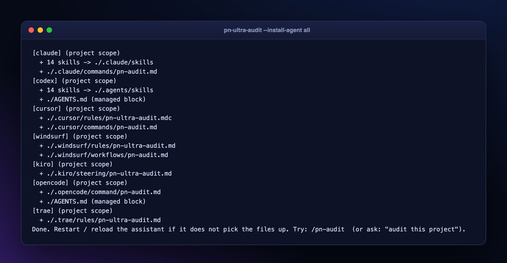

# AI Assistants and MCP



```bash
python3 audit.py --install-agent all --agent-dir /path/to/your/project   # or: claude,codex,cursor,windsurf,kiro,opencode,trae
python3 audit.py --install-agent claude --agent-scope user                # once for all projects
```
| Assistant | Installed |
|---|---|
| Claude Code | 18 skills in `.claude/skills/`, `/pn-audit`, MCP in `.mcp.json` |
| Codex | skills in `.agents/skills/`, `AGENTS.md` block |
| Cursor | `.cursor/rules/pn-ultra-audit.mdc`, command, MCP in `.cursor/mcp.json` |
| Windsurf | rules + `/pn-audit` workflow |
| Kiro | steering file (`#pn-ultra-audit`) |
| OpenCode / Trae | command / rule |

Installs are idempotent and never overwrite files you wrote (`--force` to override). The skills **ask how strict** the audit should be before running.

## Save tokens (see [Save Tokens](Save-Tokens))
```bash
python3 audit.py <path> --brief            # ~40-line summary, start here
```

### Fix cards and search
```bash
python3 audit.py --show SEC-001 --run audit-output/myapp   # one finding: code, why, steps, safe form, tested before/after, verify
python3 audit.py --kb "sql injection php"                  # offline BM25 search over the remediation guides and rules
```

## MCP server (read-only, stdio)
`python3 audit.py --mcp --run audit-output/myapp` exposes `get_brief`, `list_findings`, `get_fix_card`, `search_kb`, `get_summary` and `verify_corpus`. Register it manually in any MCP client:
```json
{ "mcpServers": { "pn-ultra-audit": { "command": "python3", "args": ["/path/to/pn-ultra-audit/audit.py", "--mcp"] } } }
```

## Verified fixes
`python3 audit.py --verify-corpus` proves every `examples/fixes/<id>/vulnerable` snippet fires its rule and every `fixed` snippet is silent - so the "safe form" shown has been tested against the engine.
