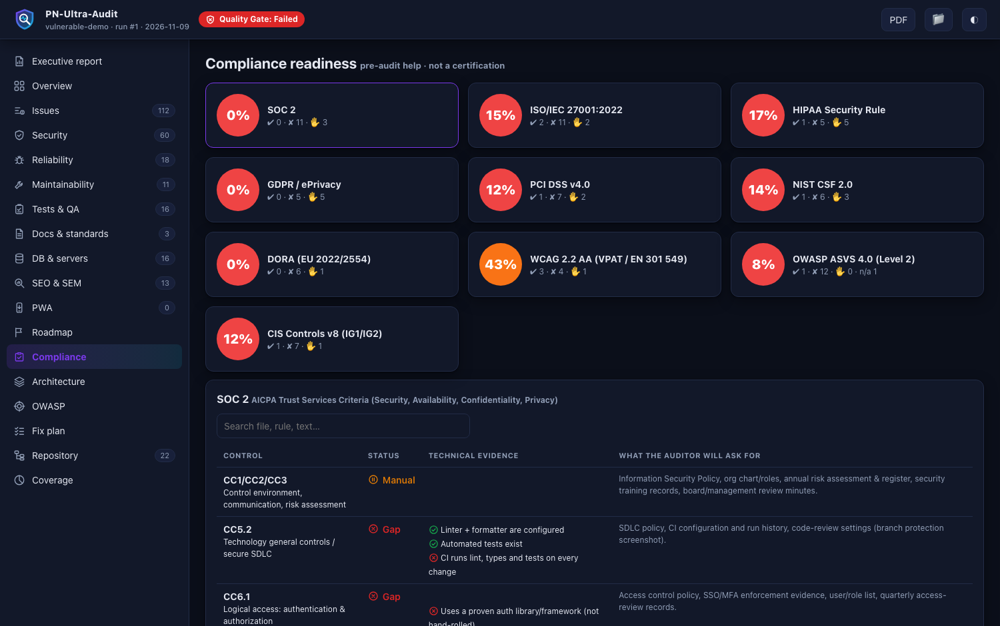

# Compliance Readiness



**Not a certification.** It maps technical findings to framework controls and tells you what evidence an auditor will ask for, so the real audit is faster and cheaper.

```bash
python3 audit.py . --compliance soc2,iso27001,hipaa --evidence-pack ./audit-pack
```
Frameworks (`--compliance` tokens): `soc2`, `iso27001`, `hipaa`, `gdpr`, `pci`, `nist`, `dora`, `euai`, `wcag`, `asvs`, `sox`, `nydfs`, `psd2`, `cis`.

| Output | Contents |
|---|---|
| Dashboard **Compliance** view | per control: pass / gap / manual, technical evidence, "what the auditor will ask for" |
| `--evidence-pack DIR` | README, control matrix CSV, evidence requests, remediation plan, findings CSV, SBOM, policy templates (information security, access control, incident response, backup, change management...) |

Industry deep-dive: `--domain auto|saas|fintech|banking|health|ecommerce` adds tenant isolation, money handling, idempotency, webhooks, PCI data, audit trail and KMS checks.
