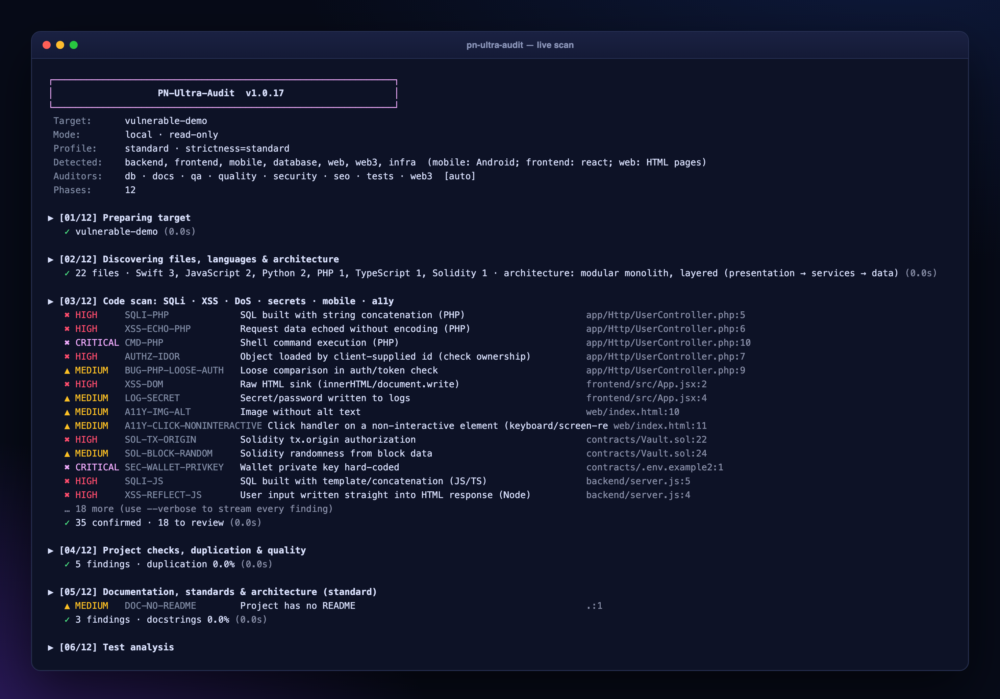

# Getting Started



```bash
git clone https://github.com/paulnewmandev/pn-ultra-audit && cd pn-ultra-audit
python3 audit.py /path/to/your/project
```
It detects the project type (backend, frontend, mobile, database, web, PWA, Vercel, Web3, SaaS/fintech...) and runs only the auditors that apply. Output goes to `audit-output/<project>/run-N/`; open `report.html`.

## The 5 commands you will use
```bash
python3 audit.py . --plan                     # dry run: what was detected and which auditors will run
python3 audit.py . --strictness strict        # basic | standard (default) | strict   (or --ask for a menu)
python3 audit.py . --level beginner --lang en # friendly mode with plain-language explanations
python3 audit.py . --export docs --pdf        # dashboard + Markdown + SARIF + JSON + PDF into ./docs
python3 audit.py --show SEC-001 --run audit-output/myapp   # compact fix card for one finding
```

## What you get
| File | Use |
|---|---|
| `report.html` | interactive dashboard (offline, one file): executive report, issues, repository tree, roadmap, compliance... |
| `REPORT.md` | Markdown report with mermaid charts and a step-by-step remediation guide |
| `findings.sarif` | GitHub code scanning / VS Code |
| `findings.json`, `summary.json`, `metrics.json` | data for your own tooling |
| `sbom.cdx.json` | CycloneDX 1.5 software bill of materials |
| `server-fixes.sh`, `repo-fixes.sh` | reviewable remediation scripts (only when `--ssh` / a git repo is audited) |

## Next steps
1. Open **Executive report** for the big picture, then **Issues** and click a finding.
2. In the side panel copy the **suggested AI prompt** and paste it into your AI editor.
3. Mark fixed items with `X`, re-run the audit with `--baseline auto` to track progress.
