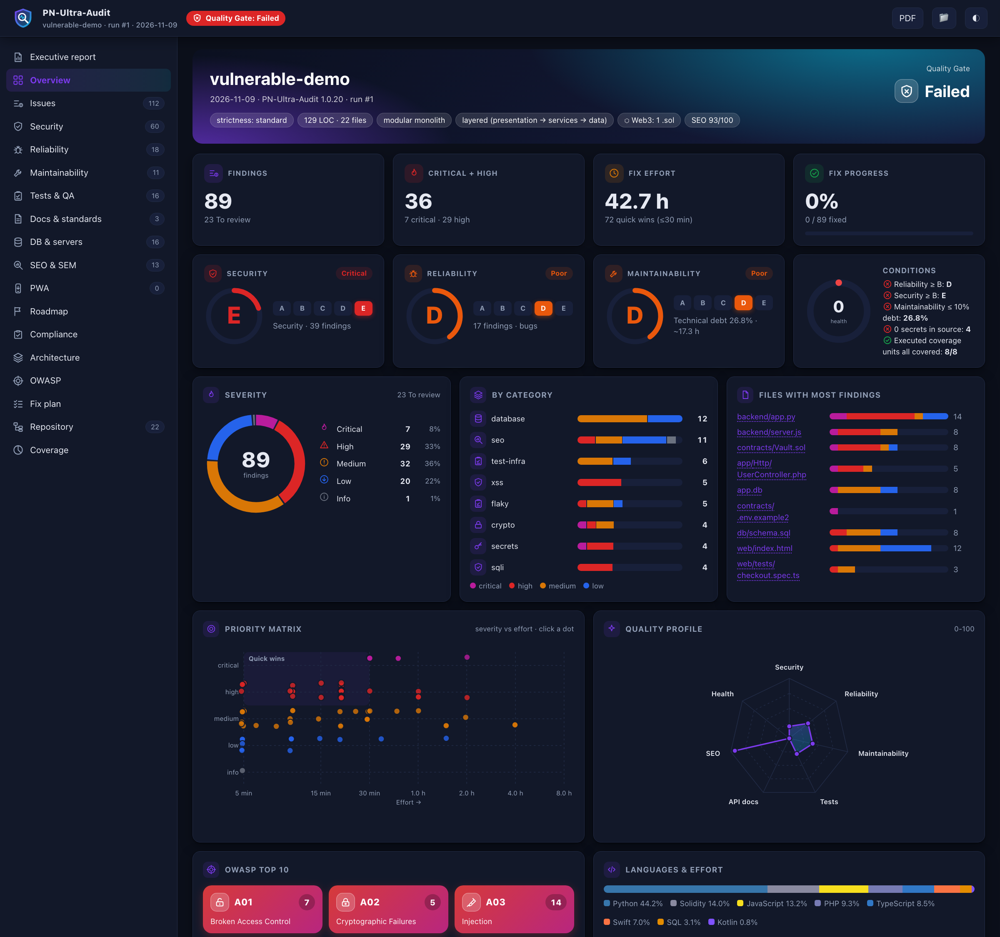

# PN-Ultra-Audit wiki

**One read-only command that audits code, tests, docs, databases, servers/VPS, Vercel, PWA, SEO, crypto, SaaS/fintech and audit-readiness - live in your terminal, delivered as a dashboard.** Version 1.0.20.

## Start here
| I want to... | Page |
|---|---|
| Run my first audit in 2 minutes | [Getting Started](Getting-Started) |
| Install it (git, pip, AI assistant) | [Installation](Installation) |
| Understand the report and the dashboard | [Reading the Report](Reading-the-Report) |
| Choose how strict it is | [Strictness Levels](Strictness-Levels) |
| Spend as few AI tokens as possible | [Save Tokens](Save-Tokens) |
| Audit a VPS (AWS, Azure, GCP, DigitalOcean, Hostinger...) | [Server and VPS Audit](Server-and-VPS-Audit) |
| Audit a Vercel project | [Vercel Audit](Vercel-Audit) |
| Audit a PWA | [PWA Audit](PWA-Audit) |
| Find leaked keys and fix a repository | [Repository Hygiene and Leaked Keys](Repository-Hygiene-and-Leaked-Keys) |
| Use it from Claude Code, Cursor, Codex... | [AI Assistants and MCP](AI-Assistants-and-MCP) |
| Prepare for SOC 2 / ISO 27001 / HIPAA... | [Compliance Readiness](Compliance-Readiness) |
| Put it in CI | [CI Integration](CI-Integration) |
| Silence a false positive / adopt on legacy code | [Suppressions and Baselines](Suppressions-and-Baselines) |
| Use another language (es, en, zh, yours) | [Languages and Translations](Languages-and-Translations) |
| Something does not work | [FAQ and Troubleshooting](FAQ-and-Troubleshooting) |
| Contribute a rule, a fix or a language | [Contributing](Contributing) |

## Reference (generated from the code)
[CLI Reference](CLI-Reference) · [Auditors](Auditors) · [Rule Catalog](Rule-Catalog)

## Principles
- **Read-only.** Your project, repositories, servers and databases are never modified. Generated fix scripts (`server-fixes.sh`, `repo-fixes.sh`) are never executed by the tool.
- **Zero dependencies.** Python 3.9+ standard library only.
- **Evidence first.** Every finding has `file:line`, a code snippet, the reason, the exact fix and how to verify it. Secret values are never copied into reports.
- **Honest limits.** The report lists what was and was not examined.
