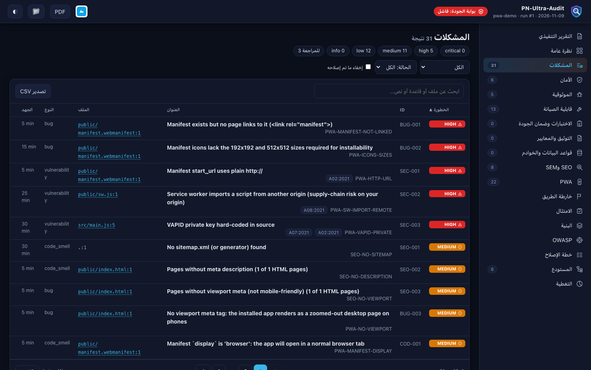
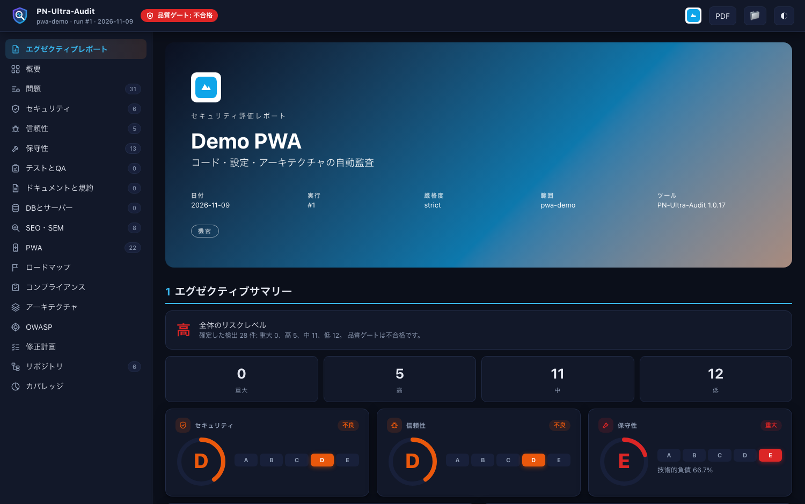

# Languages and Translations

Built in: `es` (Español), `en` (English), `ar` (العربية), `fr` (Français), `hi` (हिन्दी), `it` (Italiano), `ja` (日本語), `pt` (Português), `zh` (中文) - nine languages, including right-to-left Arabic.

`--lang auto` (default) follows your system language and falls back to **Spanish**. Force one with `--lang ja` or the `PN_AUDIT_LANG` environment variable. The terminal, the dashboard and the Markdown report are translated; the AI-prompt templates and the long remediation guides stay in English/Spanish (they fall back automatically).

## Add a language (10 minutes)
1. Copy `engine/locales/ja.json` to `engine/locales/<code>.json` (for example `ko.json`, `de.json`, `ru.json`).
2. Translate the values:
   - `name` - the language's own name, `html_lang` - for example `ko`, `dir` - `ltr` or `rtl`
   - `ui` - dashboard labels (95), `md` - Markdown report strings (73)
   - `x` - English sentence -> translation for the CLI and dashboard text
3. Run `python3 audit.py examples/vulnerable-demo --lang <code>`.

The pack is auto-discovered (also in the `--lang` choices); anything you skip falls back to English. The maintainers' packs are generated from `scripts/locale_data/` by `python3 scripts/make_locales.py`. Send a pull request!
