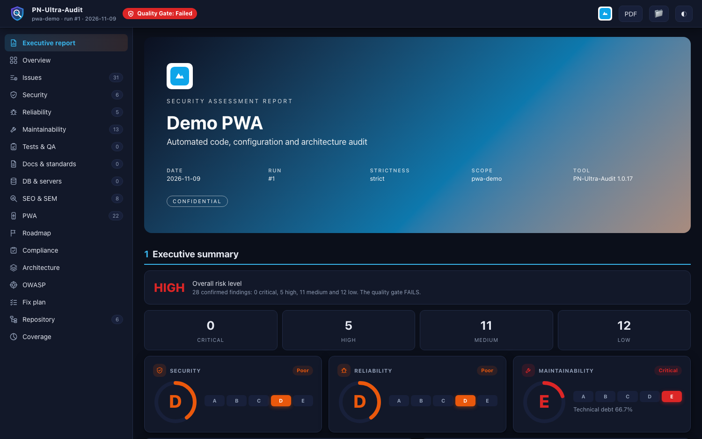
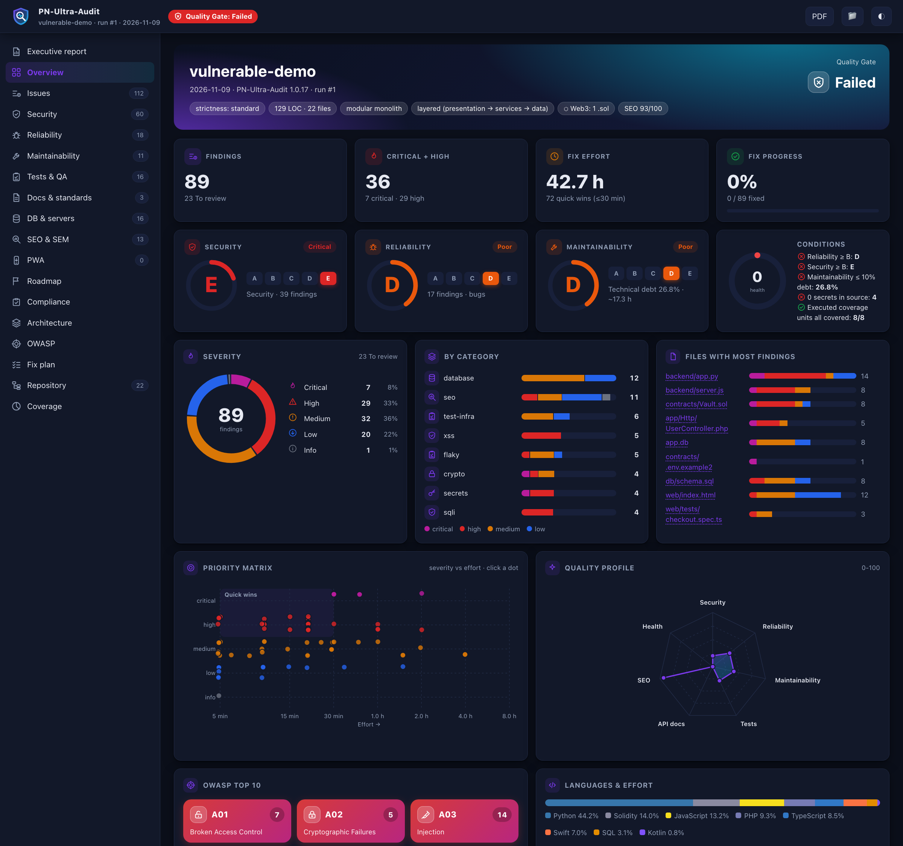
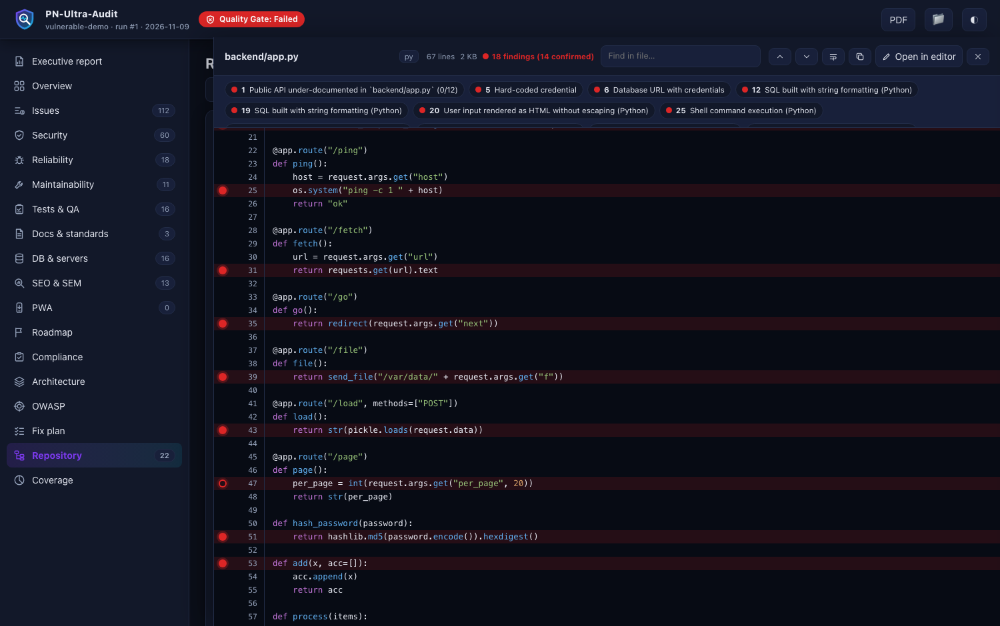

# Reading the Report

## Dashboard views (left menu)
| View | What it shows |
|---|---|
| **Executive report** | security-firm style document: cover (with your project's logo and colors), overall risk, key risks, scope and methodology, findings, remediation roadmap, repository tree |
| **Overview** | Quality Gate, KPI cards, A-E rating cards, severity ring, categories, priority matrix (severity vs effort), quality radar, OWASP heat-map, trend |
| **Issues / Security / Reliability / Maintainability / Tests / Docs / DB / SEO / PWA / Vercel / Repo hygiene** | the same data table filtered by topic |
| **Roadmap** | ~45 professional practices scored into levels 1-5 with "why" and "how" |
| **Compliance** | readiness per framework (SOC 2, ISO 27001, HIPAA, GDPR, PCI...) - not a certification |
| **Architecture / OWASP / Fix plan / Repository / Coverage** | style and layers, OWASP Top 10 / API / Mobile, effort-batched plan, file tree with findings per folder, what was and was not examined |

## Read-only code viewer
Click any `file:line` (or a file in **Repository**) to open it inside the report - any file type, read-only, with syntax colors. Every line with a finding has a **red breakpoint** (filled = confirmed, hollow = to review); click it to open that finding, use `n` / `p` to jump between findings, search inside the file, and press *Open in editor* to continue in your IDE. Source is embedded within a size budget (`--embed-source auto|findings|none`, `--embed-budget MB`); secrets are masked and `.env`, keys and state files are never embedded.

## Tables
Every table is the same component: search box, every column sortable (click the header), rows per page, and a footer with the range, centered pager and page size. Press `J`/`K` to move between findings, `X` to mark fixed, `Esc` to close.

## The finding panel
Click a row: code with the affected line, why it happens, impact, steps, vulnerable vs safe form, how to verify, and a **suggested prompt for your AI editor** in three modes (Fix, Fix + test, Explain only). *Open in editor* jumps to `file:line`.

### Open files in your editor
Click the folder button in the header once and enter the absolute project path (it is stored only in your browser). Then every `file:line` link opens VS Code, Cursor, Windsurf, Zed or VSCodium. Alt/Shift + click copies the path instead.

## Severities
`critical` (exploitable now, severe impact) > `high` > `medium` > `low` > `info`. **To review** items are suspicions that depend on context: confirm where the data comes from before changing code.

## Ratings and the Quality Gate
A-E ratings for Reliability, Security and Maintainability follow the SonarQube convention (worst open issue / technical debt ratio). The gate fails when a condition is not met (for example Security worse than B, or any secret in source). `--fail-on high` makes the CLI exit with 1 on new high findings.

## PDF
`--pdf` (or the PDF button) prints the executive report: A4, cover, page numbers, readable code blocks. Needs Chrome/Chromium.
