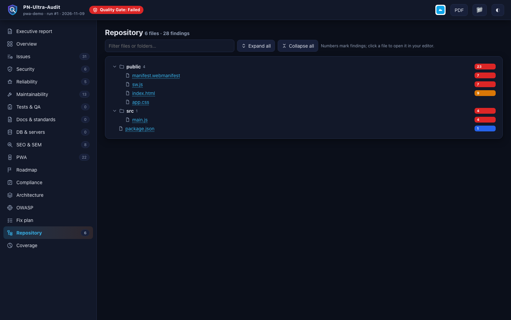

# Repository Hygiene and Leaked Keys



Runs automatically on every git project (`--only repo` to run it alone, `--skip repo` to skip it).

## What it finds
| Finding | Meaning |
|---|---|
| `REPO-PRIVATE-KEY-FILE`, `REPO-CLOUD-CREDENTIALS`, `REPO-TOKEN-FILE`, `REPO-TFSTATE`, `REPO-TFVARS`, `REPO-KUBECONFIG`, `REPO-APP-CONFIG-SECRET`, `REPO-DB-DUMP` | sensitive files **tracked in git** (private keys, service-account JSON, `.npmrc` tokens, Terraform state, kubeconfigs, production configs, dumps) - contents are checked, values are never copied |
| `REPO-TRACKED-IGNORED` | files that `.gitignore` lists but are still tracked |
| `REPO-REMOTE-CRED` | credentials embedded in a git remote URL |
| `REPO-HIST-SENSITIVE` | sensitive files committed and later deleted - **still in history** |
| `HIST-*` (with `--history`) | secrets added in recent commits |
| `REPO-GHA-*`, `REPO-CI-*` | CI/CD: `pull_request_target` + PR checkout (pwn request), script injection through `${{ github.event.* }}`, `permissions` missing or `write-all`, unpinned third-party actions, secrets echoed or passed as arguments, `curl | sh`, self-hosted runners on PRs |
| `REPO-NO-SECURITY-POLICY`, `REPO-NO-CODEOWNERS`, `REPO-NO-DEP-AUTOMATION`, `REPO-NO-SECRET-SCAN`, `REPO-LARGE-FILE` | repository metadata |

## If a key was exposed: the 5 steps
1. **Rotate first.** Every secret finding includes provider-specific steps (AWS, GitHub, Slack, Stripe, Google, databases, JWT, private keys, wallets, Vercel, package registries, Terraform/Kubernetes credentials).
2. Stop tracking it: `git rm --cached <file>` and add it to `.gitignore`.
3. Purge history when the repo is public/shared: `git filter-repo --invert-paths --path <file>`, then force-push and ask everyone to re-clone. Rotation is still mandatory.
4. Move secrets to a secret manager or the platform's encrypted variables.
5. Prevent a repeat: gitleaks in pre-commit and CI, GitHub secret scanning with push protection.

## `repo-fixes.sh`
A guided script is written next to the report (never executed by the tool):
```bash
bash repo-fixes.sh list      # UNTRACK, PURGE-HISTORY, GITIGNORE, SECRET-SCAN, CI-HARDENING
bash repo-fixes.sh safe
PNUA_CONFIRM=yes bash repo-fixes.sh PURGE-HISTORY   # destructive: rewrites history
```
Work on a fresh mirror clone (`git clone --mirror`) first.
