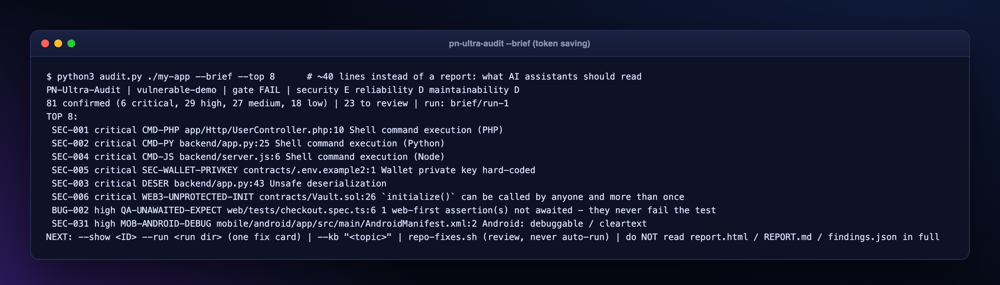

# Save Tokens

PN-Ultra-Audit is built so an AI assistant (or you) reads **the minimum**: never a whole report.

## The protocol (installed in every assistant's skill/rule)
1. `python3 audit.py <path> --brief --strictness <level>` - about 40 lines: gate, ratings, counts and the top findings. Roughly 300-500 tokens.
2. `python3 audit.py --show <ID> --run <run dir>` - ONE compact fix card: the flagged code, why, steps, safe form, a tested before/after and how to verify.
3. `python3 audit.py --kb "<topic>"` - offline search of the remediation guides when you need guidance, not a finding.
4. After fixing: `--brief --baseline auto` shows only what is new.

**Never** open or paste `report.html`, `REPORT.md` or `findings.json` in full: they are for humans.

## With MCP
Register the read-only server (`python3 audit.py --mcp`, installed automatically for Claude Code and Cursor) and use `get_brief`, `get_fix_card`, `search_kb`, `list_findings` (15 compact rows by default).

## What else keeps it cheap
- Findings have fixed fields, so cards are small and predictable.
- Secret values are never copied, so nothing sensitive is spent or leaked.
- `--only` / `--skip` and automatic project detection avoid running (and reading) irrelevant audits.
- The dashboard's **suggested AI prompt** per finding already contains just the code, cause and steps for that single finding - paste it into your editor instead of describing the problem.
