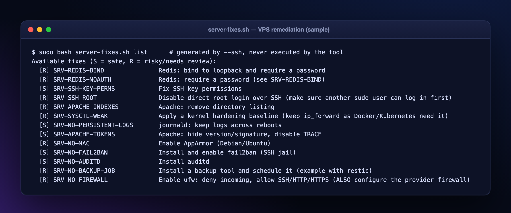

# Server and VPS Audit



```bash
python3 audit.py --ssh deploy@my-vps --authorized --sudo --remote-path /var/www/app
```
Only audit servers you own or are allowed to assess. Key/agent authentication only (`--ssh-key`, `--ssh-port`, `--ssh-opts`, `--accept-new-hostkey` the first time). `--sudo` needs passwordless `sudo -n` for complete results (sshd -T, shadow, firewall, logs). One read-only script runs on the server; nothing is installed or changed.

## What is checked
| Layer | Checks |
|---|---|
| **Provider** (auto-detected: AWS EC2, Azure, Google Cloud, DigitalOcean, Hostinger, Hetzner, Vultr, Linode/Akamai, OVH, Oracle, Contabo, IONOS...) | AWS IMDSv1 and instance role (name only), GCP service-account scopes and OS Login, Azure/DO agents, secrets in cloud-init user-data, plus the exact CLI command to verify the **provider firewall** (security group / NSG / VPC firewall / Cloud Firewall / Hostinger hPanel) |
| **OS and access** | EOL OS and runtimes, pending security updates, unattended-upgrades, reboot required, `sshd` settings and crypto, root/password login, UID 0, empty passwords, NOPASSWD sudo, SSH key permissions, DSA keys, fail2ban, brute-force noise, sysctl baseline, AppArmor/SELinux, auditd, persistent logs, cron, SUID, backups, disk and inodes |
| **Network** | listening ports vs the host firewall, Docker bypassing ufw |
| **Web** | nginx, **Apache**, PHP, TLS certificates, `.env`/`.git`/backups in web roots, world-writable files |
| **Containers and orchestration** | privileged / host network / host PID containers, `docker.sock` mounts, root users, no limits, Docker API on TCP, **Kubernetes** (k3s, kubeadm, microk8s: kubeconfig, kubelet, API server, etcd, privileged pods, hostPath, cluster-admin, NetworkPolicy) |
| **Data and messaging** | **Redis**, **Kafka/ZooKeeper (+JMX)**, MySQL/MariaDB, PostgreSQL (`pg_hba.conf`), MongoDB, Elasticsearch, memcached, RabbitMQ, Postfix open relay |

## Fixing the server
Every run writes `server-fixes.sh`. **The tool never runs it.** Copy it to the server and:
```bash
sudo bash server-fixes.sh list                       # [S] safe fixes and [R] risky fixes
sudo bash server-fixes.sh safe                       # apply the low-risk group
sudo bash server-fixes.sh SRV-SSH-ROOT SRV-NO-FIREWALL   # risky ones, by id
```
Each fix makes a timestamped backup, validates the config (`sshd -t`, `nginx -t`, `apachectl configtest`) and reloads. **Keep a second SSH session open** while changing SSH or firewall rules.

## Also connect with
`--sftp user@host --remote-path /path` (SFTP-only hosts), `--ftp ftps://user@host/path` (password in `FTP_PASSWORD`), `--db postgres://...` with `--via-ssh`, `--aws-rds`. See [CLI Reference](CLI-Reference).

## Limits
Provider-level firewalls cannot be read from inside the VM: the report prints the command to run from your workstation. Detection data comes from DMI/metadata; credentials are never read.
